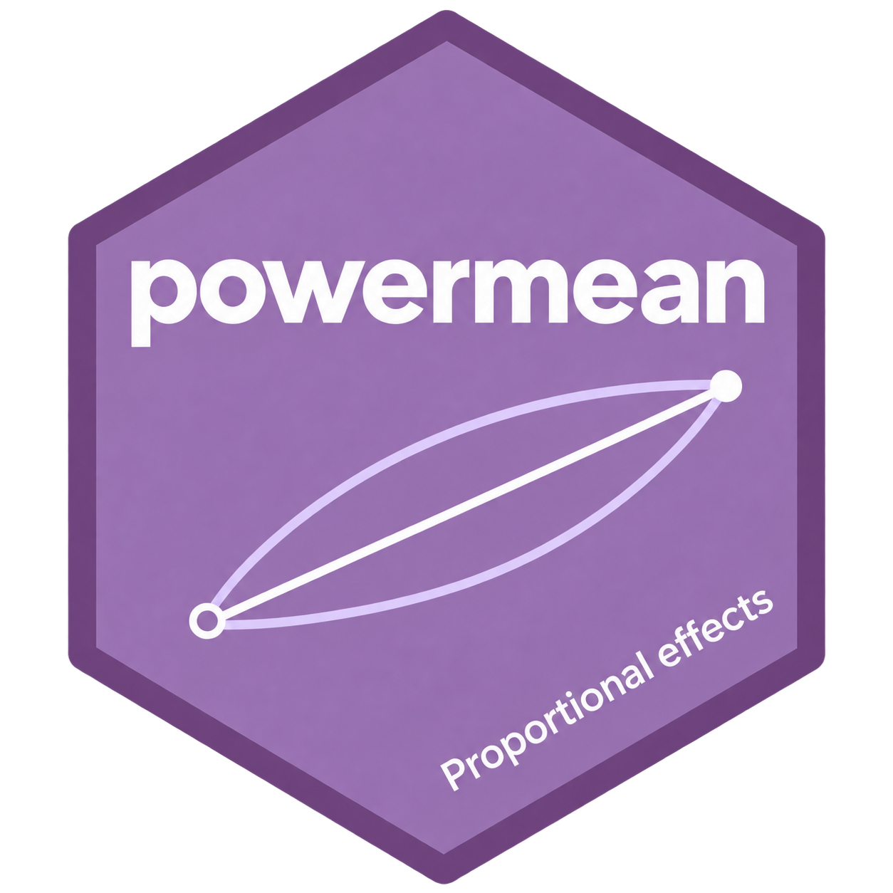

# Powermean 

**Powermean is a Python package for fitting power-mean regressions and estimating proportional effects.** It implements the framework of Benatia et al. (2026), *Dealing with Logs and Zeros in Regression Models*, including exponential conditional-mean models and log-linear regressions. With `pm.fit`, choose the conditional mean and the working variance separately, model outcomes in levels with observed zeros, and report proportional effects with confidence intervals. [Paper](https://arxiv.org/abs/2203.11820v4)

Estimate multiple high-dimensional fixed-effect blocks jointly, or cancel a selected block while retaining the others. Powermean provides bias corrections that address the incidental-parameters problem in short panels and three-way gravity models. The same formula interface takes you from a simple conditional-mean regression to three-way gravity and nonlinear difference-in-differences.

[Install Powermean](docs/install.md) · [User guide](docs/README.md) · [Function index](docs/reference/api.md)

The examples below use Powermean 0.1.1 or later. Install it from PyPI when
available, or use the [source or wheel instructions](docs/install.md).

```bash
python -m pip install "powermean>=0.1.1"
```

**Conditional mean.** Suppose `x` is strictly exogenous and `E[y | x] = exp(a + b*x)`. With a data frame named `data` containing `y` and `x`, fit the arithmetic conditional mean by Poisson pseudo-maximum likelihood (PPML).

```python
import powermean as pm

fit = pm.fit("y ~ x", data, omega=1, tau=1)
```

Read the coefficient on `x` and its interval in `fit.tidy()`. Keep `omega=1` and set `tau=1.5` or `tau=2` (Gamma PML) to change the working variance for the same mean. A runnable example shows how to report the fitted percentage change. [One conditional mean, three working variances](docs/methods/model.md#fit-one-conditional-mean-three-ways)

**Gravity.** How does bilateral trade differ when a pair has an agreement? Fit trade in levels with pair, exporter-year and importer-year effects and report the proportional difference with a pair-clustered interval. [Gravity walkthrough](docs/get-started.md)

**Two-way exponential regression.** Set `estimator="gmm1"` or `"gmm2"` in `pm.fit` to difference out two fixed-effect blocks on a complete panel or directed dyad array. [Method and examples](docs/methods/jochmans.md)

**Nonlinear difference-in-differences.** How do expected visits change after policy adoption? Use `pm.fit` for common or staggered adoption under multiplicative parallel trends, then read the effects by cohort and date with unit-clustered intervals. [DiD walkthrough](docs/examples/nonlinear-did.md)

## Work with the results

Before comparing coefficients, check which rows each model used. Each result records their input positions and the reasons for exclusions. [Compare estimation samples](docs/examples/compare-samples.md)

Use `pm.etable` to place several fitted models side by side. The result also supplies tests, proportional effects and alternative covariance estimates. [Reuse and export a fit](docs/examples/reuse-a-fit.md) · [Tables and formats](docs/reference/tables.md)

Use `fit.predict()` for fitted means, `fit.predict(type="residual")` for
response residuals, and `fit.predict(type="fixed_effects")` to extract fixed
effects. Cancelled and two-way GMM fits recover fixed effects after estimating
the slopes. For a fixed-effect counterfactual, replace the covariates on the
retained rows. [Worked prediction example](docs/reference/results.md#prediction-and-retention)

## Documentation and citation

- [User guide](docs/README.md) · [Function index](docs/reference/api.md) · [Troubleshooting](docs/help/troubleshooting.md)
- [Offline guide](docs/guide.html) · [Quarto source](docs/guide.qmd). Download the HTML and open it in a browser.
- [Papers and section map](docs/references.md). Cite Benatia et al. (2026) and, for a WZ adjustment, Weidner and Zylkin (2021). Record the exact package build with your analysis.

## License

Powermean's own source is licensed under [BSD-3-Clause](LICENSE).
Bundled components carry the [scikit-learn notice](src/powermean/_vendor/SKLEARN_COPYING)
and [native extension notices](licenses/NATIVE_NOTICE.md).
