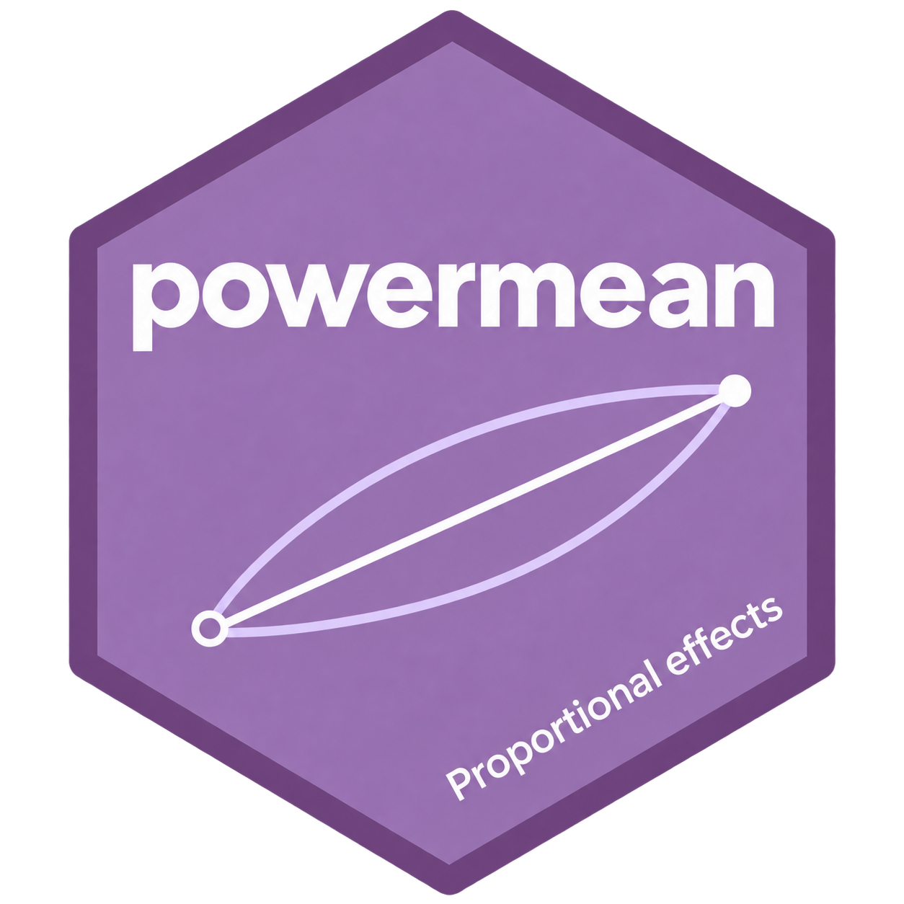

# Powermean user guide

<a id="powermean-01-user-guide"></a>



Start with the conditional mean of the outcome in levels, including observed zeros. Powermean accompanies *Dealing with Logs and Zeros in Regression Models* by Benatia et al. (2026). [Paper](https://arxiv.org/abs/2203.11820v4) · [Install Powermean](install.md)

**Conditional mean.** Suppose `x` is strictly exogenous and `E[y | x] = exp(a + b*x)`. With your own data frame, fit the arithmetic conditional mean by PPML.

```python
import powermean as pm

fit = pm.fit("y ~ x", data, omega=1, tau=1)
```

Read the slope and its uncertainty with `fit.tidy()`. At `omega=1`, PPML (`tau=1`), Gamma PML (`tau=2`) and intermediate working variances such as `tau=1.5` target the same correctly specified conditional mean. [Run the example with 12 observations](methods/model.md#fit-one-conditional-mean-three-ways)

**Gravity.** Fit trade in levels with pair, exporter-year and importer-year fixed effects. Read an agreement's estimated proportional effect and its interval. [Gravity walkthrough](get-started.md)

**Nonlinear difference-in-differences.** Start with a policy adopted at a common date, then allow effects to vary by adoption cohort and date under multiplicative parallel trends. [DiD walkthrough](examples/nonlinear-did.md) · [Cohort effects figure](examples/nonlinear-did.md#plot-the-cohort-by-period-effects)

| What do you need next? | Where to go |
| --- | --- |
| Set up an analysis | [Prepare the data and formula](help/prepare-data.md), then [choose the mean and working variance](methods/model.md). |
| Choose a panel specification | [Estimate fixed effects](methods/fixed-effects.md) or [cancel one block](methods/cancellation.md), then [choose uncertainty for your sampling design](methods/inference.md). |
| Compare and report fits | [Check the rows](examples/compare-samples.md), [interpret a proportional effect](methods/proportional-effects.md), or [build and export tables](reference/tables.md). |
| Look up a call or resolve a warning | [Function index](reference/api.md) · [Fit options](reference/options.md) · [Troubleshooting](help/troubleshooting.md) |

Download the [standalone HTML guide](guide.html) for offline reading. The [Quarto source](guide.qmd) is also available.

## Get started

- [Install the current version](install.md) from a local wheel or source archive.
- [Fit your first gravity model](get-started.md) and read its console output.
- [Prepare data](help/prepare-data.md) and write the formula.
- [Run the examples](examples/README.md) from your terminal.

## Fit a model

- [Choose a mean and working variance](methods/model.md), including PPML, Gamma PML, log OLS and NB2.
- [Estimate fixed effects](methods/fixed-effects.md) and check what identifies the slope.
- [Cancel one fixed-effect block](methods/cancellation.md) and compare the resulting estimating equations.
- [Choose a solver](methods/numerical-methods.md) and interpret its certificate.

## Read and report results

- [Check and compare estimation samples](examples/compare-samples.md), then describe their outcomes.
- [Explore and export a fit](examples/reuse-a-fit.md), including predictions, coefficient tests, contrasts and tables.
- [Interpret proportional changes](methods/proportional-effects.md) on the fitted and population scales.

## Panel designs and inference

- [Estimate nonlinear difference-in-differences](examples/nonlinear-did.md) with common or staggered adoption.
- [Choose a covariance estimator](methods/inference.md) for the sampling design.
- [Correct coefficient bias](methods/bias-correction.md) with the procedures of Benatia et al. (2026) or Weidner and Zylkin (2021).
- [Adjust pair covariance in gravity](methods/covariance-refinements.md) and plot the resulting intervals.
- [Compare with Stata ppmlhdfe](from-ppmlhdfe.md) on the same rows and specification.

## Reference and help

| Page | What to look up |
| --- | --- |
| [Function index](reference/api.md) | Find an installed function, result method or output. |
| [Supported methods](availability.md) | Supported model and covariance choices. |
| [Fit options](reference/options.md) | Formula, sample, model, covariance and start arguments. |
| [Results](reference/results.md) | Estimates, tests, covariance, sample records, diagnostics and fixed effects. |
| [Tables and formats](reference/tables.md) | Summary statistics, balance, outcomes, regression tables and exports. |
| [Solver options](reference/solver-options.md) | Newton, IOLS and numerical controls. |
| [Advanced fixed effects](reference/experimental-fixed-effects.md) | Joint and cancelled controls, correction and inference requirements. |
| [IOLS options](reference/iols_options.md) | Typed implementation and iteration settings. |
| [IOLS installation](iols_installation.md) | Compiled and NumPy-only builds. |
| [Troubleshooting](help/troubleshooting.md) | Diagnose a warning, refusal or failed fit. |
| [Report a problem](help/report-a-problem.md) | Gather the sample, diagnostic and version information. |
| [Validation](validation.md) | Interpret numerical and statistical checks. |
| [Papers and methods](references.md) | Read and cite the underlying work. |
| [Build the guide](BUILD_GUIDE.md) | Regenerate the standalone HTML from these chapters. |
