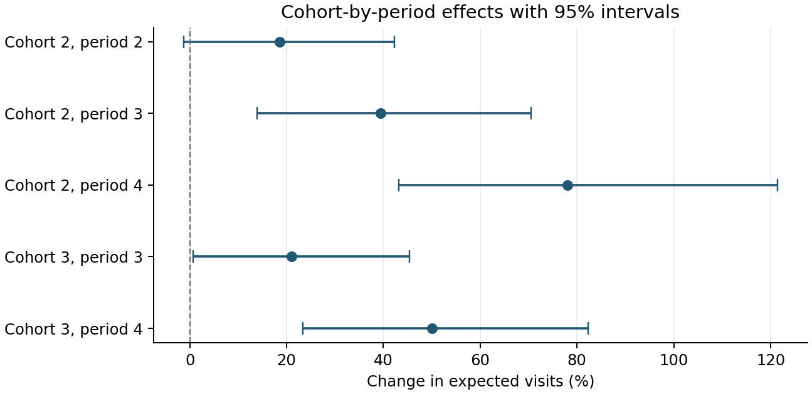

# Nonlinear difference-in-differences in a short panel

Suppose a policy changes the number of visits to a service. Some units record
zero visits. You want to compare expected visits under the policy and under no
policy. If untreated visits grow by the same **percentage** across treatment
cohorts, use an exponential mean for visits in levels. This is the log link
applied to a mean. All observed counts, including zeros, can enter the equation.
[Wooldridge (2023), §§2–3](../references.md#panel-difference-in-differences)

For an overall estimate in visits with a unit-clustered standard error,
see the [aggregate and cohort-period results](#what-the-reported-effects-measure).

## Two periods and one treated cohort

Let $G=2$ denote first treatment in period 2 and $G=0$ denote never treated.
Write $M_{g,t}(0)=E[Y_t(0)\mid G=g]$ for the untreated mean in each cohort.
With positive untreated means, multiplicative parallel trends assume

$$
\frac{M_{2,2}(0)}{M_{2,1}(0)}
=\frac{M_{0,2}(0)}{M_{0,1}(0)}.
$$

If the policy has no anticipatory effect on the treated cohort's period-1
mean, its period-2 counterfactual is its observed period-1 mean multiplied
by the control cohort's observed growth factor. For example, if controls
grow from 2 to 3 visits and the treated cohort starts at 4, the
counterfactual is 6. An observed treated post mean of 7.5 then represents
a 25% effect, or 1.5 additional visits per unit. An additive trend would
imply a counterfactual of 5.

The comparison assumes well-defined treatment regimes with no interference
in these examples, a usable untreated comparison, and comparable panel composition. Here the
complete panel follows the same units in every period. To justify the **unit FE estimators**, also
maintain the conditional mean model given the unit effect and the
complete treatment history. In the exercise that mean is
$E(Y_{it}\mid G_i,\alpha_i)=\exp(\alpha_i+\lambda_t+\beta D_{it})$,
where $D_{it}$ is one only for treated units after adoption. The unit
baseline may be related to adoption, but untreated mean growth cannot
differ systematically with adoption after conditioning. Independent units
and finite moments permit clustering by unit with dependence across dates.
[Wooldridge (1999, 2023), and Benatia et al. (2026), §5.1](../references.md)

## Fit the TWFE equation with different working variances

Run from the source root. The [script](../../examples/nonlinear_did.py)
generates 80 never-treated and 80 eventually treated units for two periods.
The simulated policy increases treated units' mean by 40%. All units'
untreated means grow by 15%, and the treated cohort starts from a higher
baseline.

```python
import powermean as pm

from examples.nonlinear_did import did_data

panel = did_data()
formula = "visits ~ 0 + treated | unit + period"
cases = (
    (1, None, "Joint PPML"),
    (1, "unit", "Cancelled PPML"),
    (1.5, "unit", "Cancelled 1.5"),
    (2, "unit", "Cancelled Gamma"),
    (2, None, "Joint Gamma"),
)
fits = [
    pm.fit(formula, panel, omega=1, tau=tau, cancel=cancel, cluster="unit")
    for tau, cancel, _ in cases
]
print(pm.etable(
    *fits, names=[name for _, _, name in cases],
    stats=("nobs", "zeros"), stars=False, digits=4,
))
```

```text
------------------------------------------------------------------------------------------------
                      Joint PPML   Cancelled PPML  Cancelled 1.5  Cancelled Gamma   Joint Gamma
------------------------------------------------------------------------------------------------
treated                 0.2872         0.2872          0.2872          0.2872          0.4014
                       (0.1291)       (0.1291)        (0.1291)        (0.1291)        (0.2054)
------------------------------------------------------------------------------------------------
Estimator                PPML           PPML         tau = 1.5          GPML            GPML
Mean order (omega)        1              1               1               1               1
unit effects          Estimated      Cancelled       Cancelled       Cancelled       Estimated
period effects        Estimated      Estimated       Estimated       Estimated       Estimated
Covariance          cluster: unit  cluster: unit   cluster: unit   cluster: unit   cluster: unit
Convention              stata          stata           stata           stata           stata
Reference               normal         normal          normal          normal          normal
Clusters                 160            160             160             160             160
------------------------------------------------------------------------------------------------
Observations             320            320             320             320             320
Zeros                    6.9%           6.9%            6.9%            6.9%            6.9%
------------------------------------------------------------------------------------------------
Standard errors in parentheses.
```

The PPML estimate implies about 33.3% higher expected visits. The sample
contains 22 zeros. The two PPML calls agree because profiling and
cancelling the unit scale give the same equation on common support.
Cancel **unit**, so period effects still account for common growth. In a
short panel they are well informed as the number of units grows.

With two periods and no covariates, the design is saturated. Each cohort's
growth factor is its post mean divided by its pre mean. The treatment slope
is the log of treated growth divided by untreated growth. Changing the
cancelled working variance multiplies every unit's estimating function
within a cohort by the same factor. That factor cancels from both the
root and its cluster sandwich, giving the same slope and standard error
on the same rows under the same covariance convention. Joint Gamma uses
outcome-dependent unit weights after profiling, which is why its estimate
can differ. [Compare staggered adoption](#allow-different-effects-by-adoption-cohort-and-date)
· [Short-group cancellation](../methods/cancellation.md)

## Allow different effects by adoption cohort and date

For staggered adoption, define $Y_t(g)$ as the outcome if first treated in
$g$ and $Y_t(0)$ as the outcome under no treatment. For $t\ge g$, the
level effect is $E[Y_t(g)-Y_t(0)\mid G=g]$. The proportional effect is
the ratio of those two means minus one. Require no anticipation in every
pre-adoption period used to identify an untreated mean. For the
no-covariate exponential specification, the log untreated cohort mean
must be a cohort intercept plus a common period effect. This imposes
parallel growth on the log of the untreated mean. With covariates,
Wooldridge allows the baseline and common trend to depend on
pretreatment covariates; comparisons require untreated observations
with support for the treated cohort's covariates. Treatment should remain
on after adoption in this example.

Include a separate indicator for each post-treatment cohort-date cell,
leaving untreated and not-yet-treated rows with all cell indicators zero.
They supply the untreated comparisons under this restricted common trend.
A single treated indicator would force a common proportional effect across
adoption cohorts and dates. The simulation below includes a never-treated
cohort in every period and allows different proportional effects in the
five treated cells.
[Wooldridge (2023), §3, assumptions CNAS and CIPTS; Wooldridge (2025), extended TWFE](../references.md#panel-difference-in-differences)

```python
from examples.nonlinear_did import CELLS

panel = did_data(staggered=True)
rhs = " + ".join(CELLS.values())
pooled = pm.fit(
    f"visits ~ 1 + C(cohort) + C(period) + {rhs}",
    panel, omega=1, tau=1, cluster="unit",
)
unit_formula = f"visits ~ 0 + {rhs} | unit + period"
within = pm.fit(unit_formula, panel, omega=1, tau=1, cancel="unit", cluster="unit")
gamma = pm.fit(unit_formula, panel, omega=1, tau=2, cancel="unit", cluster="unit")

cell_labels = {term: f"Cohort {g}, period {t}" for (g, t), term in CELLS.items()}
table = pm.etable(
    pooled, within, gamma,
    names=("Pooled PPML", "Cancelled PPML", "Cancelled Gamma"),
    keep=tuple(CELLS.values()), labels=cell_labels,
    scale="effect", uncertainty="ci", stars=False, digits=1,
)
print(table)
```

```text
------------------------------------------------------------------
                     Pooled PPML   Cancelled PPML  Cancelled Gamma
------------------------------------------------------------------
Cohort 2, period 2       18.5           18.5             17.7
                     [-1.3, 42.3]   [-1.3, 42.3]     [-1.9, 41.3]
Cohort 2, period 3       39.4           39.4             39.6
                     [13.9, 70.5]   [13.9, 70.5]     [14.3, 70.5]
Cohort 2, period 4       78.1           78.1             78.3
                    [43.2, 121.5]  [43.2, 121.5]    [43.6, 121.5]
Cohort 3, period 3       21.0           21.0             21.9
                     [0.7, 45.4]    [0.7, 45.4]      [1.6, 46.3]
Cohort 3, period 4       50.0           50.0             51.1
                     [23.4, 82.3]   [23.4, 82.3]     [24.4, 83.5]
------------------------------------------------------------------
Estimator                PPML           PPML             GPML
Mean order (omega)        1              1                1
unit effects              No         Cancelled        Cancelled
period effects            No         Estimated        Estimated
Covariance          cluster: unit  cluster: unit    cluster: unit
Convention              stata          stata            stata
Reference               normal         normal           normal
Clusters                 240            240              240
------------------------------------------------------------------
Observations             960            960              960
------------------------------------------------------------------
Entries are 100 (exp(b) - 1) for each reported coefficient coordinate; not a standalone regressor change.
95% confidence intervals in brackets, transformed from the coefficient interval.
```

Read one coefficient for each cohort and post-adoption date. At adoption,
cohort 2 has 18.5% higher expected visits in the pooled fit. The interval
below the estimate is a pointwise 95% interval based on unit clustering.
The fixed-effect rows list absorbed blocks. The pooled fit includes cohort
and period indicators as ordinary regressors.

The two PPML columns agree here in a balanced, no-covariate panel,
as in Wooldridge's comparison in §3.3. Adding covariates or changing support
can break this agreement. Wooldridge's Proposition 3.1 establishes a
different equivalence, between pooled canonical-link QMLE and the imputation
procedure under its conditions. Its Poisson argument does not carry over
to a Gamma score with a log link. The cancelled Gamma column differs because
the four-period histories yield different weights. For the cancelled fits,
Powermean supplies inference for the coefficients and their proportional
contrasts. Their `predict()` method and a dedicated DiD aggregation routine
are unavailable.

## Plot the cohort-by-period effects

This Matplotlib figure uses the pooled PPML percentages and pointwise
intervals for the same five cells shown in the table.

```python
import matplotlib.pyplot as plt

effects = pooled.effects(list(CELLS.values())).set_index("term")
points = 100 * effects["estimate"]
lower = 100 * effects["conf_low"]
upper = 100 * effects["conf_high"]
labels = [cell_labels[term] for term in effects.index]

fig, ax = plt.subplots(figsize=(7.4, 3.6), layout="constrained")
ax.errorbar(points, labels, xerr=[points - lower, upper - points],
            fmt="o", color="#215873", capsize=4)
ax.axvline(0, color="0.45", linewidth=1, linestyle="--")
ax.invert_yaxis()
ax.set(xlabel="Change in expected visits (%)", title="Cohort-by-period effects with 95% intervals")
ax.grid(axis="x", alpha=0.25)
ax.spines[["top", "right"]].set_visible(False)
fig.savefig("did-cohort-effects.png", dpi=175)
```



## Adjust for a time-varying covariate

Suppose service visits also depend on an exogenous, time-varying
covariate `x`. The script draws a different path for each unit, independently
of its baseline, adoption and outcome shocks. A one-unit increase in `x`
multiplies its untreated mean by $\exp(0.35)$. The policy multipliers and
the 15% common period growth at fixed `x` are the same as above. In an
application, use a pretreatment covariate or one that treatment cannot
affect. Conditional multiplicative parallel trends require the same untreated
growth across cohorts at a common covariate path. The design also requires
no anticipation and untreated comparisons with overlapping covariate support
at the relevant dates. [Identification assumptions](../references.md#panel-difference-in-differences)

For two periods, fit `visits ~ 0 + treated + x | unit + period`.
The example script fits each
working variance on the same panel, checks the exact retained row positions,
and reports $100(\exp(\hat\beta)-1)$ for each treatment indicator. In both
comparisons, the number in parentheses below each estimate is its unit-clustered
standard error in percentage points.

```python
import numpy as np

def comparison_rows(fits, panel, terms):
    """Display each percentage effect above its unit-clustered SE."""
    first = next(iter(fits.values()))
    for fit in fits.values():
        np.testing.assert_array_equal(fit.sample.positions, first.sample.positions)
        assert fit.sample.labels.equals(panel.iloc[fit.sample.positions].index)
    table = pm.etable(
        *fits.values(), names=tuple(fits), keep=terms, scale="effect",
        uncertainty="se", stars=False, digits=2,
    )
    # Each requested term occupies two rows before the model statistics.
    rows = table.to_frame(formatted=True).head(2 * len(terms))
    return rows.rename(columns={"": "term"})[["term", *fits]]

two_period = did_data(with_x=True)
methods = {"Joint PPML": (1, None), "Cancelled 1.5": (1.5, "unit"),
           "Cancelled Gamma": (2, "unit")}
two_fits = {
    name: pm.fit("visits ~ 0 + treated + x | unit + period", two_period,
                 omega=1, tau=tau, cancel=cancel, cluster="unit")
    for name, (tau, cancel) in methods.items()
}
print(f"Two periods with X: {two_fits['Joint PPML'].sample.count} retained rows")
print(comparison_rows(two_fits, two_period, ["treated"]).to_string(index=False))
```

```text
Two periods with X: 316 retained rows
   term Joint PPML Cancelled 1.5 Cancelled Gamma
treated      31.62         31.76           31.81
           (16.46)       (16.45)         (16.44)
```

Two units had zero visits in both periods. All three fits used the same
158 remaining units. Once `x` changes differently across units within a
cohort, the cancelled estimating functions can give those units different
relative weights. The three point estimates are close in this draw.

For staggered adoption, include `x` alongside the five treatment indicators.
Pooled PPML includes cohort and period indicators. The other three fits
use unit and period effects. All four fits cluster by unit. For example,
`g2_t3` compares treatment with no treatment for cohort 2 in period 3.

```python
staggered = did_data(staggered=True, with_x=True)
adjusted_formula = f"visits ~ 1 + C(cohort) + C(period) + {rhs} + x"
adjusted = pm.fit(adjusted_formula, staggered, omega=1, tau=1, cluster="unit")
fits_x = {"Pooled PPML": adjusted}
for name, (tau, cancel) in methods.items():
    fits_x[name] = pm.fit(f"visits ~ 0 + {rhs} + x | unit + period", staggered,
                         omega=1, tau=tau, cancel=cancel, cluster="unit")
print(f"Staggered with X: {adjusted.sample.count} retained rows")
print(comparison_rows(fits_x, staggered, list(CELLS.values())).to_string(index=False))
```

```text
Staggered with X: 960 retained rows
 term Pooled PPML Joint PPML Cancelled 1.5 Cancelled Gamma
g2_t2       29.31      29.41         30.50           31.55
          (14.20)    (14.01)       (13.92)         (13.93)
g2_t3       36.95      36.25         34.10           31.51
          (16.87)    (17.00)       (16.92)         (16.95)
g2_t4       66.55      64.88         64.84           64.94
          (19.05)    (19.07)       (19.15)         (19.45)
g3_t3       13.26      12.43         10.55            8.14
          (12.14)    (12.18)       (12.22)         (12.30)
g3_t4       31.05      29.61         28.41           27.10
          (12.84)    (12.88)       (12.99)         (13.22)
```

## What the reported effects measure

**Overall effect on visits.** The pooled PPML fit predicts 6.520 visits per
treated unit-period under the observed policy and 4.850 without it. The
comparison covers 400 treated observations from 160 units.

| Effect | Estimate | Clustered SE | 95% CI |
|:--|--:|--:|:--|
| Extra visits per treated unit-period | 1.670 | 0.372 | [0.941, 2.400] |
| Increase in visits (%) | 34.439 | 9.960 | [14.918, 53.959] |

The first row averages the difference in predicted visits, giving each
observed treated unit-period equal weight. The second divides total extra
visits by total predicted untreated visits. Its SE is in percentage points.

**Extra visits by cohort and period.** The cohort is the period in which
the unit first adopted the policy.

| Cohort | Period | Treated rows | Extra visits | Clustered SE | 95% CI |
|--:|--:|--:|--:|--:|:--|
| 2 | 2 | 80 | 1.009 | 0.414 | [0.198, 1.820] |
| 2 | 3 | 80 | 1.440 | 0.511 | [0.438, 2.442] |
| 2 | 4 | 80 | 3.077 | 0.587 | [1.926, 4.227] |
| 3 | 3 | 80 | 0.738 | 0.613 | [-0.465, 1.940] |
| 3 | 4 | 80 | 2.088 | 0.703 | [0.710, 3.466] |

Both tables use the full covariance matrix from the fit, clustered by unit
across all 240 units. The SEs and pointwise 95% normal intervals hold
the observed treated rows, their covariates and their weights fixed. Weighting
the cell ATTs by their treated-row counts reproduces the overall ATT. Its
SE includes the covariance between cells. [Covariance conventions](../methods/inference.md#form-the-sandwich-at-the-fitted-point)

### Reproduce the overall ATT and its SE

Select the exact retained treated rows. Predict visits once under the
observed policy and again with only the five adoption-cell indicators
set to zero. Cohort, period and `x` are identical in both predictions.

```python
retained = staggered.iloc[adjusted.sample.positions]
assert retained.index.equals(adjusted.sample.labels)
treated = retained.loc[retained["treated"] == 1]
no_policy = treated.copy()
no_policy[list(CELLS.values())] = 0
observed = adjusted.predict(treated)
untreated = adjusted.predict(no_policy)
assert observed.index.equals(treated.index) and untreated.index.equals(treated.index)
att = (observed - untreated).mean()
ratio = observed.sum() / untreated.sum()
```

For an exponential mean, a prediction's derivative with respect to the
coefficients is its fitted value times its design row. Average the observed
and no-policy derivatives over the same rows. Their difference is the
gradient of the level ATT. For the percentage increase, apply the quotient
rule. Keep the fitted coefficient order in both gradients and the covariance.

```python
from formulaic import model_matrix

names = adjusted.coef().index
design = model_matrix(adjusted_formula.split("~", 1)[1], retained).model_spec
x1 = design.get_model_matrix(treated).loc[:, names].to_numpy()
x0 = design.get_model_matrix(no_policy).loc[:, names].to_numpy()
d1 = (observed.to_numpy()[:, None] * x1).mean(axis=0)
d0 = (untreated.to_numpy()[:, None] * x0).mean(axis=0)
gradient = d1 - d0
vcov = adjusted.vcov().loc[names, names].to_numpy()
se_att = np.sqrt(gradient @ vcov @ gradient)
gradient_pct = 100 * (d1 - ratio * d0) / untreated.mean()
se_pct = np.sqrt(gradient_pct @ vcov @ gradient_pct)
```

The example script uses the same calculation for each cohort-period row,
averaging the derivatives within that cell. [Runnable example](../../examples/nonlinear_did.py)

## Relate the specification to Stata jwdid

In `jwdid`, the cohort variable records the first period treated and zero
for never-treated units. Its default cohort-by-time effects allow different
effects by cohort and calendar date. The following are corresponding
Stata specifications for a panel with these column names.

```stata
jwdid visits, ivar(unit) tvar(period) gvar(cohort) method(poisson)
estat simple
estat event

jwdid visits, ivar(unit) tvar(period) gvar(cohort) method(ppmlhdfe)
```

`method(poisson)` uses cohort and period indicators for pooled Poisson
regression. With `ivar(unit)`, `method(ppmlhdfe)` estimates Poisson with
unit and period effects. `estat simple` averages fitted treatment-versus-no
treatment differences among treated observations. `estat event` groups
them by time since adoption. With `never`, the comparison uses the
never-treated group and the command also allows pre-treatment deviations
relative to the reference period. This changes the specification and the
comparison group. Pre-period checks can reveal discrepancies but cannot
establish the counterfactual post-treatment trend.

Match controls, support, reference periods, clustering and aggregation
weights when comparing software. Powermean produced the tables above. The Stata syntax follows the command documentation and source.
[jwdid nonlinear estimation and postestimation](https://friosavila.github.io/app_metrics/app_metrics11.html) ·
[jwdid source](https://github.com/friosavila/stpackages/blob/main/jwdid/jwdid.ado)

<!-- guide-navigation:start -->
[Previous: Proportional changes](../methods/proportional-effects.md) · [Guide index](../README.md) · [Next: Inference](../methods/inference.md)
<!-- guide-navigation:end -->
