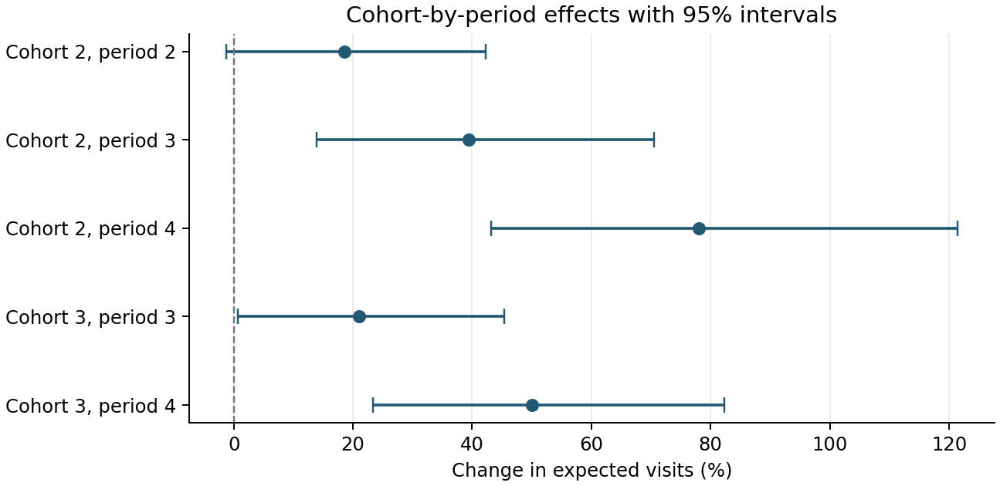
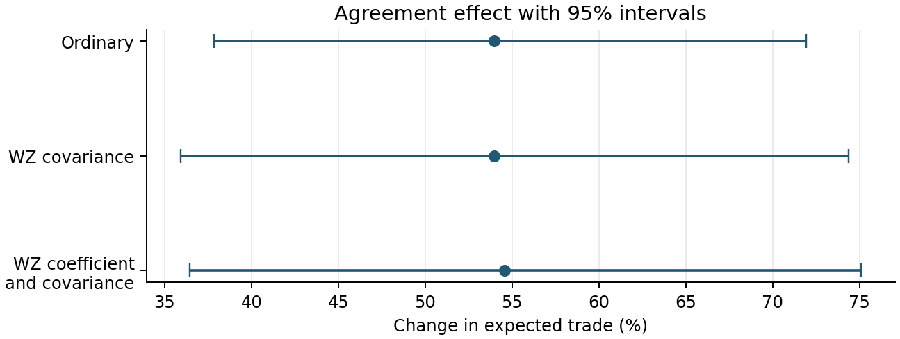

<!-- Generated from the chapter Markdown files by build-guide.mjs.
     Edit those files, regenerate, then render; do not hand-edit the HTML. -->

# Powermean user guide {#read-the-guide .unlisted}

<a id="powermean-01-user-guide"></a>


Start with the conditional mean of the outcome in levels, including observed zeros. Powermean accompanies *Dealing with Logs and Zeros in Regression Models* by Benatia et al. (2026). [Paper](https://arxiv.org/abs/2203.11820v4) · [Install Powermean](#install)

**Conditional mean.** Suppose `x` is strictly exogenous and `E[y | x] = exp(a + b*x)`. With your own data frame, fit the arithmetic conditional mean by PPML.

```python
import powermean as pm

fit = pm.fit("y ~ x", data, omega=1, tau=1)
```

Read the slope and its uncertainty with `fit.tidy()`. At `omega=1`, PPML (`tau=1`), Gamma PML (`tau=2`) and intermediate working variances such as `tau=1.5` target the same correctly specified conditional mean. [Run the example with 12 observations](#model--fit-one-conditional-mean-three-ways)

**Gravity.** Fit trade in levels with pair, exporter-year and importer-year fixed effects. Read an agreement's estimated proportional effect and its interval. [Gravity walkthrough](#first-fit)

**Nonlinear difference-in-differences.** Start with a policy adopted at a common date, then allow effects to vary by adoption cohort and date under multiplicative parallel trends. [DiD walkthrough](#nonlinear-did) · [Cohort effects figure](#nonlinear-did--plot-the-cohort-by-period-effects)

| What do you need next? | Where to go |
| --- | --- |
| Set up an analysis | [Prepare the data and formula](#prepare-data), then [choose the mean and working variance](#model). |
| Choose a panel specification | [Estimate fixed effects](#fixed-effects) or [cancel one block](#cancellation), then [choose uncertainty for your sampling design](#uncertainty). |
| Compare and report fits | [Check the rows](#compare-samples), [interpret a proportional effect](#proportional-changes), or [build and export tables](#tables). |
| Look up a call or resolve a warning | [Function index](#api) · [Fit options](#options) · [Troubleshooting](#troubleshooting) |

Download the [standalone HTML guide](#read-the-guide) for offline reading. The [Quarto source](guide.qmd) is also available.

## Get started {#read-the-guide--get-started .unlisted}

- [Install the current version](#install) from a local wheel or source archive.
- [Fit your first gravity model](#first-fit) and read its console output.
- [Prepare data](#prepare-data) and write the formula.
- [Run the examples](#examples) from your terminal.

## Fit a model {#read-the-guide--fit-a-model .unlisted}

- [Choose a mean and working variance](#model), including PPML, Gamma PML, log OLS and NB2.
- [Estimate fixed effects](#fixed-effects) and check what identifies the slope.
- [Cancel one fixed-effect block](#cancellation) and compare the resulting estimating equations.
- [Difference out two fixed-effect blocks](#jochmans) in a complete rectangle or directed array.
- [Choose a solver](#numerical-methods) and interpret its certificate.

## Read and report results {#read-the-guide--read-and-report-results .unlisted}

- [Check and compare estimation samples](#compare-samples), then describe their outcomes.
- [Explore and export a fit](#reuse-a-fit), including predictions, coefficient tests, contrasts and tables.
- [Predict and extract fixed effects](#results--prediction-and-retention), then replace covariates on the fitted rows for a counterfactual.
- [Interpret proportional changes](#proportional-changes) on the fitted and population scales.

## Panel designs and inference {#read-the-guide--panel-designs-and-inference .unlisted}

- [Estimate nonlinear difference-in-differences](#nonlinear-did) with common or staggered adoption.
- [Choose a covariance estimator](#uncertainty) for the sampling design.
- [Correct coefficient bias](#bias-correction) with the procedures of Benatia et al. (2026) or Weidner and Zylkin (2021).
- [Adjust pair covariance in gravity](#covariance-refinements) and plot the resulting intervals.
- [Compare with Stata ppmlhdfe](#compare-ppmlhdfe) on the same rows and specification.

## Reference and help {#read-the-guide--reference-and-help .unlisted}

| Page | What to look up |
| --- | --- |
| [Function index](#api) | Find an installed function, result method or output. |
| [Supported methods](#availability) | Supported model and covariance choices. |
| [Fit options](#options) | Formula, sample, model, covariance and start arguments. |
| [Results](#results) | Estimates, tests, covariance, sample records, diagnostics and fixed effects. |
| [Tables and formats](#tables) | Summary statistics, balance, outcomes, regression tables and exports. |
| [Solver options](#solver-options) | Newton, IOLS and numerical controls. |
| [Advanced fixed effects](#experimental-fe) | Joint and cancelled controls, correction and inference requirements. |
| [IOLS options](#iols-options) | Typed implementation and iteration settings. |
| [IOLS installation](#iols-installation) | Compiled and NumPy-only builds. |
| [Troubleshooting](#troubleshooting) | Diagnose a warning, refusal or failed fit. |
| [Report a problem](#report-a-problem) | Gather the sample, diagnostic and version information. |
| [Validation](#validation) | Interpret numerical and statistical checks. |
| [Papers and methods](#references) | Read and cite the underlying work. |
| [Build the guide](#build-the-guide) | Regenerate the standalone HTML from these chapters. |

# Get started {#start}

## Install Powermean {#install}

Use Python 3.12 or later. The examples in this guide require Powermean 0.1.1 or
later.

### Install in your analysis environment {#install--install-in-your-analysis-environment}

Choose a separate environment. Once 0.1.1 is available on PyPI, run:

```bash
python -m pip install "powermean>=0.1.1"
python -c "from importlib.metadata import version; print(version('powermean'))"
```

A local wheel or source archive installs with `python -m pip install`
followed by the filename. From a source checkout, run `python -m pip install .`.
A wheel name gives its Python version and platform.
[IOLS installation](#iols-installation) explains the compiled and NumPy-only wheels.

The release workflow builds separate wheels for CPython 3.12, 3.13 and 3.14
on Linux, macOS and Windows for x86-64 and ARM64. The macOS
wheels target macOS 15 or later.

The import command checks that Python can find the package. For reproducible
results, record the installed version and dependency versions.

### Know what the installation needs {#install--know-what-the-installation-needs}

| Dependency | Declared minimum |
| --- | --- |
| Python | 3.12 |
| NumPy | 2.3.1 |
| SciPy | 1.15.0 |
| pandas | 2.2.2 |
| Formulaic | 1.0.0 |
| within-py | 0.4, below 0.5 |

The source distribution uses the `scikit_build_core.build` backend, with declared
build requirements `scikit-build-core>=0.10`, `pybind11>=2.13`, `numpy>=2.3.1`
and `cmeel-eigen==3.4.1`.
Normal pip build isolation resolves these separately from runtime dependencies.
Save the dependency versions alongside the distribution filename and digest. The
[version-report recipe](#report-a-problem--record-versions-without-sharing-credentials)
shows how.

The CMake source build enables the optional IOLS C++ extension by default.
That build needs C++17, Python development-module support and Eigen headers.
Pip's isolated build environment supplies Eigen. On macOS the build also links
an existing LAPACK implementation. Installing a compatible compiled wheel
instead uses its included extension. A NumPy-only wheel omits that extension.
The source-build switch `-Ccmake.define.POWERMEAN_BUILD_IOLS=OFF` explicitly
omits the IOLS target; it does not establish a compiler-free build or a
platform-independent wheel, since the root CMake project still declares C++.

The optional IOLS solver has compiled and NumPy implementations. Automatic
selection uses NumPy only when the exact extension module is genuinely absent;
a broken extension or a failed calculation is an error, not permission to retry
with NumPy or Newton. An explicit compiled request is refused when the extension
is absent. Each IOLS result records which implementation ran.
[Availability](#availability) identifies the supported request scope, not a
checked matrix of platforms or dependency versions.

For the checked wheel formats, strict C++ selection, NumPy-only installations
and build troubleshooting, continue to [Install and troubleshoot IOLS](#iols-installation).

### Run the first example {#install--run-the-first-example}

Start with the self-contained [conditional-mean example](#model--fit-one-conditional-mean-three-ways).
For the gravity example, run the script from the unpacked source root.

```bash
python examples/first_fit.py
```

The example prints fitted coefficients and standard errors. The walkthrough
explains how to interpret them.

Continue to the [gravity walkthrough](#first-fit) to follow
the analysis from its question to its output.

## Estimate a trade agreement slope in a gravity model {#first-fit}

Suppose you observe exports from country $i$ to country $j$ in year $t$, with
some recorded flows equal to zero. You want to estimate the proportional
difference in expected trade associated with a bilateral agreement. Model
trade in levels using

$$
E[Y_{ijt}\mid X,\alpha,\gamma,\delta]
=\exp(\beta D_{ijt}+\alpha_{ij}+\gamma_{it}+\delta_{jt}).
$$

Here $D_{ijt}$ is the agreement indicator, $X$ contains the panel regressors,
and the three fixed-effect terms represent a directed pair, an exporter-year
and an importer-year. The target is the conditional arithmetic mean of trade.
For a change in $D$ from zero to one with the fixed effects held constant,
the model gives the ratio $\exp(\beta)$.

### Create the trade panel {#first-fit--create-the-trade-panel}

[Install Powermean](#install), then run the code below from the checkout or
unpacked source root. The [standalone script](../examples/first_fit.py)
contains the generator and first fit, and runs with
`python examples/first_fit.py`. It needs only the installed package and its
dependencies.

```python
import powermean as pm

from examples.first_fit import gravity_data

trade = gravity_data()
print(pm.summary_statistics(trade, vars=("trade",), probs=(0, 0.5, 1)))
```

```text
Summary statistics                                      N = 1,056 rows
----------------------------------------------------------------------
           N  missing  mean    sd    p0   p50   p100  zeros  mean | >0
----------------------------------------------------------------------
trade  1,056        0  4.08  3.25  0.00  3.00  37.00   6.0%       4.33
----------------------------------------------------------------------
```

The simulation has 12 countries, all 132 directed foreign pairs, and eight
years for each pair. There is no domestic trade in this design. Agreements
start at different dates, with some pairs untreated throughout. Adoption
dates are drawn independently by directed pair for this exercise. Real
agreements are often reciprocal, in which case the appropriate clustering
may differ. Trade is drawn in levels from a Poisson distribution with
pair-specific baselines, country-year shifts and an agreement slope of 0.35.
This makes the examples reproducible and shows how to handle genuine zeros.

### Fit with three fixed-effect blocks {#first-fit--fit-with-three-fixed-effect-blocks}

```python
formula = "trade ~ 0 + agreement | pair + exporter^year + importer^year"
fit = pm.fit(
    formula, trade, omega=1, tau=1, cancel=None, bias_correction=False,
    vcov={"cluster": "pair"},
)
print(fit.summary())
```

```text
powermean
====================================================================================
PPML (omega = 1, tau = 1)
Fixed effects: pair (estimated), exporter^year (estimated), importer^year (estimated)
Observations: 1056 of 1056 input rows (none dropped)
Status: verified; certified: True
Coverage: unique_root (BBP prop:iols-exact-sample-root)
------------------------------------------------------------------------------------
                  coef.   std. err.        z    P>|z|    [95% conf. interval]
------------------------------------------------------------------------------------
agreement        0.4315      0.0563     7.66    0.000      0.3210      0.5419
------------------------------------------------------------------------------------
Fixed-effect block counts (fitted rows, active covariance)
  pair: levels=132, redundant=132 (exact), nested in=pair
  exporter^year: levels=96, redundant=1 (exact), nested in=none
  importer^year: levels=96, redundant=8 (exact), nested in=none
Nested blocks count as fully redundant in these block counts.
```

The console summary shows the estimator, the three jointly estimated blocks,
the number of usable observations and the numerical status. The agreement
row is on the log mean scale.

- `omega=1` models the arithmetic mean. `tau=1` specifies the power working
  variance $V(m)=m$ and gives PPML. The PPML moment needs a correctly specified
  mean for its usual interpretation. Its use extends to nonnegative outcomes
  measured in continuous units.
- Terms after `|` are fixed-effect blocks. `pair` identifies a *directed*
  exporter–importer pair. `^` creates one interaction block per term.
  `0 +` omits a separate intercept because the effect indicators already
  span a constant. The fit estimates the blocks jointly through absorption.
- The covariance sums score contributions within each of the 132 pairs before
  combining them. That matches independent pair histories and allows arbitrary
  dependence within a history under the pair-sandwich assumptions. Shared
  shocks across pairs require a separate sampling argument.

All 63 zero flows contribute to the fit. In other data, some patterns of
zeros can imply separation and change the estimation sample. Inspect
`fit.sample` and `fit.summary()` for the actual sample and diagnostics.
[Prepare your data](#prepare-data)

### Identify the slope {#first-fit--identify-the-slope}

Pair effects absorb permanent bilateral differences such as distance.
Exporter-year effects absorb shifts common to all partners of an exporter
in a year, and importer-year effects do the analogous job for importers.
The agreement slope uses within-pair changes in policy that remain after
both country-year blocks are accounted for. A policy that moves identically
for all destinations of an exporter in each year would be absorbed by the
exporter-year block, even if it changes within pairs.

These controls identify a coefficient of the maintained mean model when
enough variation remains. A causal trade-policy interpretation in an
observational panel also needs assumptions about policy timing and other
time-varying bilateral shocks. The model holds exporter-year and importer-year
effects fixed when computing this comparison. A counterfactual in which those
effects respond to policy requires an additional model.

### Report a percentage and interval {#first-fit--report-a-percentage-and-interval}

Ask `pm.etable` to report the coefficient as a percentage with the
transformed confidence interval.

```python
table = pm.etable(
    fit, names=("Gravity PPML",), scale="effect", uncertainty="ci",
    stats=("nobs", "zeros"), stars=False, digits=1,
)
print(table)
```

```text
------------------------------------
                        Gravity PPML
------------------------------------
agreement                   53.9
                        [37.9, 71.9]
------------------------------------
Estimator                   PPML
Mean order (omega)           1
pair effects             Estimated
exporter^year effects    Estimated
importer^year effects    Estimated
Covariance             cluster: pair
Convention                 stata
Reference                  normal
Clusters                    132
------------------------------------
Observations               1,056
Zeros                       6.0%
------------------------------------
Entries are 100 (exp(b) - 1) for each reported coefficient coordinate; not a standalone regressor change.
95% confidence intervals in brackets, transformed from the coefficient interval.
```

With the same fixed effects, the fitted conditional mean with an agreement
is 53.9% higher. The 95% interval is pointwise. In a Python notebook,
display `table` as the last expression for an HTML table. Use
`table.to_latex()` for a LaTeX table or `fit.tidy()` for the unrounded
coefficients and uncertainty as a DataFrame. For a named regressor
comparison on the proportion scale, use `fit.effect("agreement", contrast=(0, 1))`.

### Compare with the raw outcome means {#first-fit--compare-with-the-raw-outcome-means}

```python
outcomes = pm.outcome_table(
    trade, outcomes="trade", treatment="agreement", cluster="pair",
)
print(outcomes)
```

```text
Outcome table                                                          control: agreement = 0 (N = 721); agreement = 1 (N = 335)
--------------------------------------------------------------------------------------------------------------------------------
       target   zeros (0)  zeros (1)  mean (0)  mean (1)  mean | >0 (0)  mean | >0 (1)  difference, unadjusted  [95% conf. int.]
--------------------------------------------------------------------------------------------------------------------------------
trade  theta_N       6.9%       3.9%      3.56      5.18           3.83           5.39                   45.5%    [30.1%, 62.7%]
--------------------------------------------------------------------------------------------------------------------------------
Proportional difference in means, unadjusted (theta_N).
Intervals transform the endpoints of the interval of the log ratio. Covariance: cluster-robust by 'pair', convention ssc='stata'.
```

The outcome table reports 45.5% more average trade in observed agreement
years. That comparison uses the two observed groups of rows. The
regression's 53.9% holds the three fixed-effect blocks constant. Read the
two numbers as answers to their respective comparisons. Both tables are
from one synthetic draw run with Powermean 0.1.0.
[Benatia et al. (2026), §§2–3 and §5 and Weidner–Zylkin §§3.1–3.4](#references)

### Continue with the same model {#first-fit--continue-with-the-same-model}

Read [fixed effects](#fixed-effects) to compare joint absorption
with pair cancellation on this panel. Read [coefficient bias](#bias-correction)
and [covariance refinements](#covariance-refinements) to see how
the separate WZ requests change the table, and what structure they require.

## Prepare the estimation sample {#prepare-data}

The [gravity example](#first-fit) uses one row per directed pair and
year. An observed zero is a trade flow of zero. A missing row or a missing
outcome conveys different information. Keep those distinctions when you build
the panel.

### Check outcomes and identifiers {#prepare-data--check-outcomes-and-identifiers}

- Keep observed zeros for a positive mean order. Log OLS and negative orders
  require strictly positive outcomes; `positive_only=True` defines a
  different estimation sample.
- Check that the same directed pair has the same label across dates. Check
  uniqueness at the intended observation level before interpreting a slope.
- Keep the outcome, regressor, effect and cluster columns on the same rows.
  Report missingness and explicit `subset` or positive-outcome restrictions.
- Inspect `result.sample` and `result.summary()` for the rows used, fixed-effect
  sample changes and dropped regressors. Compare those rows before comparing
  estimators or software. [Worked sample comparison](#compare-samples)

### Write the formula {#prepare-data--write-the-formula}

The left-hand side names the outcome. The right-hand side before `|` uses
Formulaic to construct ordinary regressors. Write a square as `I(x**2)`.
After `|`, use `+` to list blocks and `^` to make one interaction block.

```text
trade ~ 0 + agreement | pair + exporter^year + importer^year
sales ~ 0 + price_index | firm + year
```

A standalone intercept is redundant with these effect blocks. A fixed
regressor within a pair may also be redundant. A single interaction
classification, such as `cluster="exporter^importer"`, differs from two
cluster dimensions, `cluster="exporter + importer"`.

### Keep known scales and sampling information explicit {#prepare-data--keep-known-scales-and-sampling-information-explicit}

Use `exposure="duration"` for a positive exposure, or
`offset="log_duration"` for an offset already on the log power-mean scale.
Supply one of them. If the specification accepts weights, name the column
and its type, such as `weights="frequency", weight_type="frequency"`.
Fixed-effect fits require unit observation weights.
Keep the clustering column at the level at which histories can be
considered independent. Supply the relevant cluster information to
`pm.prepare` if you will request it from prepared data later.

See [options](#options) for input domains and
[troubleshooting](#troubleshooting) for missing, separated or unidentified fits.

## Run the examples {#examples}

Start with the [12-observation conditional-mean example](#model--fit-one-conditional-mean-three-ways) to compare PPML, Gamma PML and an intermediate working variance.

Run the scripts from the source checkout or unpacked source distribution
after installing Powermean. The datasets are generated locally
from fixed seeds. The gravity and DiD chapters show the returned tables and
include optional figure code using Matplotlib. To run the figure snippets,
install Matplotlib in the same Python environment.

| Example | Script | What to read |
| --- | --- | --- |
| Gravity with zeros | [`examples/first_fit.py`](../examples/first_fit.py) | [Three-way PPML](#first-fit) and [WZ adjustments](#bias-correction) |
| Firm sales over four years | [`examples/short_panel.py`](../examples/short_panel.py) | [Firm-cancelled Gamma and counterfactual prediction](#cancellation) |
| Nonlinear panel DiD | [`examples/nonlinear_did.py`](../examples/nonlinear_did.py) | [Common and cohort-period effects](#nonlinear-did) |
| Two-way exponential regression | [`examples/jochmans.py`](../examples/jochmans.py) | [Rectangular and directed Jochmans fits, with recovered predictions](#jochmans) |
| No-FE PPML with IOLS | [`docs/examples/iols_first_fit.py`](examples/iols_first_fit.py) | [Check the IOLS installation](#iols-installation) |

The [sample comparison](#compare-samples) uses two fits of the same frame
to show retained rows, exclusions, sample summaries and estimates. The
[prepared-fit example](#reuse-a-fit) reuses a design across solvers,
changes the covariance after estimation and reports a proportional contrast.

# Fit a model {#fit-a-model}

## Choose the mean order and working variance {#model}

Start with the quantity you want to compare as a regressor changes.
In the [gravity example](#first-fit) it is expected trade in levels.
A positive mean order allows zeros, and the working variance determines how
the estimating equation uses residuals.

### Choose a conditional mean {#model--choose-a-conditional-mean}

For $\omega\ne 0$, the regression assumes
$E(Y^\omega\mid X)=\exp(\omega X'\beta)$, where $X'\beta$ can include
fixed effects or a known offset. The conditional power mean is the
$1/\omega$ power of that moment, so Powermean reports slopes on its log scale.

| Order | Fitted target | Outcome domain |
| --- | --- | --- |
| `omega=1` | Arithmetic conditional mean | Nonnegative |
| `omega=0.5` | Square of the conditional mean of $\sqrt Y$ | Nonnegative |
| `omega=0` | Mean of log outcomes, giving the geometric mean after exponentiation | Strictly positive |
| `omega=-1` | Harmonic conditional mean | Strictly positive, with finite inverse moment |

When a fit succeeds with `0 < abs(omega) <= 1e-8`, Powermean issues a numerical
warning. Raising a positive outcome to a power very close to zero can round
away differences between observations. Dividing by the requested order to
report coefficients and standard errors can magnify that rounding. The
warning threshold is advisory. Use `omega=0` if the desired model is log OLS.

A change in order generally changes the population target and the
conditional moment restriction. Recovering the arithmetic mean from a
log regression also requires the conditional retransformation factor
$E[\exp(\varepsilon)\mid X]$. With zeros, a log model needs a separately
justified positive-outcome sample. A fixed shift such as `log(Y + 1)`
changes the target and its response to outcome units.
[Benatia et al. (2026), §§2.2, 3.1 and 3.3](#references)

### Set weights in the estimating equation {#model--set-weights-in-the-estimating-equation}

At order one, the joint power quasi-score sums
$X_i m_i^{1-\tau}(Y_i-m_i)$, where $m_i=\exp(X_i'\beta)$ and
$V(m)=m^\tau$. The working variance specifies weights. The actual
conditional variance describes the data. The PPML and Gamma equations
can share a population root under a correctly specified mean while
responding differently to the same data. Consistency of the estimator
also depends on how the fixed effects grow. The short-panel argument for
PPML cannot be transferred directly to joint GPML.
[Benatia et al. (2026), §3.2, Proposition 3 and §5](#references)

| Argument in `pm.fit` | Equation at order one | Shortcut |
| --- | --- | --- |
| `omega=1, tau=1` | PPML with level residual $Y_i-m_i$ | `pm.ppml` |
| `omega=1, tau=2` | Gamma quasi-score with relative residual $Y_i/m_i-1$ | `pm.gpml` |
| `omega=1, tau=1.5` | Power quasi-score with $V(m)=m^{1.5}$ | |
| `omega=1, variance=pm.NB2(0.5)` | Working variance $m+0.5m^2$ | |

Supply `tau` or `variance`. At order zero, use `pm.fit(..., omega=0)`
or its shortcut `pm.logols`. Order zero uses least squares on log outcomes.

Both PPML and Gamma quasi-scores can include zeros. When there is just
an intercept and a single binary regressor with positive means in both
groups, PPML and GPML set each fitted mean equal to its group mean.
With additional regressors, the difference in weights can yield different
coefficients. [Benatia et al. (2026), Supplemental Appendix S1.4, especially §S1.4.3](#references)

Run the named estimators on the same positive-outcome data to read their
resolved working equations. The NB2 fit uses the general entry point.

```python
import pandas as pd
import powermean as pm

data = pd.DataFrame({"y": [1, 3, 2, 4, 4, 7, 8, 10], "x": list(range(8))})
models = [
    pm.ppml("y ~ x", data),
    pm.gpml("y ~ x", data),
    pm.logols("y ~ x", data),
    pm.fit("y ~ x", data, omega=1, variance=pm.NB2(kappa=0.5)),
]
print(pm.etable(models, names=("PPML", "Gamma PML", "Log OLS", "NB2"), stars=False))
```

```text
-----------------------------------------------------------------
                      PPML   Gamma PML  Log OLS        NB2
-----------------------------------------------------------------
Intercept            0.450     0.402     0.329        0.423
                    (0.199)   (0.254)   (0.235)      (0.231)
x                    0.271     0.283     0.295        0.277
                    (0.034)   (0.048)   (0.044)      (0.042)
-----------------------------------------------------------------
Estimator             PPML      GPML    log OLS  NB2, kappa = 0.5
Mean order (omega)     1         1         0            1
Covariance           robust    robust    robust       robust
Convention           stata     stata     stata        stata
Reference            normal    normal    normal       normal
-----------------------------------------------------------------
Observations           8         8         8            8
-----------------------------------------------------------------
Standard errors in parentheses.
Models with different mean orders describe different conditional power means; their coefficients do not estimate one common parameter.
```

### Hold the formulation fixed when you compare weights {#model--hold-the-formulation-fixed-when-you-compare-weights}

Compare `tau` values on the same sample and fixed-effect specification.
For example, use `pm.fit(formula, trade, omega=1, tau=2, cluster="pair")`
on the [gravity data](#first-fit) to obtain joint GPML. For a short
panel the [cancellation chapter](#cancellation) compares two different
formulations at a single working variance.

For joint fits with nonzero order and a power variance outside `[1, 2]`,
Powermean uses a selected-root procedure. Check identification, existence and
the reported numerical assessment before interpreting the result.
Cancellation has its own domains and starting rules. Use explicit variance
choices: omitting both `tau` and `variance` in a cancelled `pm.fit` call
selects `tau=2`. See [options](#options--full-family-scope-and-the-current-entry-restriction)
and [numerical methods](#numerical-methods).

### Fit one conditional mean three ways {#model--fit-one-conditional-mean-three-ways}

Suppose `y` counts orders and `x` is a strictly exogenous binary regressor. The data below include a zero in each group. Fit the log-linear arithmetic mean with an intercept, first by PPML and then with two other working variances.

```python
import pandas as pd
import powermean as pm

orders = pd.DataFrame({
    "x": [0] * 6 + [1] * 6,
    "y": [0, 1, 2, 3, 4, 2, 0, 2, 3, 5, 6, 8],
})
ppml = pm.fit("y ~ x", orders, omega=1, tau=1)
intermediate = pm.fit("y ~ x", orders, omega=1, tau=1.5)
gamma = pm.fit("y ~ x", orders, omega=1, tau=2)
change = ppml.effect("x", contrast=(0, 1))
```

The fitted means are 2 orders at `x=0` and 4 at `x=1`. With a binary regressor and an intercept, each estimating equation fits the two group means exactly. Read `ppml.tidy()` for the coefficient on the log-mean scale. Multiply `change.estimate` and each endpoint of `change.interval` by 100 for the fitted percentage change and its pointwise interval. Here the fitted increase is 100%. With more covariates the choice of working variance can affect the estimated slope.

For strictly positive outcomes, log OLS targets the conditional mean of `log(y)`. [Mean orders and outcome domains](#model--choose-a-conditional-mean)

## Estimate and absorb fixed effects {#fixed-effects}

The [gravity fit](#first-fit) puts a separate baseline in the mean for
each directed pair and lets each exporter and importer change in every year.
The fit estimates these effects together with the agreement slope. Powermean
can absorb the indicator blocks, which avoids materializing a full dense
matrix of indicators in the solve.

### Specify blocks and check the remaining variation {#fixed-effects--specify-blocks-and-check-the-remaining-variation}

With three blocks, an agreement can be collinear even if it changes over
time. A policy that varies only by exporter and year lies in the span of
the exporter-year indicators. A time-invariant bilateral feature lies in
the span of the pair indicators. Each needs variation outside the span of
the *combined* effect blocks and other regressors to identify a coefficient.

Absorption is a computational technique. Profiling solves a nuisance
equation conditional on the remaining parameters and substitutes that
solution into the joint equation. Both can produce a fit of the joint
estimator. For the arithmetic mean, `joint.predict()` gives fitted trade
in sample and `joint.fixef()` gives estimated group levels under a
normalization. Individual levels depend on the normalization.
[Result methods](#results)

### Compare joint estimation with pair cancellation {#fixed-effects--compare-joint-estimation-with-pair-cancellation}

Cancellation constructs estimating equations in which the pair scale drops
out. Exporter-year and importer-year effects are still estimated. In the
special case of PPML the concentrated joint slope equation coincides with
the cancelled one on a common usable sample. Use `trade` and `formula`
from the [gravity walkthrough](#first-fit).

```python
joint = pm.fit(formula, trade, omega=1, tau=1, cluster="pair")
pair_cancelled = pm.fit(
    formula, trade, omega=1, tau=1, cancel="pair", cluster="pair"
)
print(pm.etable(
    joint, pair_cancelled, names=("Joint", "Pair cancelled"),
    stats=("nobs", "zeros"), stars=False, digits=4,
))
```

```text
----------------------------------------------------
                           Joint      Pair cancelled
----------------------------------------------------
agreement                  0.4315         0.4315
                          (0.0563)       (0.0563)
----------------------------------------------------
Estimator                   PPML           PPML
Mean order (omega)           1              1
pair effects             Estimated      Cancelled
exporter^year effects    Estimated      Estimated
importer^year effects    Estimated      Estimated
Covariance             cluster: pair  cluster: pair
Convention                 stata          stata
Reference                  normal         normal
Clusters                    132            132
----------------------------------------------------
Observations               1,056          1,056
Zeros                       6.0%           6.0%
----------------------------------------------------
Standard errors in parentheses.
```

For PPML, at a given slope and set of country-year effects, the fitted
pair total equals the observed total. Its fitted allocation to dates is
proportional to the exponential index with the pair effect omitted.
Subtracting those allocated flows from observed flows yields the same
within-pair equation by cancellation and by profiling. The pair-clustered
standard errors above use the same convention and sample.

At other working variances the cancellation and profiling weights generally
differ. Which estimator is appropriate depends on the group's conditional
mean restriction and how much information each nuisance effect receives as
the sample grows. Absorbing a growing block quickly still leaves its
estimation error in the joint score. [Benatia et al. (2026), §5.1 and Supplemental Appendix S3.6.1](#references)

### Choose what you need from the fit {#fixed-effects--choose-what-you-need-from-the-fit}

Use joint estimation when the joint equation is the one justified for your
design. Use cancellation when the within-group equation and short-group
argument fit your design.
`fixef()` in a cancelled fit can recover a scale from each group's observed
outcomes and the fitted slopes and retained effects. A short group's recovery
can remain noisy as more groups enter the sample. Both fits supply in-sample
predictions and accept replacement covariates on the retained rows.
[Prediction and counterfactuals](#results--prediction-and-retention)

[Cancellation in a short firm panel](#cancellation) shows where switching
estimators changes the result. [Advanced FE options](#experimental-fe)
covers sample checks and numerical controls.

## Cancel one fixed-effect block {#cancellation}

In a short firm panel, every additional firm brings a new intercept that
must be estimated from just a few years. Suppose you want to estimate how
expected sales change with a firm's price index, allowing for permanent
differences among firms and common year shifts. The cancellation method of Benatia et al. (2026)
uses a within-firm equation to estimate the slope and the year effects
without estimating a firm scale in that equation.

### Compare two equations on the same firm panel {#cancellation--compare-two-equations-on-the-same-firm-panel}

Run this from the source root. The [standalone short-panel script](../examples/short_panel.py)
creates 96 independent firms observed for four years, with a permanent
firm effect correlated with the price index. Prices also vary within
firms. Sales have a log-linear arithmetic mean and a simulated price
slope of −0.30.

```python
import powermean as pm

from examples.short_panel import firm_data

firms = firm_data()
firm_formula = "sales ~ 0 + price_index | firm + year"
common = {"omega": 1, "tau": 2, "cluster": "firm"}
joint_gamma = pm.fit(firm_formula, firms, **common)
cancelled_gamma = pm.fit(firm_formula, firms, cancel="firm", **common)
print(pm.etable(
    joint_gamma, cancelled_gamma, names=("Joint", "Firm cancelled"),
    uncertainty="ci", stats=("nobs", "zeros"), stars=False, digits=4,
))
```

```text
----------------------------------------------------------
                          Joint           Firm cancelled
----------------------------------------------------------
price_index              -0.3211             -0.3120
                    [-0.4377, -0.2045]  [-0.3958, -0.2282]
----------------------------------------------------------
Estimator                  GPML                GPML
Mean order (omega)          1                   1
firm effects            Estimated           Cancelled
year effects            Estimated           Estimated
Covariance            cluster: firm       cluster: firm
Convention                stata               stata
Reference                 normal              normal
Clusters                    96                  96
----------------------------------------------------------
Observations               384                 384
Zeros                      4.2%                4.2%
----------------------------------------------------------
95% confidence intervals in brackets.
```

Both fits estimate how expected sales change with prices at fixed firm and
year effects. They use the same Gamma working variance $V(m)=m^2$ and the
same cluster classification. The joint equation estimates the firm scales
and uses them in the score. The cancelled equation removes those scales.
This draw illustrates the difference in the estimates. It gives no ranking
of their accuracy or interval coverage across samples.

### Where the scale goes {#cancellation--where-the-scale-goes}

For mean order one, let $B_i$ denote the within-firm deviations of the
regressors *and* the retained year indicators, after redundant columns
are removed. Let $m_i=\exp(B_i'\theta)$ and let $H_g$ include the entire
regressor history and the effect of firm $g$. The maintained model is
$E(Y_i\mid H_g)=A_g m_i$ at the true parameter. The relative outcomes
$Y_i/m_i$ thus have common conditional mean $A_g$ within the firm.

For working variance $V(m)$, center $B_i$ using weights
$w_i=m_i^2/V(m_i)$ within $g$. The group score sums
$w_i(B_i-\bar B_{g,w})Y_i/m_i$. Its conditional expectation is zero at
the true parameter because the weighted centered deviations sum to zero.
At `tau=2` those weights are one. Profiling joint GPML instead multiplies
each group score by an inverse fitted group scale, which depends on the
observed outcomes. At `tau=1` this additional group factor is one on a
common sample with finite scales, giving the [PPML identity](#fixed-effects--compare-joint-estimation-with-pair-cancellation).
[Benatia et al. (2026), §5.1, equations (5.1)–(5.4), and Supplemental Appendix S3.6.1, equations (S3.18)–(S3.19)](#references)

### Choose the group and the sampling unit {#cancellation--choose-the-group-and-the-sampling-unit}

Use the name in the formula, here `cancel="firm"`. The other block stays
estimated. Cancelling years would leave a growing set of short firm effects
to estimate. With many independent short firms and a fixed number of years,
cancelling firms leaves a fixed-dimensional problem. Proposition 7 of Benatia et al. (2026)
uses a mean restriction conditional on the full history, independent
groups, bounded group sizes, moments and identifying within-group
variation. It permits dependence across years within a firm. Choosing the
group with the most levels via `cancel=True` is a software convenience.
The study design determines whether that block has the required properties.

A regressor constant within a cancelled group contributes no within-group
variation. Singletons and all-zero groups add no slope information to the
cancelled equation. Check the usable sample, the remaining design rank and
the covariance classification before interpreting the fit.
[Benatia et al. (2026), §5.1 and Supplemental Appendix S3.3](#references)

When you cancel firm fixed effects in PPML and all outcomes are positive,
a firm observed once stays in the sample and contributes zero to the slope score.
If you cluster by firm, that firm still counts toward the number of clusters
`G` in the default `G/(G−1)` adjustment. Joint PPML drops singleton firms
by default. The two fits can consequently agree on slopes and differ in
cluster-adjusted standard errors. When a zero outcome remains after the
initial sample filters, both routes apply the joint singleton and separation rules before
fitting. Inspect `result.sample.table()` and `result.vcov().attrs["G"]` to
see the sample and cluster count used for your fit.

### Use the cancelled result {#cancellation--use-the-cancelled-result}

Read the slope, interval and `result.sample` in the usual way.
`cancelled_gamma.fixef()` gives estimated year effects and in-sample
recovered firm scales on the log power-mean scale, with status labels and
without standard errors. `predict()` combines those scales with the retained
effects, offsets and slope index on the fitted rows.
[Recovered effects](#results--recovered-cancelled-effects)

In gravity the exporter-year and importer-year blocks can grow even after
cancelling pairs. Their estimation can still shift the slope distribution.
[Coefficient bias](#bias-correction) explains that case and the optional
short-group correction.

## Difference out two fixed-effect blocks {#jochmans}

Set `estimator="gmm1"` or `"gmm2"` in `pm.fit` for an exogenous exponential mean
with two fixed-effect blocks. The differences in Jochmans (2017) remove
both blocks from the estimating equation. The fitted result reports the slopes.

Koen Jochmans (2017). *Two-Way Models for Gravity*. The Review of Economics
and Statistics 99, 478–485. Section II derives the difference moments and
cell-projection inference (Theorem 2). Section III defines GMM1 and GMM2.
[Published paper](https://doi.org/10.1162/REST_a_00620) ·
[Open manuscript](https://www.repository.cam.ac.uk/handle/1810/286880)

### Choose the observed array {#jochmans--choose-the-observed-array}

Supply a data frame with one row per observed cell, finite regressors
and a finite nonnegative outcome. Use `0 +` for an intercept-free
Formulaic design and put exactly two identifier columns after `|`, in place of
the two identifier options in the authors' Stata commands. `estimator=` selects
the equation (`model()` in Stata). `start=` takes a one-dimensional vector in
coefficient order (`initial()` in Stata).

#### Rectangular panels {#jochmans--rectangular-panels}

Use `fe_layout="rectangular"` (the default for GMM fits, corresponding to
`twexp`) for a complete crossing with at least two levels on each axis. A panel needs one row
per unit and period. The unit and period labels are separate, and the two
dimensions can have different lengths.
A two-by-two panel contains only one rectangle, so it cannot yield usable
cell-projection standard errors. The fit refuses with `unusable_covariance`
if it reaches a root on that layout.

The `twexp` help illustrates the method with firms' patent counts and log R&D
spending, originally stored in separate columns for each year. Reshape such
data to long format before fitting. To follow the authors' example of using
the GMM1 slopes to initialize GMM2, keep the formula and its column order fixed.

```python
import powermean as pm

formula = "patents ~ 0 + log_rd | firm + year"
gmm1 = pm.fit(formula, firm_year, estimator="gmm1")
gmm2 = pm.fit(formula, firm_year, estimator="gmm2", start=gmm1.coef())
print(pm.etable(gmm1, gmm2, uncertainty="ci"))
```

#### Directed dyads {#jochmans--directed-dyads}

Use `fe_layout="directed"` (corresponding to `twgravity`) for a cross-section of
ordered pairs of agents. Supply every ordered non-self link among at least
four agents. Use the same labels for an agent in the origin and destination
columns. The outcome and regressors may differ in opposite directions.

The `twgravity` help fits trade flows in levels using bilateral variables
such as log distance, a shared border and a shared language.

```python
fit = pm.fit(
    "trade ~ 0 + log_distance + border + common_language | exporter + importer",
    bilateral_trade, estimator="gmm2", fe_layout="directed",
)
print(fit.summary())
```

An observed zero stays in the sample. Missing pairs, duplicate pairs, missing
or non-finite model values, and self-links in the directed layout raise
`SampleError`. To restrict the fit as you would with Stata's `if` or `in`,
filter the data frame first and pass a complete array on the selected levels.
[Runnable examples for both layouts](../examples/jochmans.py)

### Choose the moment equation {#jochmans--choose-the-moment-equation}

Write $p=x_{ij}+x_{k\ell}$, $q=x_{i\ell}+x_{kj}$, $P=y_{ij}y_{k\ell}$ and
$Q=y_{i\ell}y_{kj}$. Both methods set the average of $(p-q)D(b)$ to zero over
admissible rectangles. Directed rectangles use four distinct agent labels.

| Method | Difference $D(b)$ |
| --- | --- |
| `"gmm1"` | $P\exp(-p'b)-Q\exp(-q'b)$ |
| `"gmm2"` | $P\exp(q'b)-Q\exp(p'b)$ |

GMM2 gives each GMM1 rectangle a coefficient-dependent multiplier
$\exp((p+q)'b)$. The roots can differ. With exogenous slopes each equation
has as many moments as slopes and uses a local Newton root solve. The
default start is zero. Use `start=` to supply a finite vector in the
displayed coefficient order and `max_iter=` to change the budget.

The multiplicative errors must have unit conditional means and unit
conditional products for the opposite cell pairs used by the differences,
given the full regressor array and fixed effects. For the cell-projection
standard errors, assume conditional independence of the observed cells
and the large-array regularity of the source, including growth in both
dimensions. This scope excludes fixed-$T$ and unrestricted dyadic
dependence. Calling this estimator adopts these assumptions.

An intercept, an additive row or column regressor, or dependent rectangle
contrasts raise `IdentificationError`. The solver also requires a resolved
full-rank Jacobian at the evaluated point. Both a scaled moment and a
local Newton correction must pass before inference. The returned
`fit.certificate.status` is `"local_solution"`; existence and outcome can
depend on the data and the start. [Troubleshoot a refusal](#troubleshooting--jochmans-fits)

### Read uncertainty and compare with Stata {#jochmans--read-uncertainty-and-compare-with-stata}

Use `fit.coef()`, `fit.se()`, `fit.vcov()`, `fit.confint()`, `fit.tidy()`
and `fit.summary()`. `fit.sample.positions` and `fit.sample.retained_index`
keep input order. `pm.etable` can display fitted slopes or their
unit-change transformations `exp(b) - 1`.

Each projection row sums the kernels of rectangles incident on that
observed cell. With $M$ rectangles and $N$ observed cells, the projection
is $h_s=(N/M)\sum_{r\ni s}(p_r-q_r)D_r(b)$. Let $G$ be the derivative of
the mean moment. The `vcov="paper"` default uses
$G^{-1}(\sum_s h_s h_s'/N)G^{-\mathsf T}/N$ and normal-reference intervals.
In the rectangle $M=\binom{I}{2}\binom{J}{2}$ and $N=IJ$. In the directed
array $M=\binom{n}{2}\binom{n-2}{2}$ and $N=n(n-1)$.

Use `vcov="stata"` to apply the `twgravity` additional multiplier
$(n-1)/n$ for directed fits. The source averages projection products
over its $n^2$ matrix slots and uses the observed $N$ for the final
coefficient covariance. The option has unit multiplier in the rectangle.
`fit.with_vcov("stata")` changes the reporting convention on an existing
fit. Both layouts use cell projections as their available inference.

Powermean subtracts the mean of the observed design columns before solving.
In the source comparisons, `twexp` GMM2 centers on a square-padded
array and `twgravity` centers by the observed sum divided by $n^2$.
The different centers change valid-cell regressors by a common shift,
scaling the equation and its projection by a coefficient-dependent
factor. At the root that factor cancels from the sandwich because the
corresponding Jacobian term proportional to the moment is zero. A
fully padded row or column contributes zero to both rectangular outcome
products. In the directed calculation the diagonal is masked in both
factors, so only rectangles made from observed links contribute.

The implementation contracts matrix products and sums without listing
rectangles. In float64 it places a conservative bound of 150 on the
absolute centered fitted index and on the log range of positive outcomes
after common normalization. Ill-resolved cancellation, failed root
checks and unusable covariance can lead to refusal. [Function index](#api--pmfit)

### Predict trade after fitting {#jochmans--predict-trade-after-fitting}

`fit.predict()` recovers origin and destination effects by PPML with
the GMM slopes held fixed. The fitted trade totals match the observed
origin and destination totals. Each residual is observed trade minus
fitted trade.

For the directed fit above, the following compares fitted trade with
trade predicted if every retained pair had a common language.

```python
retained = bilateral_trade.iloc[fit.sample.positions]
fitted = fit.predict()
effects = fit.predict(type="fixed_effects")
residuals = fit.predict(type="residual")
same_language = fit.predict(retained.assign(common_language=1))
```

The second prediction uses the same slopes and recovered effects.
See the [runnable GMM example](../examples/jochmans.py) for synthetic data
and [prediction and counterfactuals](#results--prediction-and-retention)
for the retained-row requirements.

## Choose a solver and read its assessment {#numerical-methods}

The mean model specifies the target and the working variance specifies the
estimating equation. The solver computes a point satisfying that equation.
For instance, the default solver in the gravity example computes joint
PPML with three absorbed blocks.

### Which calculation runs? {#numerical-methods--which-calculation-runs}

Nonlinear calls default to Newton. Joint and cancelled FE fits use their
corresponding Newton procedures, with the profiled organization as the
default. Order zero uses least squares on the log outcome. Keep solver
settings separate from the order, working variance and cancellation choice.

For nonzero order and a power `tau` outside `[1, 2]`, joint and no-FE
calls compute a selected root. Unless you supply `start`, the procedure
starts from a certified fit of the nearest convex family member on the same
sample. The available root need not be unique, and some combinations have
narrower existence results. Cancellation uses its own starting rules.
If continuation runs, earlier certified stages supply starting values. The
reported result and its certification always use the requested `tau`.
[Power-variance range](#options--full-family-scope-and-the-current-entry-restriction)

### What the convergence assessment checks {#numerical-methods--what-the-convergence-assessment-checks}

The `certificate` assesses the computed point with diagnostics appropriate
to the equation, which can include score residuals, index corrections and
fixed-effect equations. Inspect the status if the achieved tolerance
differs from the request. When the assessment fails, inference is withheld.
Use `on_failure="return"` to inspect the returned state.
[Solver options](#solver-options) · [Troubleshooting](#troubleshooting)

The exact-score completion of Benatia et al. (2026) returns to the original estimating equation
after solving approximations. Under the conditions in its numerical
argument, the remaining numerical error is negligible at the statistical
scale. A numerical assessment at one sample shows how well that point
solves the equation. Establishing a valid population interpretation requires
the assumptions of the chosen model and estimator. [Benatia et al. (2026), §4 and Supplemental Appendix S2](#references)

### IOLS: an optional no-FE solver {#numerical-methods--iols-an-optional-no-fe-solver}

Iterated ordinary least squares uses shifted-log approximations and repeated
least-squares steps to compute a specified power-score equation. The shifts
scale with the outcome and fitted mean. A fixed shift before one log
regression solves a different problem. Powermean offers `solver="iols"`
for no-FE fits with positive order, a power `tau` in `[1, 2]`, an intercept,
at least one other regressor and more observations than coefficients. The
route excludes NB2, weights, offsets, exposure and a supplied start.

The [prepared-fit example](#reuse-a-fit) solves one equation
by both Newton and IOLS. IOLS can use a compiled loop or a NumPy implementation.
The result records the implementation. To inspect or request one, see
[IOLS installation](#iols-installation) and [IOLS controls](#iols-options).

# Read and report results {#read-and-report}

## Compare estimation samples {#compare-samples}

Two regressions can report the same number of observations and use different
rows. Check the sample before interpreting a difference between coefficients.
This example fits two models to the same input frame and follows the retained
rows from the result to the descriptive and regression tables.

### Fit both models on the same frame {#compare-samples--fit-both-models-on-the-same-frame}

Suppose you model weekly visits using a promotion indicator. One
specification adjusts for price, and the other adjusts for stock.
A price is missing in week 5 and a stock value is missing in week 2.
Use the same frame for both models.

```python
import pandas as pd
import powermean as pm

data = pd.DataFrame(
    {
        "visits":    [2, 0, 9, 5, 4, 10, 7, 6, 0, 2, 11, 3],
        "promotion": [0, 0, 1, 0, 0,  1, 1, 0, 0, 0,  1, 1],
        "price":     [8, 7, 6, 7, None, 6, 7, 8, 9, 9, 5, 8],
        "stock":     [21, None, 35, 28, 17, 33, 25, 30, 20, 22, 32, 24],
    },
    index=pd.Index([f"week-{i:02d}" for i in range(1, 13)], name="week"),
)
with_price = pm.fit("visits ~ 1 + promotion + price", data, omega=1, tau=1)
with_stock = pm.fit("visits ~ 1 + promotion + stock", data, omega=1, tau=1)
```

### Find the rows each fit used {#compare-samples--find-the-rows-each-fit-used}

```python
print("Adjust for price", *with_price.sample.table(), sep="\n")
print("Adjust for stock", *with_stock.sample.table(), sep="\n")
print(with_price.sample.positions)
print(with_stock.sample.positions)
print(with_price.sample.labels)
print(with_stock.sample.labels)
print(with_price.sample.reason(4))
print(with_stock.sample.reason(1))
```

```text
Adjust for price
('subset', 0)
('missing', 1)
('missing: outcome', 0)
('missing: regressors', 1)
('missing: effects', 0)
('missing: instruments', 0)
('missing: weights', 0)
('missing: offset', 0)
('missing: clusters', 0)
('zero_outcome', 0)
('zero_weight', 0)
('retained', 11)
Adjust for stock
('subset', 0)
('missing', 1)
('missing: outcome', 0)
('missing: regressors', 1)
('missing: effects', 0)
('missing: instruments', 0)
('missing: weights', 0)
('missing: offset', 0)
('missing: clusters', 0)
('zero_outcome', 0)
('zero_weight', 0)
('retained', 11)
[ 0  1  2  3  5  6  7  8  9 10 11]
[ 0  2  3  4  5  6  7  8  9 10 11]
Index(['week-01', 'week-02', 'week-03', 'week-04', 'week-06', 'week-07',
       'week-08', 'week-09', 'week-10', 'week-11', 'week-12'],
      dtype='str', name='week')
Index(['week-01', 'week-03', 'week-04', 'week-05', 'week-06', 'week-07',
       'week-08', 'week-09', 'week-10', 'week-11', 'week-12'],
      dtype='str', name='week')
missing
missing
```

Compare the exact retained positions before comparing coefficients. Both fits
read the same input frame in the same order, so use
`same_rows = with_price.sample.positions.tolist() == with_stock.sample.positions.tolist()`.
Here `same_rows` is `False`, even though both fits retain 11 of 12 rows.

`sample.table()` gives the counts in the order Powermean applies the sample
rules. Both fits have one row under `"missing: regressors"`.
`with_price.sample.reason(4)` and `with_stock.sample.reason(1)` each return
`"missing"`, the first recorded reason. Open those zero-based input positions
with `data.iloc[[4, 1]]` to see the missing price in `week-05` and missing stock
in `week-02`. Use `sample.labels` to display the original index labels.
For a retained position, `sample.reason(position)` returns `None`.
[Sample record](#results--inspect-the-estimation-sample)

### Describe the two retained samples {#compare-samples--describe-the-two-retained-samples}

```python
price_sample = pm.summary_statistics(
    data, vars=["visits"], probs=(0.5,), sample=with_price,
)
stock_sample = pm.summary_statistics(
    data, vars=["visits"], probs=(0.5,), sample=with_stock,
)
print(price_sample)
```

```text
Summary statistics                          N = 11 rows
-------------------------------------------------------
         N  missing  mean    sd   p50  zeros  mean | >0
-------------------------------------------------------
visits  11        0  5.00  3.92  5.00  18.2%       6.11
-------------------------------------------------------
Rows: the estimation sample of the fit (11 of 12).
```

For the stock-adjusted fit, use the same variables and original frame.

```python
print(stock_sample)
```

```text
Summary statistics                          N = 11 rows
-------------------------------------------------------
         N  missing  mean    sd   p50  zeros  mean | >0
-------------------------------------------------------
visits  11        0  5.36  3.59  5.00   9.1%       5.90
-------------------------------------------------------
Rows: the estimation sample of the fit (11 of 12).
```

The price model keeps both zero-visit weeks and has a mean of 5.00
visits. The stock model omits one zero-visit week and has a mean of
5.36. The outcome summaries differ despite the equal number of rows.

Pass the original frame in its original order with `sample=fit` to any of the
four descriptive table functions. Each uses the fit's retained positions,
checks the frame's row count and index, and applies its own missing-value
rules. [Descriptive table calls](#tables--describe-data-and-treatment-arms)

#### Summarize outcomes by promotion within one sample {#compare-samples--summarize-outcomes-by-promotion-within-one-sample}

```python
groups = pm.outcome_table(
    data, outcomes="visits", treatment="promotion", sample=with_price,
)
print(groups)
```

```text
Outcome table                                                               control: promotion = 0 (N = 6); promotion = 1 (N = 5)
---------------------------------------------------------------------------------------------------------------------------------
        target   zeros (0)  zeros (1)  mean (0)  mean (1)  mean | >0 (0)  mean | >0 (1)  difference, unadjusted  [95% conf. int.]
---------------------------------------------------------------------------------------------------------------------------------
visits  theta_N      33.3%       0.0%      2.50      8.00           3.75           8.00                  220.0%   [38.8%, 637.5%]
---------------------------------------------------------------------------------------------------------------------------------
Proportional difference in means, unadjusted (theta_N).
Intervals transform the endpoints of the interval of the log ratio. Covariance: robust to heteroskedasticity, convention ssc='stata'.
Rows: the estimation sample of the fit (11 of 12).
```

This table gives the unadjusted difference between observed promotion groups
within the price model's sample. The regression below conditions on the
included covariate. [Baseline balance example](#results--inspect-balance-on-the-baseline-sample)

### Compare the estimates {#compare-samples--compare-the-estimates}

```python
models = pm.etable(
    with_price, with_stock, names=("Adjust for price", "Adjust for stock"),
    stats=("nobs", "zeros"), stars=False, digits=4,
)
print(models)
```

```text
------------------------------------------------------
                    Adjust for price  Adjust for stock
------------------------------------------------------
Intercept                3.6730           -0.7143
                        (0.9998)          (0.8219)
promotion                0.5832            0.4017
                        (0.4652)          (0.2159)
price                   -0.3496
                        (0.1109)
stock                                      0.0783
                                          (0.0281)
------------------------------------------------------
Estimator                 PPML              PPML
Mean order (omega)         1                 1
Covariance               robust            robust
Convention               stata             stata
Reference                normal            normal
------------------------------------------------------
Observations               11                11
Zeros                    18.2%              9.1%
------------------------------------------------------
Standard errors in parentheses.
```

The promotion coefficients here can differ because the models use different
controls and different rows. To compare specifications on common eligible
rows, fit both models on that common input and check their retained positions
again. [Model table options](#tables--tabulate-fitted-models)

### Export a table to Markdown {#compare-samples--export-a-table-to-markdown}

Copy the text from this call into a Markdown document to render the
first summary table as shown below.

```python
print(price_sample.to_markdown())
```

**Summary statistics. N = 11 rows**

|  | N | missing | mean | sd | p50 | zeros | mean \| \>0 |
| :--- | ---: | ---: | ---: | ---: | ---: | ---: | ---: |
| visits | 11 | 0 | 5.00 | 3.92 | 5.00 | 18.2% | 6.11 |

*Notes:* Rows: the estimation sample of the fit \(11 of 12\).

[Explore results, effects and exports](#reuse-a-fit)

## Explore and export a fitted result {#reuse-a-fit}

This small no-FE example holds the design and equation fixed across
Newton and IOLS. It then computes a proportional change between two
covariate configurations. The groups in the simulation let you exercise
the cluster interface; its rows are generated independently.

### Solve the same mean equation twice {#reuse-a-fit--solve-the-same-mean-equation-twice}

Both solvers use the same input frame. Once both fits are available, check
`newton.sample.positions.tolist() == iols.sample.positions.tolist()` before
comparing their coefficients.

```python
import numpy as np
import pandas as pd
import powermean as pm

rng = np.random.default_rng(20261028)
x1, x2 = rng.normal(size=(2, 240))
mean = np.exp(0.3 + 0.25 * x1 - 0.15 * x2)
data = pd.DataFrame(
    {"y": rng.poisson(mean), "x1": x1, "x2": x2, "group": np.repeat(np.arange(60), 4)}
)
prepared = pm.prepare("y ~ 1 + x1 + x2", data, cluster="group")
newton = prepared.fit(omega=1, tau=1)
iols = prepared.fit(omega=1, tau=1, solver="iols")
print(pm.etable(
    newton, iols, names=("Newton", "IOLS"), stars=False, digits=4,
))
```

```text
--------------------------------------------------
                        Newton           IOLS
--------------------------------------------------
Intercept               0.3377          0.3377
                       (0.0621)        (0.0621)
x1                      0.2245          0.2245
                       (0.0537)        (0.0537)
x2                     -0.2494         -0.2494
                       (0.0737)        (0.0737)
--------------------------------------------------
Estimator                PPML            PPML
Mean order (omega)        1               1
Covariance          cluster: group  cluster: group
Convention              stata           stata
Reference               normal          normal
Clusters                  60              60
--------------------------------------------------
Observations             240             240
--------------------------------------------------
Standard errors in parentheses.
```

Both calls estimate the same PPML equation using the retained design and
cluster classification. This example used the compiled IOLS implementation.
An artifact with the NumPy implementation can report `numpy` instead.
[Supported IOLS domain](#numerical-methods--iols-an-optional-no-fe-solver)

### Inspect a fit and change its covariance {#reuse-a-fit--inspect-a-fit-and-change-its-covariance}

```python
print(newton.tidy().to_string(index=False))
```

```text
     term  estimate  std_error  statistic      p_value  conf_low  conf_high inference
Intercept  0.337672   0.062123   5.435507 5.464090e-08  0.215913   0.459432        ok
       x1  0.224509   0.053719   4.179356 2.923359e-05  0.119223   0.329796        ok
       x2 -0.249392   0.073739  -3.382119 7.192900e-04 -0.393917  -0.104868        ok
```

The coefficient table gives the estimate, standard error, test and
confidence interval for each term. Use `newton.coef()`, `newton.se()`
and `newton.confint()` when you need one of those objects on its own.
Use `newton.vcov()` for the active covariance matrix, including off-diagonal
entries. Use `robust_matrix = newton.vcov("robust")` to get the alternate
matrix from the same fitted point, with covariance metadata in
`robust_matrix.attrs`. The [results reference](#results) also
explains `predict()`, `fixef()`, `influence()` and the numerical certificate.

Use `with_vcov()` to carry the alternate covariance into a separate result
view. Both covariance calls reuse the fitted point without refitting.

```python
robust = newton.with_vcov("robust")
print(robust.confint().reset_index().to_string(index=False))
```

```text
     term     lower     upper
Intercept  0.215915  0.459430
       x1  0.120539  0.328480
       x2 -0.378758 -0.120027
```

The intervals above use independent-row robust covariance. Use
`robust.tidy()` for coefficients with the alternate uncertainty or
`pm.etable(robust, uncertainty="ci")` to report the intervals in a model
table. The effects and tests below also use the view's covariance.
[Post-fit covariance requests](#results--recompute-uncertainty-from-stored-information)

See [compare estimation samples](#compare-samples) when two models were
fitted on different rows.

### Read diagnostics and covariance {#reuse-a-fit--read-diagnostics-and-covariance}

```python
print(newton.vcov().round(6).to_string(index_names=False))
print(newton.estimator.to_dict())
record = newton.provenance.to_dict()
print({key: record[key] for key in ("solver", "status", "certified")})
```

```text
           Intercept        x1        x2
Intercept   0.003859 -0.000807  0.000518
x1         -0.000807  0.002886 -0.000370
x2          0.000518 -0.000370  0.005437
{'type': 'Estimator', 'mean': {'type': 'PowerMean', 'omega': 1.0}, 'variance': {'type': 'PowerVariance', 'tau': 1.0}, 'moment': {'type': 'ExogenousMean'}, 'fixed_effects': {'type': 'NoFixedEffects'}}
{'solver': 'newton', 'status': 'verified', 'certified': True}
```

The row and column names of the covariance matrix are fitted term names.
Use its `attrs` to read the covariance metadata. The estimator record
describes the equation, while provenance records how it was solved.

### Report effects and contrasts {#reuse-a-fit--report-effects-and-contrasts}

```python
change = robust.effect("x1", contrast=(0, 1))
print(change.estimate, change.interval)
```

```text
0.25170852542599226 (0.12810458307540534, 0.38885548036053386)
```

`effect()` compares two values of one regressor that enters directly.
Use `effects()` for a table of separate one-unit changes.

```python
print(robust.effects(["x1", "x2"]).T.to_string(header=False))
```

```text
term                                                                                  x1                                                                    x2
target              theta_N/NATE: proportional effect on the conditional arithmetic mean  theta_N/NATE: proportional effect on the conditional arithmetic mean
contrast                                                                      (0.0, 1.0)                                                            (0.0, 1.0)
estimate                                                                        0.251709                                                             -0.220726
std_error                                                                         0.0664                                                              0.051435
statistic                                                                       4.232259                                                             -3.778441
p_value                                                                         0.000023                                                              0.000158
conf_low                                                                        0.128105                                                             -0.315289
conf_high                                                                       0.388855                                                             -0.113103
inference                                                                             ok                                                                    ok
log_contrast                                                                    0.224509                                                             -0.249392
log_std_error                                                                   0.053047                                                              0.066004
reference                                                                         normal                                                                normal
reference_df                                                                        None                                                                  None
units                                                                       proportional                                                          proportional
unavailable_reason                                                                  None                                                                  None
```

Use `contrast()` for a change involving several coefficients. Supply complete
before and after regressor settings, including for a change to one variable
that enters through an interaction or transformation.

```python
comparison = robust.contrast({"x1": 0.0, "x2": 0.0}, {"x1": 1.0, "x2": -1.0})
print(comparison.to_frame().T.to_string(header=False))
```

```text
target              theta_N/NATE: proportional effect on the conditional arithmetic mean
contrast                      X(after) - X(before); fixed effects and offsets held fixed
before                                                            {'x1': 0.0, 'x2': 0.0}
after                                                            {'x1': 1.0, 'x2': -1.0}
estimate                                                                        0.606249
std_error                                                                       0.144593
statistic                                                                       5.264459
p_value                                                                              0.0
conf_low                                                                        0.346445
conf_high                                                                       0.916185
inference                                                                             ok
log_contrast                                                                    0.473902
log_std_error                                                                   0.090019
reference                                                                         normal
reference_df                                                                        None
units                                                                       proportional
unavailable_reason                                                                  None
```

The log mean ratio for these configurations is
$\widehat\beta_{x1}-\widehat\beta_{x2}$. The fit replays the formula on
both settings and holds fixed effects and offsets fixed where present.
The estimate and interval are proportions. The default interval transforms
the endpoints of the log-scale interval.
[Effect and contrast methods](#results--proportional-effects-contrasts-and-tests)

### Test or combine coefficients {#reuse-a-fit--test-or-combine-coefficients}

```python
print(robust.test("x1 = x2").to_frame().to_string(index=False))
print(robust.lincom("x1 - x2").to_frame().to_string(index=False))
```

```text
   term  statistic      p_value  wald_quadratic distribution  df_num df_denom  requested  reduction inference reference reference_df unavailable_reason
x1 = x2   27.71453 1.406027e-07        27.71453         chi2       1     None          1          0        ok    normal         None               None
   term  estimate  std_error  statistic      p_value  conf_low  conf_high inference reference reference_df                  units unavailable_reason
x1 - x2  0.473902   0.090019   5.264459 1.406027e-07  0.297468   0.650336        ok    normal         None coefficient expression               None
```

`test()` tests an equality using the full covariance. `lincom()` reports
a linear combination, with its standard error and interval. For a
nonlinear coefficient expression use `nlcom()`. For example,
`robust.nlcom("exp(x1 - x2) - 1")` evaluates the same point contrast here
with a delta-method interval. Use `wald(R, q)` for joint restrictions.
Here the columns are intercept, `x1` and `x2`, in the order of
`robust.coef()`. The rows below test both slopes against zero.

```python
print(robust.nlcom("exp(x1 - x2) - 1").to_frame().to_string(index=False))
print(robust.wald([[0, 1, 0], [0, 0, 1]], [0, 0]).to_frame().to_string(index=False))
```

```text
            term  estimate  std_error  statistic  p_value  conf_low  conf_high inference reference reference_df                  units unavailable_reason
exp(x1 - x2) - 1  0.606249   0.144593   4.192795 0.000028  0.322852   0.889647        ok    normal         None coefficient expression               None
term  statistic      p_value  wald_quadratic distribution  df_num df_denom  requested  reduction inference reference reference_df unavailable_reason
wald   28.43249 6.698278e-07        28.43249         chi2       2     None          2          0        ok    normal         None               None
```

[Results and tests](#results--proportional-effects-contrasts-and-tests)

### Inspect predictions and influence contributions {#reuse-a-fit--inspect-predictions-and-influence-contributions}

```python
print(robust.predict(pd.DataFrame({"x1": [0.0], "x2": [0.0]})))
print(newton.influence().head(2).reset_index().to_string(index=False))
```

```text
0    1.401681
Name: power_mean, dtype: float64
 position  Intercept        x1        x2
        0  -0.004538  0.001877  0.001345
        1   0.001679 -0.001195 -0.000852
```

The prediction is the fitted arithmetic mean at the supplied regressor
values. The influence rows give the first two stored sampling-unit
contributions of the clustered fit. Use `fixef()` on an FE result to
inspect its normalized or recovered group levels.
[Fixed-effect results](#results--fixed-effect-results)

### Export tables {#reuse-a-fit--export-tables}

```python
from pathlib import Path

table = pm.etable(newton, iols, names=("Newton", "IOLS"), stars=False, digits=4)
Path("models.md").write_text(table.to_markdown(), encoding="utf-8")
Path("models.tex").write_text(table.to_latex(), encoding="utf-8")
Path("models.html").write_text(table.to_html(), encoding="utf-8")
robust.tidy().to_csv("coefficients.csv", index=False)
robust.vcov().to_csv("covariance.csv")
```

In a notebook, display the table object for its HTML representation.
Use `print(table)` in a console and `table.to_frame()` for numeric values
and model metadata. See the [rendered Markdown example](#compare-samples--export-a-table-to-markdown).
[Table export formats](#tables--print-or-export)

## Interpret proportional changes {#proportional-changes}

The [gravity example](#first-fit) estimates a conditional mean ratio.
A population comparison requires a denominator and a population over which
to average. Benatia et al. (2026) show how those choices determine the parameter.

### Compare population means {#proportional-changes--compare-population-means}

For finite means and a positive untreated population mean, the normalized
average treatment effect (NATE) is

$$
\theta_N=\frac{E[Y(1)]}{E[Y(0)]}-1.
$$

It also gives the proportional change in the expected total for a fixed-size
population. For example, take two units whose untreated outcomes are 1
and 9 and whose treated outcomes are 2 and 9. Their mean rises from 5 to
5.5, a 10% increase. Averaging the individual percentage changes gives
50%. When individual baselines are positive, the ratio of means weights
individual percentage effects by baseline outcomes. If one individual's
baseline is zero, the ratio of population means can still be defined.

For a nonnegative outcome the mean in each state factors into the share with
positive outcomes and the mean among those positive outcomes. The two factors
can both change. The set of positive units can also change.
[Benatia et al. (2026), §2 and Supplemental Appendix S1.1.3, equations (S1.2) and (S1.4)](#references)

### When an exponentiated coefficient is enough {#proportional-changes--when-an-exponentiated-coefficient-is-enough}

Suppose a binary treatment enters the exponential conditional arithmetic
mean as $\mu_d(w)=\exp(\alpha+\beta_D d+w'\gamma)$. Treatment multiplies
each fitted conditional mean by $\exp(\beta_D)$. Averaging over the same
covariate distribution preserves that factor. In a causal design with
consistency, conditional mean exchangeability and overlap for the intended
population, $\exp(\beta_D)-1$ then gives the NATE. Other designs can identify
the two means by different assumptions, such as the untreated trend and no
anticipation in [panel DiD](#nonlinear-did).

Even when the conditional mean ratio is constant, individual outcomes can
respond differently. For an uninteracted numeric regressor, `effect()`
reports the change for one unit or a specified pair of values. Use
`contrast()` for an interacted, categorical or transformed regressor.
[Benatia et al. (2026), §3.1 and Supplemental Appendix S1.1.4](#references)

### With interactions, standardize the fitted means {#proportional-changes--with-interactions-standardize-the-fitted-means}

If treatment multiplies the mean by different amounts across covariates,
evaluate the fitted means for both states at each covariate value in the
target population. Average the treated predictions and the untreated
predictions separately. Form their ratio and subtract one. A level
effect uses the difference of those means instead. For nonzero power
orders, average each state's conditional power moment before taking
its power root. [Benatia et al. (2026), equations (3.1)–(3.2)](#references)

Uncertainty for an average of counterfactual predictions uses the derivatives
of the full calculation and, when applicable, sampling variability of the
target covariates. The result method `contrast(before, after)` reports the
ratio for two supplied regressor configurations. General standardized
effects and their uncertainty require a separate calculation.
[Result methods](#results--proportional-effects-contrasts-and-tests)

# Panel designs and inference {#panel-and-inference}

## Nonlinear difference-in-differences in a short panel {#nonlinear-did}

Suppose a policy changes the number of visits to a service. Some units record
zero visits. You want to compare expected visits under the policy and under no
policy. If untreated visits grow by the same **percentage** across treatment
cohorts, use an exponential mean for visits in levels. This is the log link
applied to a mean. All observed counts, including zeros, can enter the equation.
[Wooldridge (2023), §§2–3](#references--panel-difference-in-differences)

For an overall estimate in visits with a unit-clustered standard error,
see the [aggregate and cohort-period results](#nonlinear-did--what-the-reported-effects-measure).

### Two periods and one treated cohort {#nonlinear-did--two-periods-and-one-treated-cohort}

Let $G=2$ denote first treatment in period 2 and $G=0$ denote never treated.
Write $M_{g,t}(0)=E[Y_t(0)\mid G=g]$ for the untreated mean in each cohort.
With positive untreated means, multiplicative parallel trends assume

$$
\frac{M_{2,2}(0)}{M_{2,1}(0)}
=\frac{M_{0,2}(0)}{M_{0,1}(0)}.
$$

If the policy has no anticipatory effect on the treated cohort's period-1
mean, its period-2 counterfactual is its observed period-1 mean multiplied
by the control cohort's observed growth factor. For example, if controls
grow from 2 to 3 visits and the treated cohort starts at 4, the
counterfactual is 6. An observed treated post mean of 7.5 then represents
a 25% effect, or 1.5 additional visits per unit. An additive trend would
imply a counterfactual of 5.

The comparison assumes well-defined treatment regimes with no interference
in these examples, a usable untreated comparison, and comparable panel composition. Here the
complete panel follows the same units in every period. To justify the **unit FE estimators**, also
maintain the conditional mean model given the unit effect and the
complete treatment history. In the exercise that mean is
$E(Y_{it}\mid G_i,\alpha_i)=\exp(\alpha_i+\lambda_t+\beta D_{it})$,
where $D_{it}$ is one only for treated units after adoption. The unit
baseline may be related to adoption, but untreated mean growth cannot
differ systematically with adoption after conditioning. Independent units
and finite moments permit clustering by unit with dependence across dates.
[Wooldridge (1999, 2023), and Benatia et al. (2026), §5.1](#references)

### Fit the TWFE equation with different working variances {#nonlinear-did--fit-the-twfe-equation-with-different-working-variances}

Run from the source root. The [script](../examples/nonlinear_did.py)
generates 80 never-treated and 80 eventually treated units for two periods.
The simulated policy increases treated units' mean by 40%. All units'
untreated means grow by 15%, and the treated cohort starts from a higher
baseline.

```python
import powermean as pm

from examples.nonlinear_did import did_data

panel = did_data()
formula = "visits ~ 0 + treated | unit + period"
cases = (
    (1, None, "Joint PPML"),
    (1, "unit", "Cancelled PPML"),
    (1.5, "unit", "Cancelled 1.5"),
    (2, "unit", "Cancelled Gamma"),
    (2, None, "Joint Gamma"),
)
fits = [
    pm.fit(formula, panel, omega=1, tau=tau, cancel=cancel, cluster="unit")
    for tau, cancel, _ in cases
]
print(pm.etable(
    *fits, names=[name for _, _, name in cases],
    stats=("nobs", "zeros"), stars=False, digits=4,
))
```

```text
------------------------------------------------------------------------------------------------
                      Joint PPML   Cancelled PPML  Cancelled 1.5  Cancelled Gamma   Joint Gamma
------------------------------------------------------------------------------------------------
treated                 0.2872         0.2872          0.2872          0.2872          0.4014
                       (0.1291)       (0.1291)        (0.1291)        (0.1291)        (0.2054)
------------------------------------------------------------------------------------------------
Estimator                PPML           PPML         tau = 1.5          GPML            GPML
Mean order (omega)        1              1               1               1               1
unit effects          Estimated      Cancelled       Cancelled       Cancelled       Estimated
period effects        Estimated      Estimated       Estimated       Estimated       Estimated
Covariance          cluster: unit  cluster: unit   cluster: unit   cluster: unit   cluster: unit
Convention              stata          stata           stata           stata           stata
Reference               normal         normal          normal          normal          normal
Clusters                 160            160             160             160             160
------------------------------------------------------------------------------------------------
Observations             320            320             320             320             320
Zeros                    6.9%           6.9%            6.9%            6.9%            6.9%
------------------------------------------------------------------------------------------------
Standard errors in parentheses.
```

The PPML estimate implies about 33.3% higher expected visits. The sample
contains 22 zeros. The two PPML calls agree because profiling and
cancelling the unit scale give the same equation on common support.
Cancel **unit**, so period effects still account for common growth. In a
short panel they are well informed as the number of units grows.

With two periods and no covariates, the design is saturated. Each cohort's
growth factor is its post mean divided by its pre mean. The treatment slope
is the log of treated growth divided by untreated growth. Changing the
cancelled working variance multiplies every unit's estimating function
within a cohort by the same factor. That factor cancels from both the
root and its cluster sandwich, giving the same slope and standard error
on the same rows under the same covariance convention. Joint Gamma uses
outcome-dependent unit weights after profiling, which is why its estimate
can differ. [Compare staggered adoption](#nonlinear-did--allow-different-effects-by-adoption-cohort-and-date)
· [Short-group cancellation](#cancellation)

### Allow different effects by adoption cohort and date {#nonlinear-did--allow-different-effects-by-adoption-cohort-and-date}

For staggered adoption, define $Y_t(g)$ as the outcome if first treated in
$g$ and $Y_t(0)$ as the outcome under no treatment. For $t\ge g$, the
level effect is $E[Y_t(g)-Y_t(0)\mid G=g]$. The proportional effect is
the ratio of those two means minus one. Require no anticipation in every
pre-adoption period used to identify an untreated mean. For the
no-covariate exponential specification, the log untreated cohort mean
must be a cohort intercept plus a common period effect. This imposes
parallel growth on the log of the untreated mean. With covariates,
Wooldridge allows the baseline and common trend to depend on
pretreatment covariates; comparisons require untreated observations
with support for the treated cohort's covariates. Treatment should remain
on after adoption in this example.

Include a separate indicator for each post-treatment cohort-date cell,
leaving untreated and not-yet-treated rows with all cell indicators zero.
They supply the untreated comparisons under this restricted common trend.
A single treated indicator would force a common proportional effect across
adoption cohorts and dates. The simulation below includes a never-treated
cohort in every period and allows different proportional effects in the
five treated cells.
[Wooldridge (2023), §3, assumptions CNAS and CIPTS; Wooldridge (2025), extended TWFE](#references--panel-difference-in-differences)

```python
from examples.nonlinear_did import CELLS

panel = did_data(staggered=True)
rhs = " + ".join(CELLS.values())
pooled = pm.fit(
    f"visits ~ 1 + C(cohort) + C(period) + {rhs}",
    panel, omega=1, tau=1, cluster="unit",
)
unit_formula = f"visits ~ 0 + {rhs} | unit + period"
within = pm.fit(unit_formula, panel, omega=1, tau=1, cancel="unit", cluster="unit")
gamma = pm.fit(unit_formula, panel, omega=1, tau=2, cancel="unit", cluster="unit")

cell_labels = {term: f"Cohort {g}, period {t}" for (g, t), term in CELLS.items()}
table = pm.etable(
    pooled, within, gamma,
    names=("Pooled PPML", "Cancelled PPML", "Cancelled Gamma"),
    keep=tuple(CELLS.values()), labels=cell_labels,
    scale="effect", uncertainty="ci", stars=False, digits=1,
)
print(table)
```

```text
------------------------------------------------------------------
                     Pooled PPML   Cancelled PPML  Cancelled Gamma
------------------------------------------------------------------
Cohort 2, period 2       18.5           18.5             17.7
                     [-1.3, 42.3]   [-1.3, 42.3]     [-1.9, 41.3]
Cohort 2, period 3       39.4           39.4             39.6
                     [13.9, 70.5]   [13.9, 70.5]     [14.3, 70.5]
Cohort 2, period 4       78.1           78.1             78.3
                    [43.2, 121.5]  [43.2, 121.5]    [43.6, 121.5]
Cohort 3, period 3       21.0           21.0             21.9
                     [0.7, 45.4]    [0.7, 45.4]      [1.6, 46.3]
Cohort 3, period 4       50.0           50.0             51.1
                     [23.4, 82.3]   [23.4, 82.3]     [24.4, 83.5]
------------------------------------------------------------------
Estimator                PPML           PPML             GPML
Mean order (omega)        1              1                1
unit effects              No         Cancelled        Cancelled
period effects            No         Estimated        Estimated
Covariance          cluster: unit  cluster: unit    cluster: unit
Convention              stata          stata            stata
Reference               normal         normal           normal
Clusters                 240            240              240
------------------------------------------------------------------
Observations             960            960              960
------------------------------------------------------------------
Entries are 100 (exp(b) - 1) for each reported coefficient coordinate; not a standalone regressor change.
95% confidence intervals in brackets, transformed from the coefficient interval.
```

Read one coefficient for each cohort and post-adoption date. At adoption,
cohort 2 has 18.5% higher expected visits in the pooled fit. The interval
below the estimate is a pointwise 95% interval based on unit clustering.
The fixed-effect rows list absorbed blocks. The pooled fit includes cohort
and period indicators as ordinary regressors.

The two PPML columns agree here in a balanced, no-covariate panel,
as in Wooldridge's comparison in §3.3. Adding covariates or changing support
can break this agreement. Wooldridge's Proposition 3.1 establishes a
different equivalence, between pooled canonical-link QMLE and the imputation
procedure under its conditions. Its Poisson argument does not carry over
to a Gamma score with a log link. The cancelled Gamma column differs because
the four-period histories yield different weights. Both cancelled fits can
recover unit effects with `fixef()` and return fitted expected visits with
`predict()`. To switch off the policy, set the cohort-period treatment
indicators to zero on the retained rows and pass those rows to `predict()`.
This holds the recovered effects fixed. The DiD aggregation and inference
example below builds its own table from a pooled PPML fit.
[Prediction and counterfactuals](#results--prediction-and-retention)

### Plot the cohort-by-period effects {#nonlinear-did--plot-the-cohort-by-period-effects}

This Matplotlib figure uses the pooled PPML percentages and pointwise
intervals for the same five cells shown in the table.

```python
import matplotlib.pyplot as plt

effects = pooled.effects(list(CELLS.values())).set_index("term")
points = 100 * effects["estimate"]
lower = 100 * effects["conf_low"]
upper = 100 * effects["conf_high"]
labels = [cell_labels[term] for term in effects.index]

fig, ax = plt.subplots(figsize=(7.4, 3.6), layout="constrained")
ax.errorbar(points, labels, xerr=[points - lower, upper - points],
            fmt="o", color="#215873", capsize=4)
ax.axvline(0, color="0.45", linewidth=1, linestyle="--")
ax.invert_yaxis()
ax.set(xlabel="Change in expected visits (%)", title="Cohort-by-period effects with 95% intervals")
ax.grid(axis="x", alpha=0.25)
ax.spines[["top", "right"]].set_visible(False)
fig.savefig("did-cohort-effects.png", dpi=175)
```



### Adjust for a time-varying covariate {#nonlinear-did--adjust-for-a-time-varying-covariate}

Suppose service visits also depend on an exogenous, time-varying
covariate `x`. The script draws a different path for each unit, independently
of its baseline, adoption and outcome shocks. A one-unit increase in `x`
multiplies its untreated mean by $\exp(0.35)$. The policy multipliers and
the 15% common period growth at fixed `x` are the same as above. In an
application, use a pretreatment covariate or one that treatment cannot
affect. Conditional multiplicative parallel trends require the same untreated
growth across cohorts at a common covariate path. The design also requires
no anticipation and untreated comparisons with overlapping covariate support
at the relevant dates. [Identification assumptions](#references--panel-difference-in-differences)

For two periods, fit `visits ~ 0 + treated + x | unit + period`.
The example script fits each
working variance on the same panel, checks the exact retained row positions,
and reports $100(\exp(\hat\beta)-1)$ for each treatment indicator. In both
comparisons, the number in parentheses below each estimate is its unit-clustered
standard error in percentage points.

```python
import numpy as np

def comparison_rows(fits, panel, terms):
    """Display each percentage effect above its unit-clustered SE."""
    first = next(iter(fits.values()))
    for fit in fits.values():
        np.testing.assert_array_equal(fit.sample.positions, first.sample.positions)
        assert fit.sample.labels.equals(panel.iloc[fit.sample.positions].index)
    table = pm.etable(
        *fits.values(), names=tuple(fits), keep=terms, scale="effect",
        uncertainty="se", stars=False, digits=2,
    )
    # Each requested term occupies two rows before the model statistics.
    rows = table.to_frame(formatted=True).head(2 * len(terms))
    return rows.rename(columns={"": "term"})[["term", *fits]]

two_period = did_data(with_x=True)
methods = {"Joint PPML": (1, None), "Cancelled 1.5": (1.5, "unit"),
           "Cancelled Gamma": (2, "unit")}
two_fits = {
    name: pm.fit("visits ~ 0 + treated + x | unit + period", two_period,
                 omega=1, tau=tau, cancel=cancel, cluster="unit")
    for name, (tau, cancel) in methods.items()
}
print(f"Two periods with X: {two_fits['Joint PPML'].sample.count} retained rows")
print(comparison_rows(two_fits, two_period, ["treated"]).to_string(index=False))
```

```text
Two periods with X: 316 retained rows
   term Joint PPML Cancelled 1.5 Cancelled Gamma
treated      31.62         31.76           31.81
           (16.46)       (16.45)         (16.44)
```

Two units had zero visits in both periods. All three fits used the same
158 remaining units. Once `x` changes differently across units within a
cohort, the cancelled estimating functions can give those units different
relative weights. The three point estimates are close in this draw.

For staggered adoption, include `x` alongside the five treatment indicators.
Pooled PPML includes cohort and period indicators. The other three fits
use unit and period effects. All four fits cluster by unit. For example,
`g2_t3` compares treatment with no treatment for cohort 2 in period 3.

```python
staggered = did_data(staggered=True, with_x=True)
adjusted_formula = f"visits ~ 1 + C(cohort) + C(period) + {rhs} + x"
adjusted = pm.fit(adjusted_formula, staggered, omega=1, tau=1, cluster="unit")
fits_x = {"Pooled PPML": adjusted}
for name, (tau, cancel) in methods.items():
    fits_x[name] = pm.fit(f"visits ~ 0 + {rhs} + x | unit + period", staggered,
                         omega=1, tau=tau, cancel=cancel, cluster="unit")
print(f"Staggered with X: {adjusted.sample.count} retained rows")
print(comparison_rows(fits_x, staggered, list(CELLS.values())).to_string(index=False))
```

```text
Staggered with X: 960 retained rows
 term Pooled PPML Joint PPML Cancelled 1.5 Cancelled Gamma
g2_t2       29.31      29.41         30.50           31.55
          (14.20)    (14.01)       (13.92)         (13.93)
g2_t3       36.95      36.25         34.10           31.51
          (16.87)    (17.00)       (16.92)         (16.95)
g2_t4       66.55      64.88         64.84           64.94
          (19.05)    (19.07)       (19.15)         (19.45)
g3_t3       13.26      12.43         10.55            8.14
          (12.14)    (12.18)       (12.22)         (12.30)
g3_t4       31.05      29.61         28.41           27.10
          (12.84)    (12.88)       (12.99)         (13.22)
```

### What the reported effects measure {#nonlinear-did--what-the-reported-effects-measure}

**Overall effect on visits.** The pooled PPML fit predicts 6.520 visits per
treated unit-period under the observed policy and 4.850 without it. The
comparison covers 400 treated observations from 160 units.

| Effect | Estimate | Clustered SE | 95% CI |
|:--|--:|--:|:--|
| Extra visits per treated unit-period | 1.670 | 0.372 | [0.941, 2.400] |
| Increase in visits (%) | 34.439 | 9.960 | [14.918, 53.959] |

The first row averages the difference in predicted visits, giving each
observed treated unit-period equal weight. The second divides total extra
visits by total predicted untreated visits. Its SE is in percentage points.

**Extra visits by cohort and period.** The cohort is the period in which
the unit first adopted the policy.

| Cohort | Period | Treated rows | Extra visits | Clustered SE | 95% CI |
|--:|--:|--:|--:|--:|:--|
| 2 | 2 | 80 | 1.009 | 0.414 | [0.198, 1.820] |
| 2 | 3 | 80 | 1.440 | 0.511 | [0.438, 2.442] |
| 2 | 4 | 80 | 3.077 | 0.587 | [1.926, 4.227] |
| 3 | 3 | 80 | 0.738 | 0.613 | [-0.465, 1.940] |
| 3 | 4 | 80 | 2.088 | 0.703 | [0.710, 3.466] |

Both tables use the full covariance matrix from the fit, clustered by unit
across all 240 units. The SEs and pointwise 95% normal intervals hold
the observed treated rows, their covariates and their weights fixed. Weighting
the cell ATTs by their treated-row counts reproduces the overall ATT. Its
SE includes the covariance between cells. [Covariance conventions](#uncertainty--form-the-sandwich-at-the-fitted-point)

#### Reproduce the overall ATT and its SE {#nonlinear-did--reproduce-the-overall-att-and-its-se}

Select the exact retained treated rows. Predict visits once under the
observed policy and again with only the five adoption-cell indicators
set to zero. Cohort, period and `x` are identical in both predictions.

```python
retained = staggered.iloc[adjusted.sample.positions]
assert retained.index.equals(adjusted.sample.labels)
treated = retained.loc[retained["treated"] == 1]
no_policy = treated.copy()
no_policy[list(CELLS.values())] = 0
observed = adjusted.predict(treated)
untreated = adjusted.predict(no_policy)
assert observed.index.equals(treated.index) and untreated.index.equals(treated.index)
att = (observed - untreated).mean()
ratio = observed.sum() / untreated.sum()
```

For an exponential mean, a prediction's derivative with respect to the
coefficients is its fitted value times its design row. Average the observed
and no-policy derivatives over the same rows. Their difference is the
gradient of the level ATT. For the percentage increase, apply the quotient
rule. Keep the fitted coefficient order in both gradients and the covariance.

```python
from formulaic import model_matrix

names = adjusted.coef().index
design = model_matrix(adjusted_formula.split("~", 1)[1], retained).model_spec
x1 = design.get_model_matrix(treated).loc[:, names].to_numpy()
x0 = design.get_model_matrix(no_policy).loc[:, names].to_numpy()
d1 = (observed.to_numpy()[:, None] * x1).mean(axis=0)
d0 = (untreated.to_numpy()[:, None] * x0).mean(axis=0)
gradient = d1 - d0
vcov = adjusted.vcov().loc[names, names].to_numpy()
se_att = np.sqrt(gradient @ vcov @ gradient)
gradient_pct = 100 * (d1 - ratio * d0) / untreated.mean()
se_pct = np.sqrt(gradient_pct @ vcov @ gradient_pct)
```

The example script uses the same calculation for each cohort-period row,
averaging the derivatives within that cell. [Runnable example](../examples/nonlinear_did.py)

### Relate the specification to Stata jwdid {#nonlinear-did--relate-the-specification-to-stata-jwdid}

In `jwdid`, the cohort variable records the first period treated and zero
for never-treated units. Its default cohort-by-time effects allow different
effects by cohort and calendar date. The following are corresponding
Stata specifications for a panel with these column names.

```stata
jwdid visits, ivar(unit) tvar(period) gvar(cohort) method(poisson)
estat simple
estat event

jwdid visits, ivar(unit) tvar(period) gvar(cohort) method(ppmlhdfe)
```

`method(poisson)` uses cohort and period indicators for pooled Poisson
regression. With `ivar(unit)`, `method(ppmlhdfe)` estimates Poisson with
unit and period effects. `estat simple` averages fitted treatment-versus-no
treatment differences among treated observations. `estat event` groups
them by time since adoption. With `never`, the comparison uses the
never-treated group and the command also allows pre-treatment deviations
relative to the reference period. This changes the specification and the
comparison group. Pre-period checks can reveal discrepancies but cannot
establish the counterfactual post-treatment trend.

Match controls, support, reference periods, clustering and aggregation
weights when comparing software. Powermean produced the tables above. The Stata syntax follows the command documentation and source.
[jwdid nonlinear estimation and postestimation](https://friosavila.github.io/app_metrics/app_metrics11.html) ·
[jwdid source](https://github.com/friosavila/stpackages/blob/main/jwdid/jwdid.ado)

## Choose uncertainty for the sampling design {#uncertainty}

In the [gravity example](#first-fit), pair clustering accumulates
each directed pair's score contributions across years. Exporter-year and
importer-year effects control changes in the mean. Dependence in the
remaining scores determines the covariance request.

### Form the sandwich at the fitted point {#uncertainty--form-the-sandwich-at-the-fitted-point}

The middle of the sandwich combines variability of the estimating-equation
contributions. Its outer factors account for how those equations change
with the coefficients. Observed bread evaluates the equation's derivative
at the fitted sample point. The robust calculation forms outer products
of row contributions. A clustered calculation first adds them within the
declared classification. [Benatia et al. (2026), Supplemental Appendix S1.4 and §5.1](#references)

The default `"stata"` convention uses $N/(N-1)$ for robust covariance
and $G/(G-1)$ for one-way clustering, where $G$ is the number of
clusters. In a frequency-weighted fit $N$ can differ from the number of
stored rows. The gravity example uses a normal reference. Match these
choices explicitly when comparing intervals across implementations.
[Small-sample conventions](#options--small-sample-conventions)

In a cancelled fit the default classification is the cancelled groups.
If several cancelled groups form one independent history, cluster at
that history level when the requested method supports it. Cancellation
determines the equation and clustering determines how score contributions
are aggregated for uncertainty. The independent short-group and cell correction arguments in Benatia et al. (2026) each specify their own sampling units.
[Benatia et al. (2026), §5.2 and Appendix C.2](#references)

### Read uncertainty on the right scale {#uncertainty--read-uncertainty-on-the-right-scale}

Use `tidy()`, `se()`, `vcov()` and `confint(level=0.95)` to inspect
pointwise coefficient uncertainty. For a proportional change use the
transformed interval from `effect()` or `contrast()`. To compare several
coefficients jointly, use a test that accounts for their covariance.
Undefined and degenerate entries have explicit statuses.
[Results](#results--proportional-effects-contrasts-and-tests)

`with_vcov(spec)` makes a result view with newly requested inference at
the stored solution. `vcov(spec)` returns a matrix. To use either,
the result needs retained information for that request.
`keep_influence=False` can prevent later recomputation.
[Prepared-fit example](#reuse-a-fit)

### Other covariance methods and their availability {#uncertainty--other-covariance-methods-and-their-availability}

- With independent rows, request a named HC method from `"HC0"` through
  `"HC5"` or `"HC4m"`. Each has its own leverage or finite-sample rule.
  Keep the same sample and rank when comparing these methods. With fixed
  effects, the row leverage calculation accounts for the effect geometry.
  Cancelled fits use observed bread.
- For crossed clustering use a spec such as `{"cluster": "firm + year"}`.
  The default signed CGM form adds and subtracts terms for classifications
  and intersections. With `"multiway": "ddg"`, Powermean adds the one-way
  components. In contrast, `"firm^year"` labels a single intersection
  classification. The sampling argument must match the method used.
- For signed multiway covariance, `psd` controls the handling of negative
  eigenvalues. The signed estimate can yield an undefined standard error
  when left unadjusted. Record any eigenvalue adjustment.
- WZ's pair covariance adjustment has its own three-way PPML domain.
  [Covariance refinements](#covariance-refinements)
- HAC and Conley calculations are unavailable.

The [options reference](#options--fit-time-covariance-for-fixed-effects)
describes when each request can be evaluated and the retained inputs it needs.

## Correct coefficient bias from estimated effects {#bias-correction}

With many firms and a fixed number of years, [cancelling firms](#cancellation)
can leave a fixed number of year effects. In gravity, the number of
exporter-year and importer-year effects grows with the number of countries,
even after cancelling pairs. Their estimation can shift the distribution
of the slope by an amount comparable to its standard error. The growing-dimension result of Benatia et al. (2026) describes a leading bias of order $d/n$ when the
number of retained coefficients $d$ is at most of order $\sqrt n$ under its
information and moment conditions. A coefficient correction estimates and
subtracts that leading bias. It is an explicit analysis choice.
[Benatia et al. (2026), §5.2, Theorem 2 and Appendix C.2](#references)

<a id="bbp-after-cancelling-independent-short-groups"></a>
<a id="bias-correction--bbp-after-cancelling-independent-short-groups"></a>

### Correction after cancelling independent short groups {#bias-correction--correction-after-cancelling-independent-short-groups}

Use `bias_correction="short_group"` when the cancelled histories are the
independent sampling units under the conditions of Benatia et al. (2026). The calculation uses
their scores and derivatives at the uncorrected solution. It accounts for
the association between each history's score and derivative and for the
curvature of the total score. In the fixed-year firm example the retained
dimension is fixed, so a leading bias correction is unnecessary for a centered first-order limit. This call illustrates how to request it and
report the change.

```python
corrected = pm.fit(
    firm_formula, firms, cancel="firm", bias_correction="short_group", **common
)
print(corrected.summary())
```

```text
powermean
====================================================================================
GPML (omega = 1, tau = 2)
Fixed effects: firm (cancelled), year (estimated)
Observations: 384 of 384 input rows (none dropped)
Status: verified; certified: True
Coverage: unique_root (BBP prop:fe-fixed-design)
BBP-corrected reported coefficients; certificate and first-order inference at the uncorrected estimating root.
   uncorrected      bias  estimate
0    -0.311998 -0.001029  -0.31097
------------------------------------------------------------------------------------
                    coef.   std. err.        z    P>|z|    [95% conf. interval]
------------------------------------------------------------------------------------
price_index       -0.3110      0.0428    -7.27    0.000     -0.3948     -0.2272
------------------------------------------------------------------------------------
```

The reported coefficient is the uncorrected coefficient minus estimated
bias. The standard error here is the first-order firm sandwich evaluated
at the uncorrected root. In the covered growing-dimension gravity argument,
Benatia et al. (2026) assume independent pair histories and dense support, such as complete
off-diagonal pairs. A working variance other than PPML requires its own
cancelled equation and the corresponding conditional moment.

The separate `"cell"` option uses the cell form of the correction. Its
feasible cancelled version additionally needs growing cancellation
groups to recover scales uniformly and the stated dependence and
information conditions. A short-pair panel does not gain that justification
from software acceptance. Powermean supplies these coefficient corrections on
cancelled fits. [Benatia et al. (2026), equations (5.5)–(5.7), the three-way panel remark and Appendix C.2](#references)

### WZ for three-way PPML gravity {#bias-correction--wz-for-three-way-ppml-gravity}

Weidner and Zylkin (2021) show that three-way PPML is consistent with a fixed number
of years under their assumptions. Estimating exporter-year and importer-year
effects can still shift the slope distribution and distort pair-clustered
standard errors. The published analytical slope and covariance adjustments
target those two sources of error.

Martin Weidner and Thomas Zylkin (2021). *Bias and consistency in three-way
gravity models*. Journal of International Economics 132, 103513. The
coefficient correction follows §3.4.2 and the expansion in Proposition 3.
[Published paper](https://doi.org/10.1016/j.jinteco.2021.103513)

Continue with `trade` and `formula` from the [gravity walkthrough](#first-fit).
Here the explicit covariance request keeps the ordinary pair sandwich
while you inspect the coefficient adjustment.

```python
wz_slope = pm.fit(
    formula,
    trade,
    omega=1,
    tau=1,
    cancel=None,
    bias_correction="wz",
    vcov={"cluster": "pair", "adjustment": "none"},
)
print(wz_slope.summary())
```

```text
powermean
====================================================================================
PPML (omega = 1, tau = 1)
Fixed effects: pair (estimated), exporter^year (estimated), importer^year (estimated)
Observations: 1056 of 1056 input rows (none dropped)
Status: verified; certified: True
Coverage: unique_root (BBP prop:iols-exact-sample-root)
WZ-corrected reported coefficients; certificate and first-order inference at the uncorrected root.
Fixed effects and predictions remain original, uncorrected estimating-root outputs.
   uncorrected      bias  estimate
0     0.431455 -0.003962  0.435417
------------------------------------------------------------------------------------
                  coef.   std. err.        z    P>|z|    [95% conf. interval]
------------------------------------------------------------------------------------
agreement        0.4354      0.0563     7.73    0.000      0.3250      0.5459
------------------------------------------------------------------------------------
Fixed-effect block counts (fitted rows, active covariance)
  pair: levels=132, redundant=132 (exact), nested in=pair
  exporter^year: levels=96, redundant=1 (exact), nested in=none
  importer^year: levels=96, redundant=8 (exact), nested in=none
Nested blocks count as fully redundant in these block counts.
```

For this draw the slope rises by about 0.004. `tidy()`, intervals and
coefficient contrasts use the corrected point, with the requested
covariance evaluated at the original root. After a WZ correction,
`fixef()` and joint in-sample predictions remain at that root, as their
metadata indicate. The correction works on unweighted built-in PPML with
the three specified blocks, observed bread and the covered sample and
normalization. See the [exact WZ requirements](#experimental-fe--coefficient-corrections)
before using it on a different panel.

[Covariance refinements](#covariance-refinements) runs the separate WZ
covariance request. These adjustments address leading terms under their
respective assumptions. The single draw above illustrates the output.

## Adjust pair covariance in three-way PPML {#covariance-refinements}

Ordinary pair clustering allows dependence within each pair's history.
In three-way PPML, estimating many country-year effects also changes the
variability of the fitted scores used in that sandwich. The analytical
adjustment of Weidner and Zylkin (2021) addresses this source of covariance bias. The
coefficient correction is a separate calculation.

Martin Weidner and Thomas Zylkin (2021). *Bias and consistency in three-way
gravity models*. Journal of International Economics 132, 103513. The
pair-clustered covariance adjustment follows §3.4.3.
[Published paper](https://doi.org/10.1016/j.jinteco.2021.103513)

### Change the covariance in the gravity example {#covariance-refinements--change-the-covariance-in-the-gravity-example}

Start with the uncorrected `fit` from the [gravity walkthrough](#first-fit)
and the optional `wz_slope` from the [coefficient chapter](#bias-correction).
The calls below use the retained fits, so the estimating equation is solved
only once for each fit above. The same `vcov` mapping can be passed at fit time.

```python
pair_wz = {"cluster": "pair", "adjustment": "wz"}
covariance_only = fit.with_vcov(pair_wz)
both_adjustments = wz_slope.with_vcov(pair_wz)

comparison = pm.etable(
    fit, covariance_only, both_adjustments,
    names=("Ordinary", "WZ covariance", "WZ coefficient and covariance"),
    scale="effect", uncertainty="ci", stars=False, digits=1,
)
print(comparison)
```

```text
-----------------------------------------------------------------------------------
                           Ordinary    WZ covariance  WZ coefficient and covariance
-----------------------------------------------------------------------------------
agreement                    53.9           53.9                   54.6
                         [37.9, 71.9]   [35.9, 74.4]           [36.4, 75.1]
-----------------------------------------------------------------------------------
Estimator                    PPML           PPML                   PPML
Mean order (omega)            1              1                      1
pair effects              Estimated      Estimated              Estimated
exporter^year effects     Estimated      Estimated              Estimated
importer^year effects     Estimated      Estimated              Estimated
Coefficient correction        No             No                     WZ
Covariance              cluster: pair  cluster: pair          cluster: pair
Convention                  stata          stata                  stata
Reference                   normal         normal                 normal
Clusters                     132            132                    132
-----------------------------------------------------------------------------------
Observations                1,056          1,056                  1,056
-----------------------------------------------------------------------------------
Entries are 100 (exp(b) - 1) for each reported coefficient coordinate; not a standalone regressor change.
95% confidence intervals in brackets, transformed from the coefficient interval.
Corrected coefficients are reported with first-order inference at the certified uncorrected root.
```

The ordinary and covariance-only columns report the same agreement effect.
The WZ covariance adjustment widens the interval in this draw. The third
column also applies the coefficient adjustment. Fitting with
`bias_correction="wz"` and no covariance request selects the WZ pair
adjustment by default. Use an explicit pair request to record which
calculation you intend.

### Plot the fitted effects and intervals {#covariance-refinements--plot-the-fitted-effects-and-intervals}

Use Matplotlib to draw the percentages and interval endpoints returned by
`effects()`. That method reports proportions, so multiply the columns by
100 for the figure.

```python
import matplotlib.pyplot as plt
import pandas as pd

effects = pd.concat([
    result.effects(["agreement"])
    for result in (fit, covariance_only, both_adjustments)
], ignore_index=True)
points = 100 * effects["estimate"]
lower = 100 * effects["conf_low"]
upper = 100 * effects["conf_high"]
labels = ["Ordinary", "WZ covariance", "WZ coefficient\nand covariance"]

fig, ax = plt.subplots(figsize=(7.4, 2.8), layout="constrained")
ax.errorbar(points, labels, xerr=[points - lower, upper - points],
            fmt="o", color="#215873", capsize=4)
ax.invert_yaxis()
ax.set(xlabel="Change in expected trade (%)", title="Agreement effect with 95% intervals")
ax.grid(axis="x", alpha=0.25)
ax.spines[["top", "right"]].set_visible(False)
fig.savefig("gravity-intervals.png", dpi=175)
```



### Check the design before requesting WZ {#covariance-refinements--check-the-design-before-requesting-wz}

The correction requires unweighted built-in PPML with directed pair,
exporter-by-date and importer-by-date effects. Exporters and importers
must come from the same set of at least three countries, with at least
two dates and one record per observed date for every retained pair.
Entire pairs can be absent, including diagonal pairs. A joint fit must
keep the original unconditioned sample for the coefficient correction.
A cancelled fit on this route must cancel the pair block. Pair
independence, identifying variation and regularity conditions are part of
the statistical argument. The callable domain for panel support is a
software rule. Its acceptance on a given network does not establish a
large-sample result for that network.
[Advanced FE options](#experimental-fe--coefficient-corrections)

<a id="related-results-in-bbp"></a>
<a id="covariance-refinements--related-results-in-bbp"></a>

### Delete-group and higher-order covariance {#covariance-refinements--delete-group-and-higher-order-covariance}

The one-step delete-group covariance estimator of Benatia et al. (2026) combines approximations to changes
in the target on omitting each independent short group. The higher-order
result instead concerns covariance expectation bias after empirical
coefficient correction. It requires additional smoothness, local solution
and completion conditions. These two covariance estimators are outside the scope of Powermean. [Benatia et al. (2026), Supplemental Appendix S3.4.2, Proposition S12, and S3.4.3, Proposition S13](#references)

## Compare Powermean with ppmlhdfe {#compare-ppmlhdfe}

Use the [gravity panel](#first-fit) for a direct translation of the
specification. Start by matching the rows and mean equation, then match
the inference convention.

### Match the gravity equation {#compare-ppmlhdfe--match-the-gravity-equation}

```python
fit = pm.fit(
    "trade ~ 0 + agreement | pair + exporter^year + importer^year",
    trade, omega=1, tau=1, cluster="pair",
)
```

With the same columns loaded in Stata, the corresponding syntax is

```stata
ppmlhdfe trade agreement, absorb(pair exporter#year importer#year) vce(cluster pair)
```

After `|` in Powermean, `exporter^year` names the exporter-year group,
corresponding to the interaction in Stata's `absorb()`.
Cluster on the directed pair. In other designs, use
`offset="log_duration"` or `exposure="duration"` to enter a known scale,
when the formulation supports it. [ppmlhdfe syntax](https://scorreia.com/help/ppmlhdfe.html)

### Check the sample and uncertainty {#compare-ppmlhdfe--check-the-sample-and-uncertainty}

Check used rows, singleton and separated observations, excluded regressors,
offsets and weights. The fixed-effect interface uses unit
observation multipliers. Compare coefficients and fitted values at the
same numerical accuracy. For uncertainty, also match the cluster
classification, treatment of absorbed degrees of freedom, small-sample
factor and reference distribution. [Powermean conventions](#options--small-sample-conventions)

Coefficient correction and WZ covariance adjustment are additional
requests with their own domains. Use the same adjustment, or compare the
uncorrected PPML fits. [WZ options](#bias-correction)

When comparing elapsed time, include the same work in each timer.
Capturing a formula and sample, solving, assessing the numerical point
and computing uncertainty all take time. Compare first fits with first
fits and prepared fits with prepared fits. [Validation](#validation)

# Reference and help {#reference-and-help}

## Function index {#api}

Use this index to look up the call and the object it returns. Examples use
`import powermean as pm`. The [Supported methods](#availability) covers
supported combinations.

### Fit and configure a model {#api--fit-and-configure-a-model}

#### `pm.fit()` {#api--pmfit}

`pm.fit(formula, data, **options)` returns a fitted `Result`. Use the
untransformed outcome on the left of the formula. Choose the conditional
mean with `omega` and the working variance with either `tau` or `variance`.
A formula with fixed-effect blocks fits them jointly by default.
Use `cancel="block"` to cancel one named block.
[Fit options](#options) · [Gravity fit](#first-fit--fit-with-three-fixed-effect-blocks) · [Nonlinear DiD](#nonlinear-did--fit-the-twfe-equation-with-different-working-variances)

Set `estimator="gmm1"` or `"gmm2"` to difference out exactly two fixed-effect
blocks with the Jochmans exogenous moments. Use an intercept-free formula.
The default `fe_layout="rectangular"` requires a complete crossing. Set
`fe_layout="directed"` for complete ordered non-self links. The returned
`JochmansResult` reports coefficient inference, sample identity and a local
root certificate. [Two-way difference options](#options--two-way-difference-options) ·
[Method and example](#jochmans)

#### `pm.ppml()` {#api--pmppml}

`pm.ppml(formula, data, **options)` returns a PPML result with `omega=1`
and `tau=1`. With the gravity example's formula and data, use
`pm.ppml(formula, trade, cluster="pair")`.
[Gravity walkthrough](#first-fit) · [Working-variance comparison](#model--set-weights-in-the-estimating-equation)

#### `pm.gpml()` {#api--pmgpml}

`pm.gpml(formula, data, **options)` returns a Gamma PML result with
`omega=1` and `tau=2`. PPML and GPML require any explicit `omega` or
`tau` to match their fixed values. Use `pm.fit` to supply a custom
`variance`.
[Working-variance comparison](#model--set-weights-in-the-estimating-equation) · [Short-panel example](#cancellation)

#### `pm.logols()` {#api--pmlogols}

`pm.logols(formula, data, **options)` returns a least-squares result on
the log outcome, with `omega=0`. Use `positive_only=True` to explicitly
restrict data with zeros to the positive-outcome sample, then check
`fit.sample.positions`. Exponentiating the fitted index gives the
conditional geometric mean.
[Mean order and outcome domain](#model--choose-a-conditional-mean) · [Worked log OLS call](#model--set-weights-in-the-estimating-equation)

#### `pm.prepare()` {#api--pmprepare}

`pm.prepare(formula, data, **options)` returns a `Prepared` object with
the design and base inputs. Supply sample arguments and needed cluster
classifications during preparation. `prepared.positive_only` records the
fixed outcome-domain choice. `prepared.fit(**options)` returns a
`Result` for that fit. Compare `sample.positions` when changing the mean
order or equation.
[Sample arguments](#options--sample-arguments) · [Reuse a fit](#reuse-a-fit--solve-the-same-mean-equation-twice)

#### `pm.NB2()` {#api--pmnb2}

`pm.NB2(kappa=1.0)` returns a working variance `m + kappa*m**2`.
Pass `variance=pm.NB2(kappa=0.5)` in place of `tau`. The fit holds the
finite, nonnegative `kappa` fixed. Read `.kappa` or call `.to_dict()`
to inspect the choice.
[Working variances](#model--set-weights-in-the-estimating-equation)

#### `pm.ssc()` {#api--pmssc}

`pm.ssc(*, robust, cluster, cluster_count, reference, psd, absorbed_count="fixest")`
returns an immutable convention to pass to a covariance request. The
first five keywords are required. To save and restore the convention, use
`record.to_dict()` and `type(record).from_dict(record_dict)`.
[Small-sample conventions and example](#options--small-sample-conventions)

#### `pm.solver_defaults()` {#api--pmsolver_defaults}

`pm.solver_defaults(solver="newton")` returns a `SolverOptions` record
for Newton or an `IolsOptions` record for `"iols"`. Use the fit's
`solver=` keyword to choose which solver runs.
[Solver options](#solver-options) · [IOLS options](#iols-options)

```python
newton_defaults = pm.solver_defaults().to_dict()
iols_defaults = pm.solver_defaults("iols").to_dict()
```

#### `pm.SolverOptions()` {#api--pmsolveroptions}

`pm.SolverOptions(max_iter=500)` constructs a Newton options record with
that iteration limit and the remaining defaults. Read its fields or call
`.to_dict()`. Pass the record or a mapping as `solver_options`.
[Newton options and keyword defaults](#solver-options--ordinary-newton-options)

See [advanced fixed effects](#experimental-fe) for optional
module-level sample, solver and cancellation records.

### Inspect a fitted result {#api--inspect-a-fitted-result}

#### Coefficients and uncertainty {#api--coefficients-and-uncertainty}

##### `coef()` {#api--coef}

`fit.coef()` returns a pandas Series of estimates indexed by term.
[Results](#results)

##### `se()` {#api--se}

`fit.se()` returns a Series of standard errors by term from the active
covariance. [Worked result](#reuse-a-fit--inspect-a-fit-and-change-its-covariance)

##### `confint()` {#api--confint}

`fit.confint(level=0.95)` returns a DataFrame with `lower` and `upper`
columns by term. [Worked intervals](#reuse-a-fit--inspect-a-fit-and-change-its-covariance)

##### `tidy()` {#api--tidy}

`fit.tidy(level=0.95)` returns a coefficient DataFrame with estimates,
standard errors, test statistics, p-values and interval endpoints.
[Worked coefficient table](#reuse-a-fit--inspect-a-fit-and-change-its-covariance)

##### `summary()` {#api--summary}

`fit.summary(level=0.95)` returns a text report with estimates, sample
counts and diagnostics. Use `print(fit.summary())`.
[Gravity report](#first-fit--fit-with-three-fixed-effect-blocks)

#### Covariance and influence {#api--covariance-and-influence}

##### `vcov()` {#api--vcov}

`fit.vcov(spec=None, *, ssc=..., bread=...)` returns a covariance
DataFrame with metadata in `.attrs`. `fit.vcov()` reads the active
covariance. An alternate `spec` requests a matrix at the fitted point,
using retained information.
[Post-fit uncertainty](#results--recompute-uncertainty-from-stored-information) · [Worked covariance](#reuse-a-fit--read-diagnostics-and-covariance)

##### `with_vcov()` {#api--with_vcov}

`fit.with_vcov(spec, *, ssc=..., bread=...)` returns a separate
result view whose standard errors, intervals, tables, effects and
tests use the requested covariance at the same fitted point. With
fixed effects, supply only `spec` to either method. Put any supported
`ssc` or `bread` override inside the request mapping.
[FE covariance options](#options--fixed-effect-options) · [Worked change of covariance](#reuse-a-fit--inspect-a-fit-and-change-its-covariance)

##### `influence()` {#api--influence}

`fit.influence(*, unit="sampling")` returns a DataFrame of retained
coefficient contributions, with a row per retained observation even
under clustering. Cancellation gives one row per cancelled group by
default. Use `unit="row"` for contributions indexed by original row
position. [Worked influence output](#reuse-a-fit--inspect-predictions-and-influence-contributions)

#### Effects and contrasts {#api--effects-and-contrasts}

These calls use the active covariance and report proportions with pointwise
intervals. Choose `ci="transform"` for transformed endpoints or `ci="delta"`
for a delta-method interval.
[Effects and tests](#results--proportional-effects-contrasts-and-tests)

##### `effect()` {#api--effect}

`fit.effect(term, *, contrast=None, level=0.95, ci="transform")` returns
a proportional change record for one directly entered regressor. Supply
`contrast=(0, 1)` for a zero-to-one change. Read `estimate`, `std_error`,
`interval`, `gradient` or `metadata`. The record offers `to_dict()` and,
with retained contributions, `influence()`.
[Agreement effect](#first-fit--report-a-percentage-and-interval)

##### `effects()` {#api--effects}

`fit.effects(terms=None, *, level=0.95, ci="transform")` returns a
DataFrame of one-unit changes for named direct regressors. With
`terms=None`, it reports changes per coefficient coordinate.
[Cohort-by-date example](#nonlinear-did--allow-different-effects-by-adoption-cohort-and-date)

##### `contrast()` {#api--contrast}

`fit.contrast(before, after, *, level=0.95, ci="transform")` returns a
proportional change record across two complete settings of the formula's
raw right-hand-side variables. It replays transformations and
interactions while holding fixed effects and offsets fixed. Read the
same estimate and interval fields as for `effect()`, or use `to_dict()`,
`to_frame()` or `influence()` with retained contributions.
[Worked contrast](#reuse-a-fit--report-effects-and-contrasts)

#### Coefficient combinations and restrictions {#api--coefficient-combinations-and-restrictions}

Use reported coefficient names in expressions. These calls use the
active covariance. Both record types provide `to_dict()` and `to_frame()`.
[Worked combinations and tests](#reuse-a-fit--test-or-combine-coefficients)

##### `lincom()` {#api--lincom}

`fit.lincom(expression, *, level=0.95)` returns an affine-combination
record, for example from `"x1 - x2"`. It includes `estimate`,
`std_error`, `interval`, `gradient`, `statistic`, `p_value` and `metadata`.
[Worked linear combination](#reuse-a-fit--test-or-combine-coefficients)

##### `nlcom()` {#api--nlcom}

`fit.nlcom(expression, *, level=0.95)` returns the same kind of record
for a smooth coefficient expression using arithmetic and `exp`. Use it
for a coefficient-based change such as `"exp(x1 - x2) - 1"` with
delta-method uncertainty.
[Worked nonlinear combination](#reuse-a-fit--test-or-combine-coefficients)

##### `test()` {#api--test}

`fit.test(expression)` returns a restriction record for one affine
equality such as `"x1 = x2"`. Read its `statistic`, `p_value` and
`metadata`. [Worked equality test](#reuse-a-fit--test-or-combine-coefficients)

##### `wald()` {#api--wald}

`fit.wald(r, q)` returns a restriction record for `R beta = q`.
Supply a matrix with columns in `fit.coef().index` order and one entry
of `q` per restriction row.
[Worked joint test](#reuse-a-fit--test-or-combine-coefficients)

#### Predictions and fixed effects {#api--predictions-and-fixed-effects}

##### `predict()` {#api--predict}

`fit.predict(data=None, *, type="power_mean")` returns a Series of fitted
conditional power means. Use `type="fixed_effects"` to extract the block
Series returned by `fixef()`, or `type="residual"` for response residuals
on the fit's estimating scale. Both use the original fit sample.
For fixed-effect counterfactuals, pass replacement covariates in the
retained row order and keep the index. Slopes, offsets and fixed effects
come from the fit. Fits without fixed effects also accept compatible new
rows.
[Prediction](#results--prediction-and-retention) · [Worked prediction](#reuse-a-fit--inspect-predictions-and-influence-contributions)

##### `fixef()` {#api--fixef}

`fit.fixef()` returns a dictionary of block names to Series of normalized
levels for an FE fit, including recovered levels for cancelled and two-way
GMM fits. [Fixed effects](#results--fixed-effect-results) · [Worked recovery](#results--recovered-cancelled-effects)

#### Sample and diagnostics {#api--sample-and-diagnostics}

##### `sample` {#api--sample}

`fit.sample` gives the input and retained counts (`nobs`, `count`),
`effective_n`, `zeros`, `counts`, `missing`, and the row ledger. Use
`table()` for exclusion counts and `reason(position)` for a specific row.
The ledger includes zero-based `positions`, index `labels`, `input_labels`,
`retained_index` and `codes`. Compare the retained positions before
comparing estimates from fits on the same input frame, for example with
`with_price.sample.positions.tolist() == with_stock.sample.positions.tolist()`.
[Sample](#results--inspect-the-estimation-sample) · [Worked row comparison](#compare-samples--find-the-rows-each-fit-used)

##### `estimator` {#api--estimator}

`fit.estimator` records the fitted equation, including mean order and
working variance. Use `fit.estimator.to_dict()` for the resolved settings.
[Diagnostic records](#results--read-the-estimator-and-diagnostics)

##### `certificate` {#api--certificate}

`fit.certificate` gives the numerical assessment when the route produces
one. [Diagnostic records](#results--read-the-estimator-and-diagnostics)

##### `provenance` {#api--provenance}

`fit.provenance` gives the computation record, including the status,
root-theory coverage label, options, trace and covariance where
applicable. Use `fit.provenance.to_dict()` for export.
[Worked diagnostics](#reuse-a-fit--read-diagnostics-and-covariance)

### Build or export a table {#api--build-or-export-a-table}

All five functions return a `Table`. The four descriptive functions
accept `sample=fit` with the original frame in its original row order,
then apply their own missing-value rules.
[Summary and balance table options](#tables--describe-data-and-treatment-arms)

#### `pm.summary_statistics()` {#api--pmsummary_statistics}

`pm.summary_statistics(data, vars=None, **options)` reports usable and
missing counts, means, standard deviations and quantiles. For nonnegative
variables it also reports zero shares and means among positive values.
[Compare retained samples](#compare-samples--describe-the-two-retained-samples)

#### `pm.balance_table()` {#api--pmbalance_table}

`pm.balance_table(data, treatment, vars=None, **options)` reports
covariate means by arm and differences from the selected control, with
uncertainty and standardized differences.
[Baseline balance example](#results--inspect-balance-on-the-baseline-sample)

#### `pm.balance_regression()` {#api--pmbalance_regression}

`pm.balance_regression(data, treatment, vars=None, **options)`
regresses assignment on the covariates and reports coefficients and a
joint test in a table. It compares each noncontrol arm with the control.
Use `continuous=True` to regress the dose itself on the covariates.
[Baseline joint test](#results--inspect-balance-on-the-baseline-sample)

#### `pm.outcome_table()` {#api--pmoutcome_table}

`pm.outcome_table(data, outcomes, treatment, **options)` reports outcome
means, zero shares and unadjusted proportional comparisons by arm and
mean order. Use the fitted result's `effect()` or `contrast()` for an
adjusted conditional change.
[Outcome table by promotion](#compare-samples--summarize-outcomes-by-promotion-within-one-sample)

#### `pm.etable()` {#api--pmetable}

`pm.etable(*results, **options)` displays one model per column and
reports the estimator, fixed effects, estimation sample and covariance
choices. You can also pass one list or tuple of results. Use
`uncertainty="ci"` to display intervals and `scale="effect"` to display
percentage changes for coefficient coordinates. For a change involving
several coefficients, use `fit.contrast()` for two regressor settings
or `fit.nlcom()` for a coefficient expression.
[Regression tables](#tables--tabulate-fitted-models) · [Worked model comparison](#compare-samples--compare-the-estimates)

#### Table exports {#api--table-exports}

Use `table.to_frame(*, formatted=False)` for a DataFrame with unrounded values or set
`formatted=True` for the displayed cells. `print(table)` displays
`table.to_text()`. For reports, use `table.to_markdown()`,
`table.to_html()`, or
`table.to_latex(*, booktabs=True, floating=True, label=None)`.
[Export formats](#tables--print-or-export) · [Worked exports](#reuse-a-fit--export-tables)

### Catch a refusal or inspect a warning {#api--catch-a-refusal-or-inspect-a-warning}

Inspect `identifier`, `fields` and `message` on the exception or warning.
Existence and convergence errors also carry `status`, `certificate` and
`last_state` when available. [Troubleshooting](#troubleshooting)

| Public exception | When to check it |
| --- | --- |
| `pm.SpecificationError` | Invalid, conflicting or unsupported request. |
| `pm.SampleError` | Invalid outcomes or no usable estimation rows. |
| `pm.IdentificationError` | The remaining design fails to identify the parameters. |
| `pm.ExistenceError` | The equation has no finite solution. |
| `pm.SolverCapabilityError` | The solver does not support the requested case. |
| `pm.ConvergenceError` | The solver failed to reach a reportable point. |

| Public warning | What it describes |
| --- | --- |
| `pm.CoverageWarning` | A limit of the available theory or a recognized change to the formula's interpretation. |
| `pm.NumericalWarning` | A numerical condition or assessment. Read `status` and `certificate`. |
| `pm.CovarianceWarning` | A covariance adjustment or unavailable uncertainty. |

### Generate synthetic data {#api--generate-synthetic-data}

Import these names from `powermean.testing`. The four generators return
`Synthetic` records. Their `zeros` option adds zeros in the simulation
by randomly zeroing outcomes and rescaling the remaining values to
preserve the conditional mean. Record the seed and draw to identify a
dataset. [Simulation validation](#validation)

#### `solver_data()` {#api--solver_data}

`solver_data(design, *, n=1000, k=10, zeros=0.0, seed=SOLVER_SEED, draw=0, split="test")`
draws a no-FE dataset from `SOLVER_DESIGNS` with default seed
`SOLVER_SEED`. Choose `"development"`, `"validation"` or `"test"` for the
seed split.

#### `twoway_data()` {#api--twoway_data}

`twoway_data(design, *, n=2000, k=9, zeros=0.0, seed=TWOWAY_SEED, draw=0, split=40)`
draws a two-way FE dataset from `TWOWAY_DESIGNS` with default seed
`TWOWAY_SEED`. The seed split is an integer.

#### `threeway_data()` {#api--threeway_data}

`threeway_data(design, *, countries=20, years=5, zeros=0.0, seed=THREEWAY_SEED, draw=0, master=(100, 10), self_pairs=True)`
draws a directed dyadic panel from `THREEWAY_DESIGNS` with default seed
`THREEWAY_SEED`. `master` gives the countries and periods of the underlying
draw. Use `self_pairs=False` to exclude within-country pairs.

```python
from powermean.testing import solver_data, threeway_data, twoway_data

no_fe = solver_data("G_poisson", draw=1, split="test")
two_way = twoway_data("d12", draw=1, split=40)
three_way = threeway_data("wz2", countries=8, years=3, draw=1)
metadata = three_way.metadata()
```

#### `showcase_data()` {#api--showcase_data}

`showcase_data(*, law="nb2", regions=40, firms_per_region=5, years=6, zeros=0.0, seed=1, draw=0)`
draws a firm-year panel. Choose a law in `SHOWCASE_LAWS` for `y` and
`y_iv`. `SHOWCASE_TRUTH` records the showcase coefficient values.

```python
from powermean.testing import showcase_data

demo = showcase_data(regions=2, firms_per_region=2, years=3, seed=7)
print(demo.design, len(demo.frame))
print(demo.formula)
```

```text
showcase/nb2 12
y ~ treat + x_normal + x_skewed + x_binary + C(category) + dose + C(arm) + policy | firm + year
```

#### `showcase_treat_coefficient()` {#api--showcase_treat_coefficient}

`showcase_treat_coefficient(omega)` returns the true coefficient of
`treat` for the conditional power mean of the positive outcome `y_pos`
at the requested order.

#### `Synthetic` {#api--synthetic}

The dataset record contains `design`, `frame`, `formula`, `truth`,
`columns`, `seed`, `source`, `fingerprint` and `notes`. Read
`zero_share` for the fraction of zeros in `y`, `digest()` for numeric
checks and `metadata()` for the JSON-compatible recipe and digest.

#### `save()` {#api--save}

`save(data, path)` takes a `Synthetic` record and a `pathlib.Path`
ending in `.csv` or `.dta`. It writes the dataset and a companion
JSON file with the same stem, and returns `None`.

## Supported methods {#availability}

<a id="what-powermean-01-supports"></a>

Statistical interpretation
depends on the mean, sampling assumptions and the applicable fixed-effect
regime. [Methods and papers](#references)

| Task | Domain |
| --- | --- |
| Fit without fixed effects | `pm.fit` with finite mean orders, power working variance or supported NB2, plus log OLS at order zero. Positive orders allow zeros. Nonpositive orders require positive outcomes. |
| Estimate fixed effects jointly | One or more blocks after `\|` in the formula. Predict in sample or replace covariates on retained rows. Supplied observation weights are unavailable. |
| Cancel one block | Select a named block at nonzero mean order, with every other block retained. The working variance and equation have method-specific requirements. Recover the cancelled scales with `fixef()` or use them for prediction. [Cancellation](#cancellation) |
| Difference out two blocks | `pm.fit` with `estimator="gmm1"` or `"gmm2"` on complete rectangles or complete directed non-self links. Cell-projection covariance and prediction with recovered effects. [Method](#jochmans) |
| Choose a numerical procedure | Newton is the default for nonlinear fits. IOLS handles supported no-FE models with positive order and power `tau` in `[1, 2]`. Order zero uses a linear calculation. |
| Reuse prepared rows | `pm.prepare` captures the design and available cluster information. Supported fits can change mean, working variance or covariance within the prepared domain. |
| Estimate uncertainty | Robust, named HC and one- or multiway cluster methods within their fit-time and postfit domains. With cancellation, use observed bread. The fit-specific default covariance and the named HC rules are in [options](#options--fit-time-covariance-for-fixed-effects). |
| Correct coefficient bias | The `"short_group"` and `"cell"` corrections of Benatia et al. (2026) for supported cancelled fits. WZ `"wz"` for unweighted three-way PPML within its panel requirements. |
| Adjust pair covariance in gravity | `vcov={"cluster": "pair", "adjustment": "wz"}` for the covered three-way PPML design. |
| Report or export | Coefficients, intervals, conditional proportional changes, contrasts, tests, prediction where supported, and regression, outcome and balance tables. |

For joint fits with nonzero mean order, power `tau` outside `[1, 2]`
requests a selected root. Those values have narrower existence results.
[Working-variance range](#options--full-family-scope-and-the-current-entry-restriction)

The [advanced FE options](#experimental-fe)
describe experimental module-level records and correction requirements.
Powermean does not compute HAC or Conley covariance, the deletion or higher-order covariance estimators of Benatia et al. (2026), automatic working-variance targeting,
or instrumental-variable estimates. The `cancel=` option of `pm.fit` accepts
one block. The
[options](#options) and [results](#results)
references give accepted spellings and result-specific limits. Find a
function or output in the [function index](#api) and look up all
display and export options in [tables and formats](#tables).

## Options {#options}

Use this page to translate a statistical choice into an exact argument.
Start with the function that matches the mean and estimating equation, supply
the sample decisions, then choose uncertainty and numerical controls.
The [walkthrough](#first-fit) shows those choices in a complete analysis.

Fitting and preparation take a formula, a pandas DataFrame and named
keywords. Unknown or conflicting requests raise `SpecificationError`.
For reproducible results, record the installed version and the wheel or source archive used. [Function index](#api)

| Function | Purpose |
| --- | --- |
| `fit(formula, data, **options)` | Choose mean order and working variance, or select a two-way difference estimator. |
| `ppml(formula, data, **options)` | Fix `omega=1`, `tau=1`. |
| `gpml(formula, data, **options)` | Fix `omega=1`, `tau=2`. |
| `logols(formula, data, **options)` | Fix `omega=0`; require positive outcomes. |
| `prepare(formula, data, **options)` | Capture a problem for subsequent `prepared.fit()` calls. |
| `solver_defaults(solver="newton")` | Inspect typed defaults: `SolverOptions` for Newton, the IOLS record for `"iols"`. |
| `NB2(kappa=1.0)` | Working variance `m + kappa * m**2` with a fixed, finite `kappa >= 0`. |
| `ssc(*, robust, cluster, cluster_count, reference, psd, absorbed_count="fixest")` | Declare a custom small-sample convention. The first five keywords are required. The record supports `to_dict()` and `type(record).from_dict(...)`. See [conventions](#options--small-sample-conventions). |

### Sample arguments {#options--sample-arguments}

These arguments determine which observations and known scales enter the
equation. They belong to preparation when you use a prepared problem.

| Argument | Default | Meaning |
| --- | --- | --- |
| `positive_only` | `False` | Explicitly restrict to positive outcomes. |
| `weights` | Omitted | Name of the weight column. |
| `weight_type` | `"analytic"` | `"analytic"`, `"frequency"` or `"probability"`, with `weights`. |
| `offset` | Omitted | A column or numeric expression on the log power mean scale. |
| `exposure` | Omitted | A positive column or expression whose logarithm is the offset. |
| `subset` | Omitted | Boolean condition per row, such as `data["x"] > 0`; missing conditions exclude rows. |
| `retain` | Omitted | Experimental FE metadata columns for supported later requests; not an ordinary no-FE activation. |

Choose either offset or exposure. Supply sample arguments to `prepare` rather
than `prepared.fit`. A fit cannot override the prepared outcome domain.

### Fit and inference arguments {#options--fit-and-inference-arguments}

Once the sample is set, choose the mean order and working variance.
The covariance describes sampling uncertainty; the solver controls how the
equation is computed.

| Argument | Default | Meaning |
| --- | --- | --- |
| `omega` | `1` | Any finite real mean order; nonpositive orders require positive outcomes. |
| `tau` | `1`, or `2` for a cancelled `pm.fit` | User-specified power variance index. Any finite value with Newton at a nonzero `omega`; outside `[1, 2]` the estimate is a selected root. IOLS and `omega=0` accept `[1, 2]` only; see the [range note](#options--full-family-scope-and-the-current-entry-restriction). Cannot accompany `variance`. |
| `variance` | Omitted | A variance object, including `pm.NB2(kappa)`; NB2 is refused with IOLS. |
| `vcov` | `"robust"` for no-FE fits; see [FE defaults below](#options--fit-time-covariance-for-fixed-effects) | `"robust"`; a named HC method, `"HC0"` to `"HC5"` or `"HC4m"`, never beside a cluster; or a cluster mapping: `{"cluster": "unit"}` for one classification, `{"cluster": "a + b"}` for several dimensions, with optional `"multiway"` and `"psd"` keys. |
| `cluster` | Omitted | Cluster shorthand; must agree with `vcov` if both appear. |
| `ssc` | Omitted | The covariance convention, given as `"stata"`, `"none"`, `"regression"` or a `pm.ssc(...)` record. If omitted, the default `"stata"` or the prepared request's own convention applies. At fit time, pass `ssc` as a keyword alongside `vcov` or `cluster`. |
| `bread` | `"observed"` | Without fixed effects, `"expected"` is accepted only beside a named HC method; robust and cluster requests use the observed bread. |
| `solver` | `"newton"` | `"newton"`, or the optional no-FE `"iols"`; order zero uses a dedicated linear calculation and refuses IOLS. |
| `solver_options` | Canonical defaults | A mapping or `SolverOptions` record; inspect `pm.solver_defaults()`. With IOLS, a mapping or the record from `pm.solver_defaults("iols")`. A no-FE Newton fit with `tau` outside `[1, 2]` also reads the root-Newton keys of the [range note](#options--full-family-scope-and-the-current-entry-restriction). |
| `tol` | Canonical default | Shorthand for the numerical `tol`; contradictory explicit values are refused. |
| `start` | Automatic | One finite value per retained coefficient on the reported scale; omit entries for dropped regressors. Refused with IOLS. |
| `on_failure` | `"raise"` | `"return"` permits inspection with inference withheld. |
| `keep_influence` | `True` | Retain contributions needed for subsequent requests. |

Prepared fits use only clustering information retained during preparation.
Convenience wrappers refuse contradictory mean or variance choices.
The full numerical defaults and domains are in [solver options](#solver-options),
including the [IOLS options](#solver-options--iols-options).

#### Two-way difference options {#options--two-way-difference-options}

Select `estimator="gmm1"` or `"gmm2"` in `pm.fit` and use an intercept-free
formula with exactly two fixed-effect identifiers. These fits accept the
following options and require the input to contain every cell of the chosen
geometry. Filter the data frame first to fit on a smaller complete array.
[Two-way difference method](#jochmans)

| Argument | Default | Meaning |
| --- | --- | --- |
| `estimator` | Required for this route | `"gmm1"` or `"gmm2"` selects the moment equation from Jochmans (2017), §III. [Published paper](https://doi.org/10.1162/REST_a_00620) |
| `fe_layout` | `"rectangular"` | A complete crossing of two dimensions, or `"directed"` for all ordered non-self links among common agents. |
| `vcov` | `"paper"` | Observed-cell normalization, or `"stata"` to match the directed Stata normalization. |
| `start` | Zero slopes | Finite starting slopes in formula design order. |
| `max_iter` | `100` | Maximum number of accepted Newton updates. |

#### Full-family scope and the current entry restriction {#options--full-family-scope-and-the-current-entry-restriction}

The power-score family is not limited to the PPML-to-GPML interval. With
Newton at a nonzero `omega`, an ordinary no-FE fit and a joint fit in the
[fixed-effect options](#options--fixed-effect-options) accept any finite `tau`. Inside
`[1, 2]` their convex Newton route is unchanged. Outside it, the estimate is
a selected root of the specified equation. Unless `start` is supplied, root
Newton starts from the certified fit of the nearest convex member on the same
sample, at the requested mean order: `tau=1` for `tau < 1`, `tau=2` for
`tau > 2` (PPML and GPML at `omega=1`). If that fit is not
certified, no root step runs and the result is not certified. A supplied
`start` is used as given and recorded; it is not certified first, and no
continuation path leaves from it. The certificate establishes a regular root;
the root is not claimed to be unique or global.

Existence of a finite root is not characterized for `tau < 1`, or for
`tau > 2` with zero outcomes. Such a fit issues a `CoverageWarning`, drops no
row for it and leaves the decision to the solver and the certificate.
A wider family does not guarantee a finite root, identification or a
certified fit for every user-specified value.

A no-FE fit outside `[1, 2]` reads six root-Newton keys from the same
`solver_options` mapping: `root_armijo`, `root_max_backtracks`,
`root_max_iter`, `merit_metric` (`"gamma"` or `"gram"`), `continuation`
(`"fallback"` or `"never"`) and `continuation_step`, as in
`solver_options={"merit_metric": "gram"}`. Omitted keys, or a
`SolverOptions` record, keep their defaults; other fits refuse these keys as
unknown. A joint fit takes them in its nested `root_options` record instead;
see [advanced FE options](#experimental-fe--other-numerical-records).
The resolved root options are recorded with the fit's other numerical
settings.

IOLS still accepts only `[1, 2]`, and order zero still refuses powers outside
that interval. Cancellation resolves any finite `tau`, or an NB2
variance, through its own routes and starts; the nearest convex start above
applies to the no-FE and joint FE routes only.

#### Small-sample conventions {#options--small-sample-conventions}

Use `ssc` to choose the convention for a robust, cluster or named HC
request. Pass a preset (`"stata"`, `"none"` or `"regression"`) or an immutable
record from `pm.ssc`. All six parameters are keyword-only. The first five
are required. A value outside the table raises `SpecificationError`.
The convention takes effect when a covariance request uses it.

| Keyword | Accepted values | Role |
| --- | --- | --- |
| `robust` | `"none"`, `"N/(N-1)"`, `"N/(N-K*)"` | Factor of a robust request. |
| `cluster` | `"none"`, `"G/(G-1)"`, `"(N-1)/(N-K*)*G/(G-1)"` | Factor of a cluster request. |
| `cluster_count` | `"min"`, `"each"` | One factor with the smallest cluster count of a multiway request, or each component with its own count. |
| `reference` | `"normal"`, `"t"` | Reference distribution of statistics, p-values and intervals. |
| `psd` | `"cgm"`, `"fixest"`, `"none"` | Treatment of an indefinite signed multiway estimate: `reghdfe`'s and `ppmlhdfe`'s eigenvalue adjustment in standardized coordinates, `fixest`'s rule (eigenvalues below `1e-12` set to `1e-12` on the reported matrix), or none. |
| `absorbed_count` | `"fixest"` (default), `"exact"` | Count of absorbed effects for fixed-effect log OLS when the covariance factor or reference uses that count. |

Here `K*` is the count `K_factor` used by the factor. With fixed effects it is
the number of retained regressors plus the count of the absorbed parameters.
For fixed-effect log OLS (`omega=0`), `"fixest"` counts levels less one per
counted block after the first. `"exact"` uses the rank of the counted
indicators. For clustered log OLS, both rules exclude blocks nested in a
requested cluster dimension and subtract one from the count if any block
is nested and any counted block remains. HC1 uses the chosen count for its
factor. The default robust convention uses `N/(N-1)` and a normal reference.
Other joint fits use the indicator rank with the cluster nesting adjustment.
Only fixed-effect log OLS supports `absorbed_count="exact"` among FE fits.
For the named HC methods of cancelled fits, redundant levels are removed
exactly for one and two blocks and by a pairwise bound, taken in the order
of the formula, from the third block on.
[Covariance metadata](#results)

A robust or cluster request applies its convention's factor once and uses
its reference. A signed multiway request without its own `"psd"` key also
uses its `psd` treatment.
A named HC method keeps its own factor and takes the convention's reference.
An omitted or inherited convention never adds its factor to that method.
An explicit convention with robust factor `"none"` adds nothing; an explicit
factor identical to the method's own, by formula and exact counts, is that
same correction applied once. Any other explicit factor is refused as a
second correction. For robust or cluster requests, an explicit `"stata"`
keeps the default factors and is recorded as requested.

For a robust fit without fixed effects, use the `data` frame from the
[worked no-FE example](#reuse-a-fit--solve-the-same-mean-equation-twice).

```python
import powermean as pm

convention = pm.ssc(
    robust="N/(N-1)",
    cluster="G/(G-1)",
    cluster_count="min",
    reference="normal",
    psd="cgm",
)
fit = pm.fit("y ~ 1 + x1 + x2", data, vcov="robust", ssc=convention)
```

When a fit of a prepared problem gives `vcov` or `cluster`, that request and
its convention replace the prepared ones; `ssc` given alone applies to the
prepared request, as does `bread` to a prepared named HC method. After a fit
without fixed effects, `vcov(spec, ssc=...)` and `with_vcov(spec, ssc=...)`
use the request's explicit convention or inherit the fit's. Both reuse
the fitted point. See the [fixed-effect options](#options--fixed-effect-options)
for FE requests.

### Fixed-effect options {#options--fixed-effect-options}

Write the effect blocks after `|` in the formula. To cancel one block, name it
with `cancel="block"`, or use `cancel=True` to select the unique largest block.
Ordinary fixed-effect calls use the package's sample and solver defaults.
Within `solver_options`, choose `absorbed="index"` to use the index organization
instead of the default `"profiled"`. Preparation remains order-neutral.
[Advanced FE options](#experimental-fe) explains the optional
control records and their supported domains.

FE fits use Newton; `solver="iols"` is refused. Through `pm.fit`, a cancelled
call that omits both `tau` and `variance` uses power `tau=2`, not the
ordinary default `tau=1`.

#### Fit-time covariance for fixed effects {#options--fit-time-covariance-for-fixed-effects}

For an ordinary joint fit with no covariance request, Powermean clusters
on the pair if the three retained fixed-effect blocks identify a unique
pair, origin-by-date and destination-by-date structure. For example, the
pair block can be `pair` in `pair + origin^year + destination^year`, provided
it groups the same endpoint pairs on the retained sample. If no such
structure is established, the ordinary default remains `"robust"`. If more
than one assignment is valid, specify the intended cluster explicitly,
for example `cluster="pair"` for a block named `pair`.

An explicit covariance request, including `vcov="robust"`, takes precedence
on this route. Omitting covariance does not request a coefficient correction
or the WZ covariance adjustment. WZ-corrected fits and cancelled fits use
their own covariance rules.

At fit time, joint fits accept robust, `"HC0"` to `"HC5"`, `"HC4m"` and
one-way or multiway cluster requests, subject to the requirements of each
covariance. Supply `ssc=` and `bread=` as fit keywords. Cancelled fits
also accept robust, named HC and one-way or multiway cluster requests
within their domains.
They use observed bread. FE fits also accept `bias_correction` (`False`, `True`,
`"short_group"`, `"cell"` or `"wz"`) within the
[correction domains](#experimental-fe--coefficient-corrections).
Fixed-effect fits use unit multipliers. Supplied observation weights are unavailable.
Unsupported families, domains and inference requests are refused; see the
package API documentation and [availability](#availability).

#### Post-fit covariance for fixed effects {#options--post-fit-covariance-for-fixed-effects}

Use `fit.vcov()` to read the active covariance. For a supported alternate
request, `fit.vcov(spec)` returns a matrix and `fit.with_vcov(spec)` returns
a result view. Both require an accepted fit and the information needed
for the request. For clustering, the classifications must be available
from the fit. [Recompute uncertainty](#results--recompute-uncertainty-from-stored-information)

FE results accept `ssc` and `bread` overrides as keys inside the request
mapping, subject to the covariance's domain. For example, with a joint
FE fit and the convention above, use
`fit.vcov({"method": "robust", "ssc": convention})`. Pass any overrides
through `spec` for both methods.

### Covariance adjustment key {#options--covariance-adjustment-key}

Ordinary no-FE calls refuse the `vcov` mapping key `adjustment`. In FE
requests, `{"cluster": pair, "adjustment": "wz"}` asks for Weidner and
Zylkin's three-way PPML covariance adjustment, at fit time or through
`vcov(spec)`, within its
[documented domain](#experimental-fe--coefficient-corrections).
Under `bias_correction="wz"`, an explicit `"adjustment": "none"` keeps the
ordinary pair-cluster covariance. The key does not activate either covariance refinement of Benatia et al. (2026). See [covariance refinements](#covariance-refinements)
for the statistical distinctions.

### Deferred HAC and Conley requests {#options--deferred-hac-and-conley-requests}

HAC and Conley covariance are unavailable. The reserved FE request
forms below result in an unavailable or invalid request diagnostic.

| Request | Reserved mapping keys | Typed record |
| --- | --- | --- |
| HAC | `{"hac": time, "unit": unit, "lag": lag, "step": step}` | `HacRequest(time, unit=..., lag=..., step=...)` |
| Conley | `{"conley": [latitude, longitude], "cutoff": cutoff, "units": units, "distance": distance, "pool_times": True}` | `ConleyRequest(latitude, longitude, cutoff=..., units=..., distance=..., pool_times=...)` |

The records are defined in
[`powermean.data.inference_requests`](../src/powermean/data/inference_requests.py),
not as root exports `pm.HacRequest` or `pm.ConleyRequest`.
The variable names in the table stand for column names and explicit settings;
optional fields may be omitted. `None` is a supplied value, not omission.

For HAC, `time` and an explicitly supplied `unit` are column names. `lag` is
a nonnegative integer and `step` is a positive integer. Omitted lag represents
the reserved automatic-lag request; the record's omitted step represents one
period. No lag rule, time grid validation or covariance calculation runs here.

For Conley, the two column names are latitude then longitude. `cutoff` is
a finite nonnegative number, including zero. Explicit `units` is `"km"` or
`"mi"` and requires an explicit cutoff. `distance` is `"triangular"` or
`"spherical"`. `pool_times`, when supplied, accepts only `True`.
Reserved omission metadata represents kilometers and triangular distance,
with an automatic cutoff request if cutoff is omitted. This does not validate
coordinates or repeated locations, choose a numerical cutoff or compute a
spatial covariance. It does not substitute another covariance or refit.

### Reserved requests {#options--reserved-requests}

Automatic working-variance selection (targeted IOLS) is unavailable.
The `tau` and `variance` arguments choose a working variance you provide;
neither requests automatic targeting, and `solver="iols"` computes the
equation you specified.

Bias correction, difference moments, instruments and public thread control
remain unavailable through ordinary no-FE calls, as does expected bread beside
a robust or cluster request. `advise` and `gmm` are also reserved rather than
active features. Recognized argument names can produce an informative
unsupported-feature error without activating the feature.

Inactive `cancel=None`, `difference=False`, `bias_correction=False` and
`moment="multiplicative"` are accepted, as is `bread="observed"` beside a
robust or cluster request. Without fixed effects, `ssc` always belongs to the
covariance request; see [small-sample conventions](#options--small-sample-conventions).
See [availability](#availability).

For computational controls, continue to [Solver options](#solver-options).
For inspecting a returned fit, use [Results](#results).

## Results {#results}

A fitted result keeps the estimate together with its uncertainty, sample and
computation record. Each of the [worked results](#reuse-a-fit)
and [sample comparison](#compare-samples) runs from fitting
to a printed output. Begin with `summary()` or `tidy()`, then inspect the
methods below for a particular calculation. The
[first example](#first-fit) uses this workflow.

The methods report different objects: a prediction is a fitted conditional
mean, an influence contribution describes first order sampling variation,
and the numerical assessment concerns the computed point.

| Method or property | Contents |
| --- | --- |
| `coef()` | Coefficients as a pandas Series indexed by term. |
| `se()` | Standard errors of the active covariance: the one requested at the fit, unless `with_vcov` selected another. |
| `vcov()` | Covariance DataFrame, with convention metadata in `attrs`. |
| `vcov(spec)` | A requested covariance matrix from retained information. In no-FE fits, `ssc` selects the convention and `bread` selects the bread for a named HC method. |
| `with_vcov(spec)` | A separate result view whose uncertainty uses the requested covariance. Both calls reuse the fitted point. [Recompute uncertainty](#results--recompute-uncertainty-from-stored-information) |
| `confint(level=0.95)` | A DataFrame with `lower` and `upper`. |
| `tidy(level=0.95)` | Coefficients and uncertainty in one table. |
| `summary(level=0.95)` | Text summary, displayed with `print(result.summary())`. |
| `predict(data=None, type="power_mean")` | Fitted conditional power means, fixed-effect levels or response residuals. Replacement covariates are supported for fitted means. |
| `influence(unit="sampling")` | Retained first-order contributions by sampling unit and coefficient. A cancelled result gives one row per cancelled group by default. Use `unit="row"` for contributions indexed by original row position. |
| `fixef()` | Joint FE: normalized estimated levels. Cancelled and two-way GMM: includes ex-post recovered levels. Available for fits with fixed effects. |
| `effect`, `effects`, `contrast` | Proportional changes on the fitted conditional power mean; see [below](#results--proportional-effects-contrasts-and-tests). |
| `lincom`, `nlcom`, `test`, `wald` | Coefficient combinations and restriction tests. |
| `sample.table()` | Counts by exclusion reason, in processing order. |
| `sample.positions`, `sample.labels` | Zero-based positions and original index labels of retained rows. |
| `sample.reason(position)` | First recorded exclusion reason, or `None` for a retained row. |
| `estimator` | Resolved order and working variance. |
| `certificate` | Numerical assessment, when available. |
| `provenance` | Recorded computation information. |
| `provenance.coverage` | Root-theory label and basis, such as `unique_root` or `selected_root`; unrelated to confidence interval coverage. |

On fixed-effect log OLS, the covariance metadata, `vcov().attrs` and
`provenance.covariance`, holds two counts. `rank` is the exact rank of the
design, the slopes and the absorbed effects, where the request forms it (HC2
to HC5, or `ssc=pm.ssc(..., absorbed_count="exact")`), and `None` otherwise.
`K` is the parameter count that the covariance reads, present only on a
request whose factor or reference reads one: HC1's `N/(N-K)`, the factors
`N/(N-K*)` of the `"regression"` convention and the Student t reference. It
counts the absorbed effects as `fixest` and `pyfixest` do by default, the
levels less one per further block, or by their exact rank with
`absorbed_count="exact"`. On the same requests, and only there,
`provenance.covariance["absorbed_count"]` names the count, `summary()` prints
one line on it and `etable` adds the row "Absorbed count"; a request that reads
no count, such as the default `"stata"` robust one, shows none, as the tables
of `fixest` and `pyfixest` show no count.

### Inspect the estimation sample {#results--inspect-the-estimation-sample}

See [Compare estimation samples](#compare-samples) for
`sample.table()`, `sample.reason()` and the retained row positions and
labels. For two fits on the same input frame in the same order, compare
`a.sample.positions.tolist() == b.sample.positions.tolist()` before reading
the coefficients side by side. Pass a zero-based input position to
`sample.reason(position)` to check a particular exclusion.
[Worked row comparison](#compare-samples--find-the-rows-each-fit-used)

Use `sample=fit` with the original frame in `pm.summary_statistics`,
`pm.outcome_table`, `pm.balance_table` or `pm.balance_regression` to describe
that fit's rows. [Descriptive table calls](#tables--describe-data-and-treatment-arms)

| Sample member | What it reports |
| --- | --- |
| `nobs`, `count`, `effective_n`, `zeros` | Input rows, retained rows, the exact total of frequency counts for frequency-weighted fits (otherwise the retained count), and retained zero outcomes. |
| `counts`, `missing` | Exclusion counts by step and missing-value counts by input role. Missing-role counts can overlap. |
| `positions`, `labels`, `input_labels` | Retained input positions, retained index labels and the full input index. |
| `retained_index`, `codes`, `reason(i)` | For each input row, its position in the retained sample or `-1`, its exclusion code (zero if retained), or its first exclusion reason. |
| `fingerprint` | A fingerprint of the fitted sample and design. Use positions to check whether two different specifications kept the same rows. |
| `omega`, `positive_only`, `conditioned` | The mean order, the positive-outcome request and whether it removed a zero. |
| `column_names`, `dropped_collinear`, `omitted_slopes` | Design names, names omitted for collinearity, and name–reason records. FE views also give `active_names`. |
| `weight_kind`, `weights`, `cluster_names` | Applied weight type and retained weights, when present, and the recorded clustering classifications. |
| `columns`, `subset_missing` | The input roles read by the no-FE fit and the number of missing subset flags. |
| `reasons`, `dropped_singleton`, `dropped_separated`, `dropped_separated_by_fixed_effect` | Fixed-effect row reasons and counts from the fitted sample. |
| `source`, `grouping`, `cancelled_name`, `retained_names`, `accounting` | Where available on FE views, source and retained grouping records, the chosen cancellation block, the estimated blocks and the cancellation accounting. |

`sample.grouping` can expose block `names` and `n_levels` on retained rows.
Use the [joint summary](#results--fixed-effect-block-counts-in-the-summary) for the
per-block redundancy and nesting report.

### Read the estimator and diagnostics {#results--read-the-estimator-and-diagnostics}

`fit.estimator` records `mean`, `variance`, `moment` and `fixed_effects`.
Its `route` is `"linear"` at order zero and `"power"` otherwise.
Use `estimator.to_dict()` for a structured record and
`type(fit.estimator).from_dict(record)` to reconstruct the specification.

`fit.provenance.to_dict()` returns the computation record. Its sections cover
software `versions` and `implementation`, the `solver` and its `options`
and `trace`, the `linear` calculation when applicable, `requested_start`,
`formula`, `estimator`, `sample`, `covariance`, and `references`. Read
`status`, `level`, `certified`, `degenerate`, `coverage` and `failure` to
interpret the result. The record can also include `carried_files`.
Optional entries depend on the fit type. [Worked diagnostics](#reuse-a-fit--read-diagnostics-and-covariance)

`fit.certificate` contains the numerical assessment when the route supplies
one. Read it with the reported status and separate coverage label.
[Numerical assessment](#numerical-methods--what-the-convergence-assessment-checks)

### Export tables {#results--export-tables}

See the [table reference](#tables) for all table options and formats.

#### Inspect balance on the baseline sample {#results--inspect-balance-on-the-baseline-sample}

The [two-period panel](#nonlinear-did) starts with higher
expected visits in the treated cohort. Use a printed table to check that
baseline difference before looking at changes over time. Take the period-1
rows, one per unit. The default control arm, `cohort=0`, identifies
never-treated units. `cohort=2` identifies units treated in period 2.

```python
import powermean as pm

from examples.nonlinear_did import did_data

panel = did_data()
baseline = panel.loc[panel["period"].eq(1)]
balance = pm.balance_table(baseline, treatment="cohort", vars=("visits",))
print(balance)
```

```text
Balance table        control: cohort = 0 (N = 80); cohort = 2 (N = 80)
----------------------------------------------------------------------
        mean (0)  mean (2)  difference  std. err.  p-value  std. diff.
----------------------------------------------------------------------
visits      2.17      3.19        1.01       0.29   <0.001       0.559
----------------------------------------------------------------------
1 variable(s). Joint test: pm.balance_regression.
Differences from the control arm; standard errors and p-values from the two-sample comparison with unequal variances (HC2 variance, Welch degrees of freedom).
Standardized difference: difference / sqrt((s_a^2 + s_0^2)/2); not a test.
```

The difference describes the baseline outcome. The DiD assumption concerns
how the untreated mean would have grown over time. Use `pm.balance_regression` for the
linear probability regression of assignment on baseline covariates.
Here the regression has one baseline covariate. Adding further
covariates to `vars` expands the joint test shown in the table.

```python
balance_fit = pm.balance_regression(baseline, treatment="cohort", vars=("visits",))
print(balance_fit)
```

```text
Balance regression    control: cohort = 0
-----------------------------------------
                           cohort = 2
-----------------------------------------
visits                       0.072
                            (0.018)
Intercept                    0.306
                            (0.064)
-----------------------------------------
Joint test              chi2(1) = 16.02
p-value                      <0.001
Observations                  160
Rows dropped (missing)         0
-----------------------------------------
Linear probability model of each arm against the control on all variables, on the rows of the two arms.
Covariance: robust to heteroskedasticity, convention ssc='stata'. Joint Wald test that every coefficient on the variables is zero.
Standard errors in parentheses.
```

`balance_fit` is a table. Read the joint Wald test and its sample counts with
`balance_fit.to_frame().attrs["joint_test"]`.
[Balance table options](#tables--describe-data-and-treatment-arms)

#### Save a fitted model's output {#results--save-a-fitted-models-output}

`pm.etable` returns a display-ready table. Its fixed-effect rows describe
absorbed or cancelled blocks. Indicators entered as ordinary regressors
appear among the coefficients. For examples, see the
[gravity walkthrough](#first-fit) and [nonlinear DiD](#nonlinear-did).

Keep coefficients and their covariance together when reporting or using a fit.
For an existing fitted `result`, choose your output paths:

```python
result.tidy().to_csv("coefficients.csv", index=False)
result.vcov().to_csv("covariance.csv")
```

`tidy` contains `term`, `estimate`, `std_error`, `statistic`, `p_value`,
`conf_low`, `conf_high` and `inference`. Status is `"ok"`, `"degenerate"` for
a zero standard error, or `"missing"`. A zero standard error does not supply a
finite normal test statistic. Keep unrounded values for further calculations.
Statistics, p-values and intervals use the reference recorded by the
convention of the active covariance: normal, or Student t with its degrees
of freedom. The default `"stata"` convention of a no-FE fit uses the normal
reference. A corrected FE result adds the columns `uncorrected` and `bias`.

### Prediction and retention {#results--prediction-and-retention}

Interpret a prediction using the mean order chosen at fitting. At order one,
predictions are conditional arithmetic means. Other orders give conditional
power means. Exponentiating the fitted log OLS index does not add
the retransformation correction needed for an arithmetic mean. A replacement
frame supplies the original raw regressors, including inputs for formula
columns omitted due to collinearity. No-FE predictions on new data also read
the offset or exposure specified at fitting.

For predictions without fixed effects, `predict(data)` uses the categorical
levels learned during fitting, including the reference level. A missing
categorical value gives a missing prediction at that row’s original position.
If any observed value is outside the fitted levels, `predict(data)` raises
a `SpecificationError` that identifies the factor and the unexpected value.
`contrast()` also requires categorical values to belong to the fitted levels.

For a fixed-effect fit, `fit.predict()` uses the retained rows in fitting order.
`fit.predict(type="fixed_effects")` returns the same dictionary of normalized
level Series as `fit.fixef()`. `fit.predict(type="residual")` subtracts the fitted
response from the observed response on the estimating scale. The response is
`Y` at `omega=1`, `log(Y)` at `omega=0`, and `Y**omega` at other orders.

For rows with finite effects, Powermean adds the slope index, offset and
fixed effects on the log scale, then exponentiates. An exposure contributes
its logarithm as an offset. Joint fits already have the effects. Cancelled
fits recover the missing group scale from the observed outcomes and fitted
index. Two-way GMM fits recover both effect blocks by PPML with the GMM
slopes held fixed. [Fixed-effect recovery](#results--fixed-effect-results)

For a fixed-effect counterfactual, pass a frame with the same retained index
and row order, containing the raw regressors used by the original formula.
The fit replays its learned coding and transforms, holds the original offsets
and effects fixed, and evaluates the slopes at the replacement covariates.
If the frame includes FE identifiers, they must match the fitted membership.
An outcome column is unnecessary.

#### Predict from a cancelled Gamma fit {#results--predict-from-a-cancelled-gamma-fit}

Run this from the source root. The simulated firm panel uses mean order one,
so fitted sales and residuals are in outcome units.

```python
import numpy as np
import pandas as pd
import powermean as pm

from examples.short_panel import FORMULA, firm_data

data = firm_data()
fit = pm.fit(FORMULA, data, omega=1, tau=2, cancel="firm", cluster="firm")
rows = data.iloc[fit.sample.positions]
fitted = fit.predict()
effects = fit.predict(type="fixed_effects")
residuals = fit.predict(type="residual")
counterfactual = fit.predict(rows.assign(price_index=rows["price_index"] + 0.10))

log_mean = (
    fit.coef()["price_index"] * rows["price_index"]
    + rows["firm"].map(effects["firm"])
    + rows["year"].map(effects["year"])
)
np.testing.assert_allclose(fitted, np.exp(log_mean))
print(pd.DataFrame({
    "Sales": rows["sales"],
    "Fitted sales": fitted,
    "Sales at higher price": counterfactual,
    "Residual": residuals,
}).head().round(3))
print(effects["firm"].head())
```

The counterfactual adds 0.10 to the price index and keeps each firm's
recovered scale and year effect fixed. For prediction after a bias
correction, see [which fitted point is used](#results--corrected-results).

#### Recompute uncertainty from stored information {#results--recompute-uncertainty-from-stored-information}

Covariance recomputation requires stored information. A classification never
stored cannot be added just by naming it later. `keep_influence=False` removes
contributions needed by some subsequent requests. Inference requires an accepted
numerical result.

Both calls reuse the fitted point without refitting. In a no-FE fit with
retained influence, use `fit.vcov("robust")` for a covariance DataFrame with
request metadata in `.attrs`. Use
`robust = fit.with_vcov("robust")` for a separate result view whose
`se()`, `tidy()`, `confint()`, effects and tests use the robust covariance.
The certificate still describes the covariance requested at fitting.
Report the view with `pm.etable(robust, uncertainty="ci")`.
[Worked covariance example](#reuse-a-fit--inspect-a-fit-and-change-its-covariance)

Without fixed effects, `spec` can be `"robust"`, a named HC method, or a mapping
whose `"cluster"` names one retained classification or several retained
dimensions, with optional `"multiway"` and `"psd"` keys. `with_vcov(None)`
selects the fit's own request. `vcov()` or `vcov(None)` without per-request
keywords returns the active covariance, which may be a view's; with such
keywords, `None` uses the fit's request as the base. `ssc=` gives the request's
convention; omitted, the fit's
convention is inherited. `bread="expected"` is accepted only for a named HC
method. The fit's own request is answered from its stored record, even after
`keep_influence=False`; another request needs the stored contributions and
is refused once they are discarded. FE results refuse the `ssc=` and `bread=`
keywords. [Inference](#uncertainty--other-covariance-methods-and-their-availability)
shows call recipes.

### Proportional effects, contrasts and tests {#results--proportional-effects-contrasts-and-tests}

These methods derive targets from one certified point and its active
covariance. They do not refit, recover fixed effects or change `tidy()`.
An uncertified result withholds them, as it withholds `se()`.

| Call | Reports |
| --- | --- |
| `effect(term, *, contrast=None, level=0.95, ci="transform")` | `expm1(beta * (d1 - d0))` for a standalone regressor entered directly, with `contrast=(d0, d1)`; one unit by default. |
| `effects(terms=None, *, level=0.95, ci="transform")` | A table. Selected `terms` give one-unit changes, as in `effect`. Without `terms`, each reported coefficient gives `exp(beta) - 1`, labeled as a coefficient coordinate rather than a regressor change. |
| `contrast(before, after, *, level=0.95, ci="transform")` | `expm1((X(after) - X(before))' beta)` between two explicit regressor configurations. |
| `lincom(expression, *, level=0.95)` | An affine combination such as `"x1 + 2*x2"`, with variance `c'Vc`. |
| `nlcom(expression, *, level=0.95)` | A smooth function using arithmetic and `exp`, such as `"exp(x1 + 2*x2) - 1"`, by the delta method with an analytic gradient. |
| `test(expression)` | One affine equality such as `"x1 = x2"`, reported as by `wald`. |
| `wald(r, q)` | The joint restriction `R beta = q`, for an explicit matrix with one column per reported coefficient, in `coef()` order, and a matching vector. |

`effect` accepts a single standalone regressor entered directly. Use
`contrast` for a change that involves several coefficients, such as a
simultaneous change in two regressors or a change in a categorical,
transformed or interacted regressor. Use `nlcom` when the target is
specified as a coefficient expression.

`contrast` takes `before` and `after` mappings. Give one scalar value for each raw
right-hand-side variable of the formula, and no other entries. The fitted
categorical coding and transformations are replayed; nothing is filled in or
averaged. A level outside the fitted encoding is refused. Inputs outside the
raw RHS names, including extra outcome, fixed effect, offset or exposure
entries, are refused. Fixed effects and offsets are held fixed even if an RHS
variable also supplies one of those components. A contrast is conditional on
the supplied values, not a population
average. Expressions name reported coefficients and are parsed, never
evaluated as Python.

Intervals are pointwise. Each method uses the reference of the active
covariance, as `tidy()` does. For a proportional change, `ci="transform"`
applies `expm1` to the endpoints of the interval for the log-scale contrast
`l`; `ci="delta"` centers an interval on the
estimate with the delta standard error `exp(l) se(l)`. The statistic and
p-value test `l` against zero. Zero standard errors are reported as
degenerate and undefined ones as missing, never floored.

Each proportional target is labeled with the fitted mean order. Only an
`omega=1` fit is labeled `theta_N/NATE`, the proportional change in the
conditional arithmetic mean. The label names a conditional comparison, not
an identified causal effect. Local semi-elasticities, elasticities and
standardized treatment effects have no public method.

`wald` counts redundant restrictions once. The effective count is the rank
of `R V R'` under NumPy's default `matrix_rank` rule, which the generalized
inverse shares. With a normal reference the statistic is referred to
chi-square with that count; with a t reference, the statistic divided by the
count is referred to F with the fit's denominator degrees of freedom. The
report includes the requested and effective counts and the reduction. If
`R beta - q` has a component outside the range of `R V R'`, the null cannot
be tested with this covariance: the report is degenerate, without a p-value.
Exact-zero covariance is degenerate; negative or undefined covariance is
missing. Empty or inconsistent requests are refused.

`effect` and `contrast` return records with `estimate`, `std_error`,
`interval`, `label`, `order`, `population`, `gradient` and `metadata`.
Read `level` and `ci` for the requested interval settings. The contrast
record also gives the aligned `before` and `after` values,
`coefficient_names`, `contrast` and `learned_columns`. Their
`influence()` multiplies the target gradient by the retained coefficient
contributions and needs those contributions. `lincom` and `nlcom` return
`estimate`, `std_error`, `statistic`, `p_value`, `interval`, `gradient` and
`metadata`, with `term`, `kind` and `level` identifying the request.
Test records expose `statistic`, `p_value`, the restriction `rows` and `rhs`,
the estimated `difference`, its `covariance`, and `metadata`. Both the
combination and test records export with `to_dict()` and `to_frame()`.
An `effect` record exports one row with `to_dict()`; a `contrast` record
has both `to_dict()` and `to_frame()`. The method `effects(terms)` returns
a DataFrame directly. The [follow-on walkthrough](#reuse-a-fit)
shows these result types in use.
On a corrected FE result, these methods use the corrected coefficients with
the first-order covariance at the uncorrected root, and `metadata` records
both points.

See the [worked results example](#reuse-a-fit--report-effects-and-contrasts)
for recorded effects, a contrast, coefficient tests and table exports.

### Fixed-effect results {#results--fixed-effect-results}

For joint fits, `fixef()` returns a dictionary with one Series per
fixed-effect term in formula order. The reporting normalization processes
terms by their number of levels in the estimation sample, largest first,
with ties resolved by formula order.
Within each connected component, the first level of each later term is set to
zero. The remaining indicator columns are considered in that same term order
and in level order. Effects for linearly dependent columns are set to zero.
The normalization preserves the fitted index and `predict()` returns in-sample
fitted values.

For cancelled fits, `fixef()` returns the retained blocks and the recovered
cancelled block described below. `predict()` uses the same recovery across
supported working variances. A retained all-zero group gives zero fitted
means and a missing log effect. The prediction's `zero_boundary_rows` attribute
lists boundary rows by position within the retained sample.

For two-way GMM, post-estimation recovery holds the GMM slopes fixed and fits
only the two effect blocks by PPML at the slope index. The fitted means match
the observed row and column totals on observed cells. A directed fit uses
its non-self links. If a cell cannot carry positive mass at those margins,
its fitted mean is zero. An unsupported level has a missing effect. In each
component of the positive support, the first supported column effect is
normalized to zero.

#### Fixed-effect block counts in the summary {#results--fixed-effect-block-counts-in-the-summary}

For a successful joint fit, `print(fit.summary())` reports the number of
levels of each block on the fitted rows, the redundant levels, and nesting
in a cluster dimension of the active covariance. A block is nested when
each of its levels lies in one cluster of that dimension. Reported nested
blocks count as fully redundant in this display. Changing the active
covariance can change the nesting calculation. With multiple cluster dimensions,
the summary names the first matching dimension in request order.

For three or more nonnested blocks the later entries can be pairwise lower
bounds. The covariance's `K` and `rank` have their own request-specific
definitions above. In the [gravity summary](#first-fit--fit-with-three-fixed-effect-blocks),
the three-block design has a nested pair block. This small example leaves
all three blocks nonnested and shows how the summary labels the bound.

```python
import pandas as pd
import powermean as pm

cells = [("A1", "B2", "C1"), ("A1", "B1", "C2"), ("A2", "B2", "C2")]
data = pd.DataFrame(
    [
        (a, b, c, x, y + x * (1 + (i * i + 3 * i) % 7))
        for i, (a, b, c) in enumerate(cells)
        for x in (0, 1)
        for y in (3 + i % 2, 6 + i % 3, 10 - i % 3)
    ],
    columns=["a", "b", "c", "x", "y"],
)
fit = pm.fit(
    "y ~ 0 + x | a + b + c", data, omega=1, tau=1,
    cancel=None, bias_correction=False, vcov="robust", ssc="regression",
)
print(fit.summary())
```

```text
powermean
====================================================================================
PPML (omega = 1, tau = 1)
Fixed effects: a (estimated), b (estimated), c (estimated)
Observations: 18 of 18 input rows (none dropped)
Status: verified; certified: True
Coverage: unique_root (BBP prop:iols-exact-sample-root)
------------------------------------------------------------------------------------
          coef.   std. err.        t    P>|t|    [95% conf. interval]
------------------------------------------------------------------------------------
x        0.4169      0.1781     2.34    0.035      0.0350      0.7988
------------------------------------------------------------------------------------
Fixed-effect block counts (fitted rows, active covariance)
  a: levels=2, redundant=0 (exact), nested in=none
  b: levels=2, redundant=1 (exact), nested in=none
  c: levels=2, redundant=1 (pairwise lower bound), nested in=none
```


#### Recovered cancelled effects {#results--recovered-cancelled-effects}

A cancelled fit never estimates the removed scales. After a certified fit,
`fixef()` computes them on request from the estimation sample and the stored
point; nothing is refit. Each group's value is
`log(groupmean(Z exp(-v))) / omega`, where `Z` is the outcome on the fit's
transformed scale and `v` the fitted working index without the cancelled
effect. The Series attribute `attrs["cancelled_recovery"]` holds, by group,
the arithmetic `scale`, defined as `groupmean(Z exp(-M_C v))` where `M_C v`
is `v` centered within the group, its `log_scale`, a `status` and a
`log_effect_status`.

| `status` | Meaning |
| --- | --- |
| `"positive"` | Finite recovered scale. |
| `"zero"` | Every outcome in the group is zero: the scale is zero and the effect is missing, with `log_effect_status` `"no_finite_effect"`. |
| `"overflow"`, `"underflow"` | The arithmetic scale is not representable and is missing; `log_scale` is kept. |

`log_effect_status` is `"finite"`, `"no_finite_effect"`, `"overflow"` or
`"underflow"`. The recorded `point` is the original uncorrected root or,
after a short-group or cell correction, its reporting point. The `attrs` state that neither
consistency of each effect nor unbiasedness of the plug-in values is
asserted and that no standard errors are supplied: with fixed short groups
these values remain noisy. The resulting fitted means and counterfactuals
condition on the recovered scales.

Inspect the fitted levels and recovered scales after following the
[short-panel example](#cancellation):

```python
print(joint_gamma.fixef()["firm"].head(2))
recovered = cancelled_gamma.fixef()["firm"]
record = recovered.attrs["cancelled_recovery"]
print(record["point"])
print(record["scale"][:2])
print(record["status"][:2])
```

```text
firm
0    0.603407
1    2.019176
Name: firm, dtype: float64
original_uncorrected
[2.2137495  7.94845472]
('positive', 'positive')
```

#### Corrected results {#results--corrected-results}

`bias_correction` changes the reported coefficients, not the certified root.
`coef()` and the `estimate` column of `tidy()` are corrected; `tidy()` adds
`uncorrected` and `bias`. Intervals are centered on the reported corrected
coefficients, using first-order covariance evaluated at the uncorrected root;
the standard errors use that covariance and the certificate describes that
root. After a WZ correction, `fixef()` and joint
`predict()` remain original uncorrected outputs, labeled in their `attrs`.
After a short-group or cell correction, retained and recovered cancelled effects use its
reporting point. See
[advanced FE options](#experimental-fe--coefficient-corrections).

The FE retained backends have additional recomputation paths for named HC,
cluster and WZ-adjusted requests. Each requires the relevant retained
information and its own numerical conditions. These paths do not expand the
initial fit time inference requirements. See [inference](#uncertainty).

Returned tables are intended for inspection and export, not as mutable inputs
to a future fit. Keep the requested method, sample accounting and numerical
status with coefficients and standard errors. The
[example collection](#examples) links these outputs back to
recorded displays; [validation](#validation) explains what evidence
is needed to make broader claims.

### Jochmans fits {#results--jochmans-fits}

`pm.fit(..., estimator="gmm1")` or `estimator="gmm2"` returns a
`JochmansResult`. Read `coef()`, `se()`,
`vcov()`, `confint(level)`, `tidy(level)`, `effects(level=...)`,
`summary(level)` and `sample`. It supports `pm.etable()` and
`with_vcov("paper")` or `with_vcov("stata")`. The certificate records
the final relative moment and scaled Newton correction. Both effect
blocks are differenced, so the result exposes slope inference and
unit-change transformations of the slope coordinates.
[Method and covariance conventions](#jochmans)

## Tables and formats {#tables}

For a first run, see the [worked sample comparison](#compare-samples)
and the [balance example](#results--inspect-balance-on-the-baseline-sample).
All five functions return a `Table`. Call `print(table)` for the fixed-width
text shown in the guide.

### Describe data and treatment arms {#tables--describe-data-and-treatment-arms}

Pass a pandas DataFrame. Use `vars` to name one column or a sequence of
columns. With `vars=None`, the summary and balance calls select eligible
numeric columns and skip their grouping, treatment and weight inputs.

| Call | Output |
| --- | --- |
| `pm.summary_statistics(data, vars=None, **options)` | One row per variable with the usable and missing counts, mean, standard deviation and quantiles. For nonnegative variables it also reports the zero share and the mean among positive values. |
| `pm.balance_table(data, treatment, vars=None, **options)` | Covariate means by arm, differences from the control, standard errors, p-values and standardized differences. The numeric frame also holds arm counts and standard deviations. |
| `pm.balance_regression(data, treatment, vars=None, **options)` | Regresses treatment status on the listed covariates. It reports coefficients with standard errors, the joint test, its p-value and the fitted sample. Each noncontrol arm has its own comparison with the control. With `continuous=True`, it instead regresses the dose itself on the covariates. |
| `pm.outcome_table(data, outcomes, treatment, **options)` | One row per nonnegative outcome and mean order. Reports zero shares, means and positive-outcome means by arm and unadjusted proportional differences from the control with intervals. The numeric frame is indexed by outcome and order. |

Use the original promotion data with the price-adjusted fit to describe its
retained rows.

- Summarize visits with
  `pm.summary_statistics(data, vars=["visits"], probs=(0.5,), sample=with_price)`.
  [Saved summaries](#compare-samples--describe-the-two-retained-samples)
- Compare observed promotion arms with
  `pm.outcome_table(data, outcomes="visits", treatment="promotion", sample=with_price)`.
  [Saved outcome table](#compare-samples--summarize-outcomes-by-promotion-within-one-sample)

Use `baseline`, the period-1 rows of the DiD panel, to check baseline
differences by cohort.

- Compare baseline visits by cohort with
  `pm.balance_table(baseline, treatment="cohort", vars=("visits",))`.
  [Saved baseline tables](#results--inspect-balance-on-the-baseline-sample)
- Regress cohort assignment on baseline visits and report the joint test with
  `pm.balance_regression(baseline, treatment="cohort", vars=("visits",))`.
  [Saved baseline tables](#results--inspect-balance-on-the-baseline-sample)

All four functions accept `weights` for a weight column, `by` for a
subgroup column, `labels` for display names, and `digits` for display
precision. `sample=fit` uses a fitted result's row positions. Supply the
original frame with the same index labels in the same order. Each calculation
then handles missing values within those rows according to its own options.

| Where | Additional options |
| --- | --- |
| Summary | `probs` selects quantile levels from 0 to 1. The default is `(0, .05, .1, .25, .5, .75, .9, .95, 1)`. `complete=True` uses rows complete in every requested variable, and `expand=True` expands categorical columns into indicators. |
| Balance table | `control`, `bins`, `cluster`, `fe`, `ssc`, `complete`, `expand`. |
| Balance regression | `control`, `bins`, `continuous`, `cluster`, `fe`, `vcov`, `ssc`, `expand`. |
| Outcome table | `orders`, `control`, `bins`, `cluster`, `ssc`, `positive_only`, `level`. |

`control` selects the reference arm and defaults to the first sorted arm.
`bins` groups a numeric treatment into quantile groups. For balance
calculations, `fe` names one absorbed classification or one interaction
such as `"site^year"`. `cluster` names one clustering column. The supported
`ssc` names are `"stata"` (default), `"none"` and `"regression"`.
Balance regression uses robust covariance by default and also accepts
`vcov="classical"` without clustering. In a balance regression choose either
`bins` for arm comparisons or `continuous=True` for the dose itself.

The outcome table defaults to `orders=(1,)` and `level=0.95`. If you
request a nonpositive order in the presence of zeros, use
`positive_only=True` to report that order on the positive outcomes.
Intervals transform the log-ratio endpoints and are specific to each
comparison. These tables describe the observed groups. For an adjusted
comparison, fit a model and inspect a fitted effect or contrast.
[Proportional changes](#proportional-changes)

To work with the recorded outcome table from the
[promotion example](#compare-samples--summarize-outcomes-by-promotion-within-one-sample),
read the numeric output of the same `groups` table:

```python
values = groups.to_frame().reset_index()
columns = ["outcome", "order", "estimate[1]", "conf_low[1]", "conf_high[1]"]
print(values[columns].round(3).to_string(index=False))
```

```text
outcome  order  estimate[1]  conf_low[1]  conf_high[1]
 visits    1.0          2.2        0.388         6.375
```

The estimate and its endpoints are proportions in the numeric frame.
The console outcome table displays them as percentages.

### Tabulate fitted models {#tables--tabulate-fitted-models}

`pm.etable(a, b)` and `pm.etable([a, b])` give one column per fitted result.
The table reports the estimator and mean order, fixed-effect treatment,
the covariance convention and reference, and relevant counts and correction
labels. Its numeric frame has one row per model and term, with estimates,
standard errors, p-values and confidence endpoints. Model information is
available in `table.to_frame().attrs["models"]`.

In the promotion example, check the retained positions before tabulating
the fits with `pm.etable(with_price, with_stock, stats=("nobs", "zeros"))`.
The table displays each fit's own uncertainty.
[Saved model table](#compare-samples--compare-the-estimates)

To report alternate confidence intervals for the Newton fit, pass its
alternate result view with `pm.etable(robust, uncertainty="ci")`, or request
the covariance within the table with
`pm.etable(newton, vcov="robust", uncertainty="ci")`.
Both use the fitted point without refitting.
[Worked covariance example](#reuse-a-fit--inspect-a-fit-and-change-its-covariance)

| Options | Meaning |
| --- | --- |
| `names`, `title`, `notes` | Label the models and add a table title or notes. Supply one name per result. |
| `scale` | `"coefficient"` by default. `"effect"` reports `100 * expm1(b)` separately for each coefficient coordinate, with uncertainty on that display scale. |
| `uncertainty`, `level` | Show standard errors (`"se"`, default), intervals (`"ci"`) or p-values (`"p"`). The default confidence level is 0.95. |
| `vcov` | Request an alternate covariance available from the retained information, without refitting the models. |
| `keep`, `drop`, `labels` | Select, exclude or rename terms by their fitted names. |
| `stars`, `digits` | Give p-value cutoffs or turn stars off with `False`. Default cutoffs are .10, .05 and .01; default precision is three decimals. |
| `stats` | Show the observation count with `"nobs"` (default), the zero share with `"zeros"`, or both. |

For a change that depends on several coefficients, use `fit.contrast()` for
two complete regressor settings or `fit.nlcom()` for a coefficient expression.
[Worked contrast](#reuse-a-fit--report-effects-and-contrasts) · [Worked coefficient expression](#reuse-a-fit--test-or-combine-coefficients)

### Print or export {#tables--print-or-export}

| Method | Output |
| --- | --- |
| `print(table)`, `table.to_text()` | Fixed-width console text. |
| `table.to_frame()` | An independent DataFrame with unrounded values and metadata; its columns depend on the table. |
| `table.to_frame(formatted=True)` | The displayed cells as strings, including the group heading when applicable. |
| `table.to_markdown()` | Markdown source to paste into a document or save to a file. [Rendered example](#compare-samples--export-a-table-to-markdown) |
| `table.to_html()` | An HTML table. In a notebook, displaying the object uses its HTML representation. |
| `table.to_latex(booktabs=True, floating=True, label=None)` | A LaTeX table. Set `floating=False` for a standalone tabular and `booktabs=False` to use ordinary rules. |

The formatted exports use the same displayed cells. Use the numeric frame
for calculations and save model coefficients and covariance from the fitted
result for further inference. [Worked exports](#reuse-a-fit--export-tables)

## Solver options {#solver-options}

Use solver controls after specifying the sample, model and estimating equation.
They govern computational accuracy and effort. They do not change which
population quantity the model targets or which observations can be dependent.
[Numerical methods](#numerical-methods) explains the distinction.

The ordinary defaults below apply to Newton, the default solver. The
optional IOLS solver has its own record, described after the Newton table.
Inspect the installed version before changing a setting:

```python
import powermean as pm

options = pm.solver_defaults()
print({key: options.to_dict()[key] for key in ("tol", "max_iter", "curvature")})
iols_options = pm.solver_defaults("iols")
print({key: iols_options.to_dict()[key] for key in ("iols_backend", "stopcrit")})
```

```text
{'tol': 1e-08, 'max_iter': 100000, 'curvature': 'observed'}
{'iols_backend': 'cpp', 'stopcrit': 1000000}
```

### Ordinary Newton options {#solver-options--ordinary-newton-options}

| Option | Default | Accepted values and role |
| --- | --- | --- |
| `tol` | `1e-8` | Positive finite real; strict numerical threshold. |
| `tol_secondary` | `1e-6` | Positive finite real; secondary numerical threshold. |
| `coef_tol` | `1e-6` | Positive finite real; coefficient accuracy diagnostic threshold. |
| `rcond_min` | `1e-13` | Strictly between zero and one; conditioning safeguard. |
| `newton_provider` | `"bundled"` | `"bundled"` or compatible installed `"sklearn"`. |
| `gradient_tol` | `1e-10` | Positive finite real; iteration gradient threshold. |
| `max_iter` | `100000` | Positive integer; iteration budget. |
| `max_evaluations` | `1000000` | Positive integer; evaluation budget. |
| `armijo` | `2**-11` | Strictly between zero and one; sufficient decrease setting. |
| `backtrack_factor` | `0.5` | Strictly between zero and one; step reduction factor. |
| `max_backtracks` | `21` | Positive integer; backtracking budget. |
| `retry` | `1` | Integer zero or one; the solver's specified retry control. |
| `curvature` | `"observed"` | `"observed"` or `"expected"` for the Newton system. |

The solver's `curvature` option is not the inference argument `bread`. Expected
curvature in an iteration does not activate expected bread covariance.
`retry=1` allows at most one retry. In an eligible profiled fixed-effect fit,
if the first attempt fails to find a numerical step, complete its line search
or finish the inner absorption, the solver may restart from the original
coefficient start, opening with all the fixed effects estimated together.
The retry uses the remaining budgets and the same sample and accuracy
requirements. If it does not certify, the original refusal stands. Set
`retry=0` to disable retries.

Pass a mapping through `solver_options` or a complete `SolverOptions` record.
Unknown keys are errors. Booleans are not numeric tolerances or budgets; a
floating point value is not accepted in place of an integer budget.

The top level `tol` keyword is shorthand for the nested `tol`. If both are
explicit, they must agree exactly. A complete `SolverOptions` record counts as
explicit values, including the fields equal to defaults.

### IOLS options {#solver-options--iols-options}

`solver="iols"` selects IOLS for a supported no-FE fit. Its `solver_options`
is a mapping or the record returned by `pm.solver_defaults("iols")`, not a
`SolverOptions` record. In a mapping, `tol`, `tol_secondary`, `coef_tol`
and `rcond_min` keep the certificate roles, domains and defaults of the table
above, and the top level `tol` follows the same agreement rule. Every other
key belongs to the IOLS record. The [complete IOLS table](#iols-options)
lists all nine controls, defaults and constructor versus execution domains.
Print `pm.solver_defaults("iols").to_dict()` to inspect your installation.

The key `iols_backend` requests an implementation: `"cpp"` for the compiled
extension or `"numpy"`. Omit it for automatic selection. An explicit `"cpp"`
request is refused when the compiled extension is unavailable.
`result.provenance.trace` records `requested_backend`, `actual_backend` and
`fallback_used`; read them rather than assuming which implementation ran.

Passing the typed default record preserves omitted implementation selection.
Passing its complete `.to_dict()` mapping instead makes `"cpp"` explicit,
because that mapping contains `iols_backend`. On a NumPy-only installation,
use the typed record or explicitly request `"numpy"`. The
[installation guide](#iols-installation--select-the-implementation-deliberately)
explains this distinction.

IOLS refuses settings outside its no-FE scope, listed in
[numerical methods](#numerical-methods--iols-an-optional-no-fe-solver).
It does not select `tau` and does not change the Newton default.

### Experimental absorption options {#solver-options--experimental-absorption-options}

With fixed effects, the iteration also solves weighted within-group problems.
Fixed-effect fits use the additional controls below for that work. These are not
ordinary no-FE solver keywords.

| Option | Default | Role |
| --- | --- | --- |
| `absorbed` | `"profiled"` | Choose `"index"` to request the index organization explicitly. |
| `absorb_tol_start` | `1e-4` | Positive finite starting absorption tolerance. |
| `absorb_tol_final` | `2e-11` | Positive finite final absorption tolerance. |
| `absorb_max_sweeps` | `20000` | Positive integer sweep limit. |
| `absorb_acceleration` | `True` | Boolean acceleration choice. |
| `profile_tol` | `2e-11` | Positive finite profiling tolerance. |
| `profile_max_sweeps` | `20000` | Positive integer profiling sweep limit. |

Ordinary joint and cancelled fits use the package's default sample and numerical
controls. To customize them, use `SampleRequest` for a joint fit or
`CancelledFitControls` for a cancelled fit. The
[advanced FE options](#experimental-fe) describes these records.
FE fits use Newton; `solver="iols"` is refused with fixed effects.

Larger budgets are not a remedy for nonidentification, separation or a wrong
model. A numerical threshold does not establish coefficient parity, coverage or
a universal error bound. Preserve the actual failure and review its cause.

Use [Troubleshooting](#troubleshooting) to distinguish an unavailable
request, a sample problem and an unsuccessful numerical solve.

## Advanced fixed-effect options {#experimental-fe}

Routine fits use the formula and defaults from the [fixed effects chapter](#fixed-effects).
The optional module-level control records in this reference are experimental.

Use the default settings for an ordinary fixed-effect call. Supply a
`solver_options` record to choose the organization or control sample
construction for the cases below.

### Formula and call shapes {#experimental-fe--formula-and-call-shapes}

Use `pm.fit` and specify the supported equation. Write FE blocks after `|`, for example
`"y ~ 0 + x | firm + year"`. The slope intercept is omitted here because
the group indicators already span a constant.

The calls below use a frame with columns `y`, `x`, `firm`, `year` and
`unit`. The first estimates both blocks jointly. The second cancels the
firm block, estimates year effects and uses the cancelled groups for its
default covariance.

```python
import powermean as pm

joint = pm.fit(
    "y ~ 0 + x | firm + year", data,
    omega=1, tau=1, cluster="unit",
)
cancelled = pm.fit(
    "y ~ 0 + x | firm + year", data,
    omega=1, tau=1, cancel="firm",
)
```

At `omega=1, tau=1`, joint and cancelled PPML have the same uncorrected
slopes on the same retained sample. Each positive-total firm's fitted
values sum to its observed total. This equation determines its intercept
at each Newton step. When the admitted fixed effects permit that calculation,
the default zero-start cancelled fit uses the joint solver to perform it.
The solver trace records the steps it actually took. The cancelled fit
checks its own score and reports the requested covariance and bias correction.

To select an organization explicitly, pass `solver_options={"absorbed": "index"}`
or `solver_options={"absorbed": "profiled"}` to `pm.fit`. Omitting it
uses `"profiled"`. Within that mapping, a joint call can supply an
already constructed `SampleRequest` under `"sample_request"`. A cancelled
call can supply a `CancelledFitControls` record under `"controls"`.
The [resolver](../src/powermean/interface/fe_options.py) describes
these experimental module-level records.

Any one block can be cancelled by name. Use `cancel=True` to select the
unique block with the most levels. A cancelled `pm.fit` call that omits
both `tau` and `variance` uses `tau=2`, so state the working variance
explicitly when comparing calls.

### Joint sample controls {#experimental-fe--joint-sample-controls}

A joint fit first constructs the sample appropriate to its mean order and
working variance. [`SampleRequest`](../src/powermean/interface/sample_records.py) requires
all eight fields:

| Field | Requirement |
| --- | --- |
| `omega` | Current mean order; must match the fit. |
| `positive_only` | Current prepared outcome domain; must match the fit. |
| `variance` | Matching `PowerVariance` or `NB2Variance` at nonzero order; `None` at order zero. |
| `keep_singletons` | Explicit Boolean governing that sample step. |
| `support` | Actual `SupportControls` for power `1 <= tau < 2` or NB2; otherwise `None`. |
| `recession` | Actual `LPControls` for power `tau=2`; otherwise `None`. |
| `collinearity` | Actual diagnostic controls for the FE sample. |
| `mode` | `"drop"` or `"error"` for collinearity. |

For power `tau < 1` or `tau > 2` at a nonzero order, both existence controls
are `None`: sample construction runs rank checks only, without an existence
analysis.

These records govern ordered sample construction. They are not saved success
flags for another sample, order or variance. Inspect the actual sample
accounting. Keeping singletons does not disable subsequent identification
or existence checks.

### Cancellation controls {#experimental-fe--cancellation-controls}

A cancelled fit has its own geometry and numerical work controls. To override
the defaults, supply a
[`CancelledFitControls`](../src/powermean/interface/cancelled_selection.py)
record with ten fields:

| Field | Role |
| --- | --- |
| `gram_rtol` | Geometry rank threshold. |
| `gap_min` | Required geometry spectral gap. |
| `geometry_bytes` | Geometry allocation budget. |
| `admission_bytes` | Admission allocation budget. |
| `identity_atol` | Numerical identity comparison threshold. |
| `attempt` | `AttemptBounds` for the numerical attempt. |
| `certificate` | `AttemptBounds` for its assessment. |
| `inference` | `AttemptBounds` for inference work. |
| `diagnostic` | Collinearity/absorption diagnostic controls. |
| `collinear` | Explicit collinearity policy. |

`AttemptBounds(max_bytes=..., max_work=...)` requires positive Python integers.
Its byte limit reserves specified numerical buffers; it is not a hard limit
on process memory. Provider workspace, Python objects and other storage can
lie outside that reservation. See the
[constructor](../src/powermean/solve/cancelled_operator.py).

Choose custom controls for the scale and purpose of your analysis.
A large budget does not resolve a failure of identification.

### Other numerical records {#experimental-fe--other-numerical-records}

After those input requirements, the requested variance determines the
computational procedure. Cancellation at `omega=0` is refused; log OLS uses its separate additive
formulation. Execution for a supported cancelled model is recorded in
`result.provenance.options["route"]`: `"convex_tau2"` for power variance
`tau=2`, `"absorbed_tau1"` for `tau=1` or NB2 with zero `kappa`,
and `"root_newton"` otherwise. These are computational labels, not different
estimands to choose after a failure. The `absorbed_options` affect the
absorbed tau-one calculation; other branches use their own recorded controls.

`solver_options` can also contain the ordinary solver options record,
`absorbed_options` and `root_options`, a `RootOptions` record or its mapping.
Equivalent flat and nested explicit settings must agree. A cancelled call may
use `root_options`. A joint call reads it only for a power `tau` outside
`[1, 2]` at a nonzero order and refuses it otherwise; flat root keys are
unknown to FE calls. A joint call refuses cancellation controls, and a
cancelled call refuses `sample_request`.
A joint call may add `max_dense_bytes`, a positive integer ceiling for the
WZ numeric buffers of the fit and of its later covariance requests; a
cancelled call refuses it. FE fits use Newton; `solver="iols"` is refused.

On that selected-root route, a joint fit starts from a certified `tau=1` fit
(below 1) or `tau=2` fit (above 2) of the same sample, at the requested mean
order and computed by the requested organization, unless `start` is supplied.
At `omega=1` these are PPML and GPML. It then runs sparse root Newton on
the full joint equation. Its settings sit beside `"absorbed"` and
`"sample_request"`, for example `"root_options": {"merit_metric": "gram"}`.
It issues a `CoverageWarning` where the root is not characterized.
`result.provenance.options` records `operation` and the resolved
`root_options`, and `result.provenance.trace` records the initializer and the
stage path.

The [root record](../src/powermean/solve/cancelled_records.py), shared by
cancellation and the selected-root routes, has `root_armijo=1e-4`,
`root_max_backtracks=60`, `root_max_iter=200`, `merit_metric="gamma"`,
`continuation="fallback"` and `continuation_step=0.5`.
These specify a root procedure, not permission to change the estimator after
failure. This table does not claim broad scientific validation of every
continuation path.

### Coefficient corrections {#experimental-fe--coefficient-corrections}

`bias_correction` requests a coefficient correction for an FE fit; ordinary
no-FE calls accept only `False`. A correction is evaluated once at the
certified uncorrected root, without refitting. A domain that is not
established is refused rather than replaced by a zero correction.

| Request | Fit | Requirements |
| --- | --- | --- |
| `False` (default) | Any | No correction work runs. |
| `True` or `"short_group"` | Cancelled | Short-group correction of Benatia et al. (2026), with cancelled groups as the sampling units. |
| `"cell"` | Cancelled | Cell correction of Benatia et al. (2026). Without `vcov`, the sampling units are the cancelled groups; a declared one-way classification that consists of complete cancelled groups is the sampling unit. |
| `"wz"` | Joint or cancelled | Weidner and Zylkin's correction for builtin PPML, `omega=1` and `tau=1`, with observed bread and no weights. |

Powermean supplies the coefficient corrections of Benatia et al. (2026) for cancelled fits. A `vcov` request that declares no sampling of the correction
(robust, named HC, several dimensions, a classification that crosses the
cancelled groups, or one coarser than them beside `True` or `"short_group"`)
is answered at the fit as `with_vcov` answers it after the fit: the correction
at the cancelled groups and the requested covariance at the uncorrected root,
with the same estimates, covariance and diagnostic notes. The
corrections use the cancelled fit's working variance and their own numerical
checks.

The analytical coefficient and covariance adjustments follow
Weidner and Zylkin (2021), §§3.4.2–3.4.3.
[Published paper](https://doi.org/10.1016/j.jinteco.2021.103513)

For three-way PPML, the WZ correction needs an identifiable directed pair block.
Name the pair cluster explicitly if the formula leaves its role ambiguous.
The correction requires the same set of at least three countries on the origin
and destination sides and at least two dates. Each retained directed pair
must appear once at every observed date. Whole pairs may be absent, and
diagonal pairs may be present or absent.

A joint fit must keep its original unconditioned sample: no positive-only
restriction, conditioning or recorded sample-construction change. A cancelled
fit must be unconditioned, cancel that pair block and keep every slope identified.
Without a `vcov` request, the covariance becomes the pair cluster with
`adjustment="wz"`. An explicit request must cluster on the pair; adding
`"adjustment": "none"` keeps the ordinary pair covariance.

`coef()`, the `estimate` column of `tidy()`, effects, contrasts and tests use
the corrected coefficients. `tidy()` adds `uncorrected` and `bias`, and
`summary()` prints the decomposition. The certificate refers to the
uncorrected root; `se()`, `vcov()` and intervals use the first-order
covariance evaluated there. `provenance.options["bias_correction"]` records
the correction. If the root is not certified, the coefficients and the
correction are withheld.

After a WZ correction, `fixef()` and `predict()` are
outputs of the original uncorrected root; corrected slopes are not combined
with original effects. Their `attrs` record
`evaluation_point="original uncorrected estimating root"` and
`nuisance_correction="not_supplied"`.
After a short-group or cell correction, cancelled predictions and effects
use the corrected reporting point.

The WZ covariance adjustment is a separate request:
`vcov={"cluster": pair, "adjustment": "wz"}`, where `pair` names the pair
block, at fit time or through `vcov(spec)` and `with_vcov(spec)`. At fit
time it requires builtin PPML, observed bread and a named `ssc` preset; with
cancellation, `cancel` must name that pair block. The returned
`vcov().attrs` record `adjustment="wz"`, `coefficient_correction=False` and
`covariance_point="uncorrected root"`.

### Current inference and result limits {#experimental-fe--current-inference-and-result-limits}

Joint and cancelled calls accept robust, named HC (`"HC0"` to `"HC5"` and
`"HC4m"`) and one-way or multiway cluster requests, subject to the method's
requirements. Cancelled calls use observed bread. A named HC request on a
cancelled call is evaluated once at the accepted point, with or without
`bias_correction`.

For example, a cancelled fit can use
`vcov={"cluster": "country + family", "multiway": "cgm", "psd": "none"}`
with `ssc="none"` for the unadjusted signed two-way covariance. To request
the same covariance after a fit, retain the cluster labels and the influence
contributions. `influence(unit="row")` returns the original-row contributions
in estimation-sample order. The default `influence()` returns one contribution
per cancelled group.

Fixed-effect calls refuse supplied observation weights, even if all values
equal one. HAC and Conley computation are deferred.

Joint `fixef()` returns estimated normalized effects. Cancelled `fixef()`
returns the retained blocks and, under the cancelled block's name, effects
recovered in sample at the stored point; [results](#results--recovered-cancelled-effects)
describes their status labels and how they are used in prediction.
A failed fit retains its actual status and diagnostics.

Preparation remains order neutral. Each fit still needs controls consistent
with its requested order, family and formulation. See
[cancellation](#cancellation), [results](#results) and
[availability](#availability).

If a request is refused, [Troubleshooting](#troubleshooting)
explains what to inspect before changing it.

## IOLS solver options (`IolsOptions`) {#iols-options}

`powermean.solver_defaults("iols")` returns a fresh `powermean.solve.iols.options.IolsOptions` record with the default settings for `solver="iols"`.

| Option | Type | Default | Constructor domain | Execution / resolver rule | Description |
| --- | --- | --- | --- | --- | --- |
| `eps` | `float` | `1e-12` | positive finite real numbers | positive finite real numbers | Stops iteration when the largest coefficient change is below the threshold; the final residual check determines whether the solution has converged. |
| `anderson_m` | `int` | `5` | nonnegative integers | nonnegative integers | Initial depth of the Anderson mixing; a nonnegative integer, zero included, stored as given and not a statement about the source's later adaptation of the depth. |
| `max_phase1_iterations` | `int` | `100000` | positive integers | integers >= 2 at execution (`max_phase1_iterations=1` is accepted by `IolsOptions` construction but refused by `options_to_kernel_control` with `specification.invalid_value`; no silent clamping) | Budget of pilot updates; a positive integer, 1 included. |
| `stopcrit` | `int` | `1000000` | positive integers | integers >= 2 at execution (`stopcrit=1` is accepted by `IolsOptions` construction but refused by `options_to_kernel_control` with `specification.invalid_value`; no silent clamping) | Budget of updates per step size; a positive integer, 1 included. |
| `max_phase2_evaluations` | `int` | `5000000` | positive integers | integers >= 1 (`max_phase2_evaluations=1` is accepted at both construction and execution mapping) | Budget of evaluations of the exact map; a positive integer, 1 included. |
| `delta_grid` | `tuple[float, ...]` | `[0.006737946999085467, 0.0820849986238988, 1.0, 12.182493960703473, 148.4131591025766]` | nonempty lists, tuples or one-dimensional arrays of positive finite real numbers | nonempty 1D sequence of positive finite reals (stored as `tuple[float, ...]`, serialized as `list[float]`, preserving order and duplicate entries) | The shifts of the pilot, in their order and with their repetitions; a nonempty list, tuple or one-dimensional array of positive finite reals, stored as a tuple of floats; neither sorted, deduplicated nor rebuilt from endpoints. |
| `rho_log_min` | `float` | `-7.0` | finite real numbers | unbounded finite real numbers (`lower=null`, `upper=null` in JSON metadata; independent of the opposite bound) | Logarithmic lower bound of the step grid; a finite real, independent of ``rho_log_max`` and not exponentiated here. |
| `rho_log_max` | `float` | `14.0` | finite real numbers | unbounded finite real numbers (`lower=null`, `upper=null` in JSON metadata; independent of the opposite bound) | Logarithmic upper bound of the step grid; a finite real, independent of ``rho_log_min`` and not exponentiated here. |
| `iols_backend` | `literal["cpp", "numpy"]` | `"cpp"` | 'cpp', 'numpy' | `'cpp'`, `'numpy'` (omitted prefers `'cpp'` and falls back to `'numpy'` only when `powermean._native.iols._kernel_cpp` is absent on disk; explicit `'cpp'` is strict; internal `'auto'` is refused) | The implementation: the compiled full loop or its NumPy twin, an explicit and recorded choice. |

### Execution and implementation rules {#iols-options--execution-and-implementation-rules}

- **Constructor budgets vs. execution mapping (`options_to_kernel_control`).** `IolsOptions` validates `max_phase1_iterations`, `stopcrit`, and `max_phase2_evaluations` as positive integers (`>= 1`) at construction. When mapping to `IOLSKernelControl` for execution, `max_phase1_iterations < 2` and `stopcrit < 2` are refused with `SpecificationError("specification.invalid_value")` rather than clamped; `max_phase2_evaluations = 1` remains valid at execution.
- **Backend omission vs. explicit selection (`backend_explicit`).** Public `iols_backend` values are `'cpp'` and `'numpy'` only; internal `'auto'` is not a valid public literal and is refused. When `iols_backend` is omitted (`IolsOptions()` or `IolsOptions.from_dict({})`), `iols_backend` equals `'cpp'`, `backend_explicit` is `False`, and `effective_backend_request` is `'auto'`, preferring `'cpp'` and falling back to `'numpy'` only when `powermean._native.iols._kernel_cpp` is absent on disk. When `iols_backend='cpp'` is supplied explicitly, `backend_explicit` is `True` and `'cpp'` selection is strict without fallback. Because `IolsOptions.to_dict()` returns a complete mapping that includes `'iols_backend'`, passing `opts.to_dict()` back to `IolsOptions.from_dict(...)` or `solver_options` supplies `'cpp'` explicitly (`backend_explicit=True`).
- **Ordered pilot grid (`delta_grid`).** `delta_grid` accepts any nonempty list, tuple, or 1D array of positive finite real numbers and stores a `tuple[float, ...]` preserving the caller's exact order and duplicate entries without sorting, deduplicating, or reconstructing from endpoints.
- **Unbounded finite-real logarithmic step bounds (`rho_log_min`, `rho_log_max`).** Both bounds accept any finite real number (`lower=null`, `upper=null` in exported JSON domain metadata; non-finite values and Booleans are refused) and are not ordered against each other.
- **Certificate keys alongside IOLS options.** When `solver='iols'` and `solver_options` is passed as a mapping, the certificate keys (`coef_tol`, `rcond_min`, `tol`, `tol_secondary`) are resolved through `SolverOptions` while all IOLS-specific keys are resolved through `IolsOptions`.

### When slope scaling stops the solve {#iols-options--when-slope-scaling-stops-the-solve}

Before the first iteration, IOLS checks the centered standard deviation of each slope in its input units. A positive SD below the larger of `1e-12 × largest slope SD` and `1e-300` stops the solve with status `solver_error`. The default raises `ConvergenceError`. With `on_failure="return"`, `result.provenance.failure` records the first affected slope name and its index (zero-based, excluding the intercept), its SD, the maximum SD, the floor and zero iterations and evaluations. The result has no fitted point or certificate, and inference is withheld. Changing a predictor’s units can cross this floor while preserving the rank of the design.

## Install and troubleshoot no-FE IOLS {#iols-installation}

Powermean provides a compiled implementation of the complete no-fixed-effects
IOLS iteration loop and a corresponding NumPy implementation. Newton remains
the default solver; installing an IOLS extension does not change that default.

### Choose the artifact before installing {#iols-installation--choose-the-artifact-before-installing}

Choose a wheel for your Python version, operating system and architecture.
Use a compiled wheel if you want to require the C++ IOLS backend. The wheel
name identifies the Python and platform tags; check the artifact description
to distinguish a compiled build from a NumPy-only build.

Start in a separate, compatible Python environment with the dependencies declared
by the package already available. A local, offline wheel-installation recipe is:

```sh
python -m pip install --no-index --no-deps --no-compile \
    ./artifacts/powermean-*.whl
```

Put only the selected wheel in `artifacts`. This offline command uses the
dependencies already in your environment. For normal dependency resolution,
follow the [installation guide](#install).

### Check the installed IOLS implementation {#iols-installation--check-the-installed-iols-implementation}

Run the [example script](examples/iols_first_fit.py) using the Python
environment where you installed Powermean:

```sh
python docs/examples/iols_first_fit.py --backend auto
```

The script creates a fixed-seed, 240-row simulated sample, requests no-FE PPML
with IOLS and robust covariance, and prints the coefficient table and actual implementation.
On a compiled build, the solver information includes:

```text
Solver: iols
requested_backend: auto
actual_backend: cpp
fallback_used: False
```

The script's `--backend auto` means that it omits `iols_backend` from the package
request. It does not pass `iols_backend="auto"`, which is not a public option
value. With automatic selection, the example reports `numpy` on a
NumPy-only build. Use the reported backend to confirm which one ran.

### Select the implementation deliberately {#iols-installation--select-the-implementation-deliberately}

For an IOLS fit, `solver="iols"` selects IOLS. Within `solver_options`, the only
public `iols_backend` values are `"cpp"` and `"numpy"`:

- Omit the backend to prefer C++. Automatic NumPy selection is allowed only when
  the exact `powermean._native.iols._kernel_cpp` module is genuinely absent.
- Supply `iols_backend="cpp"` to require C++. Its absence or failure is an error,
  not permission to switch implementations.
- Supply `iols_backend="numpy"` to select NumPy intentionally.

`pm.solver_defaults("iols")` returns a typed options record. Its default backend
value is `"cpp"`, but the record separately retains that the caller omitted the
backend. Passing that typed record preserves omission. Passing its complete
`.to_dict()` mapping supplies the backend explicitly and therefore requires C++.
This distinction matters on a NumPy-only installation.

Inspect the returned result's provenance rather than inferring which
implementation ran from the package name or an iteration count. A broken native
extension, exhausted budget or failed numerical assessment does not cause a retry
with NumPy or Newton.

### Source-build requirements {#iols-installation--source-build-requirements}

A source build is distinct from installing a compatible wheel. Its declared build
requirements are installed by pip when it builds in isolation. The CMake
configuration uses installed native libraries and headers.

The compiled target uses C++17, Python development-module support, pybind11 and
Eigen headers supplied by `cmeel-eigen` or a local installation. On Linux
and Windows it uses its Eigen JacobiSVD least-squares
branch and links no LAPACK library unless an OpenBLAS library is explicitly
supplied through `POWERMEAN_IOLS_OPENBLAS64_LIBRARY`. On macOS
the build links the build NumPy's scipy-openblas64 library when it
finds one in NumPy's `numpy.libs` folder, and otherwise requires an existing
LAPACK implementation. Set `EIGEN3_INCLUDE_DIR` if CMake cannot find the
existing Eigen headers.

`POWERMEAN_BUILD_IOLS` is the CMake switch for including the IOLS extension and is
`ON` by default. Selecting `OFF` omits that target; it does not establish a
compiler-free build or a platform-independent wheel. The current root CMake
project still declares the C++ language.

### Troubleshooting without changing the requested model {#iols-installation--troubleshooting-without-changing-the-requested-model}

| Observation | Meaning and appropriate next step |
| --- | --- |
| The example reports NumPy when selection was omitted | On a NumPy-only artifact this is expected. Check the supplied artifact manifest and the recorded actual backend. |
| Explicit C++ fails because its exact module is absent | The installed artifact cannot satisfy that explicit request. Use a compatible compiled artifact, or explicitly request NumPy if that is what you intend. |
| Import reports a missing transitive dependency, incompatible ABI or missing symbol | This is not extension absence. Correct the installation or library compatibility; automatic fallback is not applied. |
| The module lacks a required entry point | Install the wheel for your Python version and platform. |
| `iols_backend="auto"` is refused | Omit the option for automatic availability-based selection. `"auto"` is an internal request label, not a public literal. |
| A typed default works but its `.to_dict()` mapping fails without C++ | The complete mapping made C++ explicit. Pass the typed record to preserve omission, or explicitly request NumPy. |
| A budget of one constructs successfully but is refused when fitting | Construction and execution have distinct domains: `max_phase1_iterations` and `stopcrit` require at least two for execution; `max_phase2_evaluations=1` remains valid. Values are not silently clamped. |
| IOLS refuses FE, weights, offsets, exposure, instruments or a supplied start | This no-FE solver does not support those requests. This is a capability refusal, not a broken installation or a reason for hidden solver substitution. |
| A fitted solution fails its convergence or inference checks | An installed extension is not a guarantee of a verified fit. Keep the failure visible; changing implementation or weakening a check is not an automatic recovery step. |

The supported IOLS domain uses positive `omega`, power working variance with
`tau` in `[1, 2]`, a unit intercept, at least one slope and more observations than
design columns. NB2, log OLS, cancellation and bias correction are not supported
by this route. The package's separate FE/cancellation work does not expand this
solver's domain.

Use the [IOLS option reference](#iols-options) for all nine
controls and their domains. Report the small public call, the relevant exception
and the implementation provenance when asking for help; do not share credentials,
private observations or a complete environment dump.

## Diagnose errors and unsuccessful fits {#troubleshooting}

Start with the exception class, the full diagnostic and the formula. A single
change to the outcome transformation or retained rows can change the
quantity being estimated.

| Symptom | Inspect |
| --- | --- |
| `SpecificationError` | Unknown or conflicting options, formula syntax and method requirements. |
| `SampleError` | Negative outcomes, zeros at a nonpositive mean order, negative weights, or an empty estimation sample. |
| `ValueError` during data preparation | Check that exposure is positive, frequency weights are whole counts, and the subset has one Boolean per input row. |
| `KeyError` during data preparation | Check the names of the requested fixed-effect and weight columns against the data. |
| `IdentificationError` | Variation after accounting for all fixed effects and the remaining regressors. |
| `ExistenceError` | Separation and other obstacles to a finite solution. |
| `ConvergenceError` | The last numerical state, assessment and solver controls. |
| `SolverCapabilityError` | Whether the requested solver handles the formula, variance and data options. |

Powermean exceptions and warnings provide an `identifier` for programmatic
inspection and `fields` and `message` for details. `ExistenceError` and
`ConvergenceError` also carry `status`, `certificate` and `last_state`
when available. For example, a log fit refuses zero outcomes unless you
explicitly request a positive-outcome sample.

```python
import pandas as pd
import powermean as pm

try:
    pm.logols("y ~ x", pd.DataFrame({"y": [0, 2, 4], "x": [1, 2, 3]}))
except pm.SampleError as error:
    print(error.identifier)
    print(error.fields)
```

```text
sample.zero_outcome_at_order
{'count': 1, 'omega': 0.0}
```

### A fixed effect call is refused {#troubleshooting--a-fixed-effect-call-is-refused}

Check whether one valid label per row identifies each block. In gravity,
`exporter^year` is one block. If you cancel, choose an existing block by name.
For WZ, check the actual retained sample and the three gravity blocks against
the [WZ requirements](#experimental-fe--coefficient-corrections).
For optional module-level controls, check the record against the formula,
mean order and working variance.
[Options](#options--fixed-effect-options)

When a trend is omitted, inspect its scale on the retained rows. By default,
the fixed-effect collinearity check compares the sum of squared values after
removing the fixed effects with the sum of squared original values. A ratio
at or below `1e-9` counts as absorbed. If a time index has a large arbitrary
origin, express it as elapsed time from a meaningful base date before fitting.
Subtracting a constant preserves the slope in a model with fixed effects.

In a joint PPML model with two fixed effects and slopes, a worker–firm
pattern can separate zero observations even when every worker and every firm
has a positive outcome. Powermean checks the proposed direction on the
original rows, records the separated observations in the sample ledger, and
checks the remaining sample again.

If a fixed-effect fit with zeros reports `separation_unresolved`, Powermean
could not certify which remaining rows support a finite fit. On small designs,
when both iterative checks are inconclusive, it uses a sparse linear program
to check whether all remaining rows can stay. Fitting continues only if the
result satisfies the checks for every slope and fixed-effect level. The program
cannot select observations for removal.

### Your outcome contains zeros {#troubleshooting--your-outcome-contains-zeros}

Keep recorded zero flows in a model of the arithmetic mean. For the log or
a negative order, justify a positive-outcome analysis before selecting it.
In a joint PPML fit, a pattern of zeros can leave some effects without
finite estimates. Inspect the sample ledger and any separation diagnostic.
A perfectly absorbed regressor needs a different source of variation.

A regressor can also separate zero outcomes in an ordinary PPML fit without
fixed effects. For example, if a category has only zeros, Powermean checks
which rows can be removed and fits the remaining observations, including
any other zeros they contain. Use `fit.sample.reason(i)` for the exclusion
reason at input position `i` and `fit.sample.positions` for the fitted rows.

For Gamma PML (`tau=2`), the same pattern can leave the criterion with no
finite optimum. A proved direction gives `no_finite_root`. With
`on_failure="return"`, inspect the diagnostic in `fit.certificate`.
The sample stays intact and the result has no reportable coefficients or
standard errors.

A joint fit with profiled fixed effects can return a result with a
`NumericalWarning` about a very small fitted mean at a zero outcome. In
this case, a fresh separation check proved overlap on the same retained
rows, and the final fixed-effect calculation and all strict accuracy
checks passed. The warning remains visible because a very small fitted
mean can still deserve attention in the fitted model. Inspect the warning
and `result.provenance`. If overlap remains unresolved or a final check
fails, the fit follows the usual failure handling and withholds standard
errors.

### IOLS reports a slope below its scale floor {#troubleshooting--iols-reports-a-slope-below-its-scale-floor}

If IOLS reports that a slope SD fell below its normalization floor, inspect the recorded scales in `result.provenance.failure` with `on_failure="return"`. Rescaling that predictor or using Newton can preserve the fitted model. [IOLS scale diagnostics](#iols-options--when-slope-scaling-stops-the-solve)

### Standard errors are withheld {#troubleshooting--standard-errors-are-withheld}

With `on_failure="return"`, inspect the status, summary and numerical
assessment. A returned last iterate with a failed assessment has no
reportable uncertainty. A successful fit can still have a degenerate or
undefined entry for a particular inference request. Look at the relevant
row in `tidy()` and the [covariance conditions](#uncertainty).

`CoverageWarning` refers to the theory supporting the selected numerical
route. `NumericalWarning` and `CovarianceWarning` describe the fitted
calculation and inference diagnostics. Preserve those messages along
with the result when reporting a problem.

### Results differ from another package {#troubleshooting--results-differ-from-another-package}

First match the outcome, actual fitted rows, slopes, effect blocks and
estimator. Then match the clustering, small-sample factors, reference
distribution and final numerical accuracy. [Compare with ppmlhdfe](#compare-ppmlhdfe)

If the issue persists, keep both calls and use a small example someone else
can run. [Report a problem](#report-a-problem)

### Jochmans fits {#troubleshooting--jochmans-fits}

- For `SampleError`, check the counts of every row/column pair and make
  sure model values are finite. For directed links, use matching agent
  labels in both identifiers, exclude self-links, and supply every
  ordered pair of different agents.
- For `IdentificationError`, check that slopes vary in rectangle
  contrasts and that eligible rectangles contain positive products.
  A Jacobian refusal means the equation has insufficient resolved
  slope information at the evaluated point.
- `ConvergenceError` identifies the numerical failure in `status`.
  For an iteration limit or line-search refusal, inspect the supplied
  start and the last evaluated slope state when available. An
  `unusable_covariance` refusal means that the projection did not
  yield a finite, resolved full covariance.
  [Jochmans estimation and covariance](#jochmans)

## Report a reproducible problem {#report-a-problem}

After [troubleshooting](#troubleshooting), a small reproducible example lets
another reader examine the same behavior. Use the project's issue tracker if
you have access. Reports should exclude confidential data and credentials.

### Include enough to reproduce the behavior {#report-a-problem--include-enough-to-reproduce-the-behavior}

State what you expected and what happened, using the model definition or a
matched software comparison where relevant. Include the Powermean version,
Python and dependency versions, operating system, exact formula and options,
and the complete exception identifier and message. For a local build, include
the source commit or the distribution filename and its SHA-256 digest. If the
fit returned a result with a failure status, include that status.

Use a small simulated or redistributable dataset with the same essential
structure. Keep meaningful zeros, FE block relationships and dependence units;
do not replace the problem by a different successful model. Save the random
seed if data are simulated.

For a fixed-effect fit, include the organization and explicit control
records, cancelled and retained block names, sample changes and requested
covariance. For a comparison, provide both packages' calls and conventions.
For a runtime report, state the timing boundary, thread setting and repetitions.

### Record versions without sharing credentials {#report-a-problem--record-versions-without-sharing-credentials}

Run this in the environment where you used Powermean:

```python
import platform
from importlib.metadata import version

print("Python", platform.python_version())
for package in ("powermean", "numpy", "scipy", "pandas", "formulaic", "within-py"):
    print(package, version(package))
```

From a Git checkout, `git rev-parse HEAD` gives its commit. For an installed
source distribution or wheel, give the file name and its SHA-256 digest. Identify
the build you used. A version number alone cannot distinguish local builds
from different revisions.

Remove access tokens, credentials, personal identifiers, local private paths
and confidential rows before posting. Do not attach an entire environment,
private research archive or account log. A minimal reproducible example is
more useful than a large unrelated dump.

The report should preserve the original statistical question and settings.
Changing a sample, assumption or tolerance just to obtain success can conceal
the problem. When citing an expected method result, use the
[method source map](#references) to identify the relevant version and
assumptions.

## Read validation and performance evidence {#validation}

After interpreting a result, ask what supports the claim you want to make.
A small equation residual supports numerical accuracy at a computed point.
A simulation study addresses sampling behavior in its specified design.
A benchmark measures a task on a particular system. Each answers a different
question.

Use this page to read model diagnostics, compare results and time a complete
analysis.

### Begin with the claim {#validation--begin-with-the-claim}

| Question | Relevant evidence | Limit of that evidence |
| --- | --- | --- |
| Does a calculation match the intended formula? | Independent derivation and direct calculation, including full covariance and SE. | Agreement on tested cases does not establish public integration or repeated-sample behavior. |
| Does the software detect selected invalid inputs or wrong calculations? | Perturbations and invalid-input checks. | Passing those checks does not rule out every possible defect. |
| Do two packages agree? | Reference comparison with matched data, model, covariance and numerical accuracy. | Agreement does not transfer to unmatched conventions or other designs. |
| How does an estimator behave across samples? | A specified Monte Carlo study. | Its bias and coverage findings are specific to the design. |
| How long does the analysis take? | A complete fit benchmark with stated hardware, threads and timing boundaries. | Runtime does not establish correct inference or a universal speed ranking. |
| Does installation work in an environment? | Installation and platform checks. | A tested environment does not validate every future dependency combination. |

### What the guide currently demonstrates {#validation--what-the-guide-currently-demonstrates}

The [gravity example](#first-fit) illustrates a coefficient, pair-clustered
standard error and interval on one simulated PPML sample. Use
[its script](../examples/first_fit.py) to reproduce the calculation. The
[IOLS example](#iols-installation) shows how to check whether the installed
package used the compiled or NumPy implementation.

### Read statistical summaries with their failures {#validation--read-statistical-summaries-with-their-failures}

To interpret a repeated experiment, identify its target, data-generating
process, sample sizes, independent units, repetitions and each method's
assumptions. Read bias, dispersion, reported standard errors and interval
coverage together.

A summary restricted to successful fits must state that denominator and also
report the overall failure rate and reasons. Replacing failed estimates by
zero or silently dropping them changes the evidence. A larger sample alone
also does not validate a covariance formula: short panels and growing numbers
of effects require the relevant information and dependence conditions.

### Compare runtime on matched tasks {#validation--compare-runtime-on-matched-tasks}

For PPML, use `omega=1`, `tau=1` in Powermean and match the other package's
rows, regressors, effects and uncertainty calculation. State elapsed time,
threads, repetitions and the timing boundary. A complete fit includes
preparation, solving, final numerical assessment, covariance and storing the
result. Compare cold fits with cold fits and prepared fits with prepared fits.
Report unsuccessful fits and their timings separately.

Use the full analysis elapsed time to compare user workflows. [Coming from
ppmlhdfe](#compare-ppmlhdfe) explains how to align the inputs and settings.

The [model reference](#availability) describes the available requests.
To share a reproducible example, see [Report a problem](#report-a-problem).

## Papers and methods {#references}

Benatia, David, Christophe Bellégo and Louis-Daniel Pape (2026).
*Dealing with Logs and Zeros in Regression Models*, arXiv:2203.11820v4,
16 November 2026. The supplemental references below use the ancillary PDF
from that same revision. [Paper](https://arxiv.org/abs/2203.11820v4) ·
[Supplemental appendices](https://arxiv.org/src/2203.11820v4/anc/supplemental_appendices.pdf) ·
[Replication materials](https://github.com/dvbn/bbp-replication)

| Topic | Sections in Benatia et al. (2026) |
| --- | --- |
| [Proportional effects](#proportional-changes) | §2 and Supplemental Appendix S1.1, including covariance identity (S1.2) and positive-outcome decomposition (S1.4). |
| [Mean order and working variance](#model) | §§3.1–3.3, equation (3.4) and Propositions 2–3. |
| [IOLS computation](#numerical-methods) | §4 and Supplemental Appendix S2. See §3.2 for the estimating equation. |
| [Cancellation](#cancellation) | §5.1, Proposition 7, Supplemental Appendix S3.3 and S3.6.1. Equations (S3.18) and (S3.19) compare cancellation and joint profiling. |
| [Bias from retained effects](#bias-correction) | §5.2, Theorem 2 and Appendix C.2. Equation (5.7) is the empirical group correction. |
| [Delete-group and higher-order covariance](#covariance-refinements--delete-group-and-higher-order-covariance) | Supplemental Appendix S3.4.2, Proposition S12, and S3.4.3, Proposition S13. |

### Two-way exponential regression {#references--two-way-exponential-regression}

Jochmans, Koen (2017). *Two-Way Models for Gravity*. The Review of
Economics and Statistics 99, 478–485. See §II for the difference moments and
cell-projection inference (Theorem 2), and §III for GMM1 and GMM2.
[Published paper](https://doi.org/10.1162/REST_a_00620) ·
[Open manuscript](https://www.repository.cam.ac.uk/handle/1810/286880) ·
[Powermean implementation](#jochmans)

### The separate three-way PPML correction {#references--the-separate-three-way-ppml-correction}

Weidner, Martin and Thomas Zylkin (2021). *Bias and consistency in three-way
gravity models*. Journal of International Economics 132, 103513. Section 3
sets out the fixed-$T$ model and the asymptotic result. Sections 3.4.2 and 3.4.3
give the analytical coefficient correction and pair covariance adjustment.
Powermean's WZ calls use those analytical procedures.
[Published article](https://doi.org/10.1016/j.jinteco.2021.103513) ·
[Open-access copy](https://ora.ox.ac.uk/objects/uuid%3A318e5814-ce0b-4696-a619-1a3b173412af)

### Panel difference-in-differences {#references--panel-difference-in-differences}

- Wooldridge, Jeffrey M. (1999). *Distribution-free estimation of some
  nonlinear panel data models*. Journal of Econometrics 90(1), 77–97.
  See the mean-based argument for conditional Poisson fixed effects.
  [Article](https://www.sciencedirect.com/science/article/pii/S0304407698000335)
- Wooldridge, Jeffrey M. (2023). *Simple approaches to nonlinear
  difference-in-differences with panel data*. The Econometrics Journal 26(3),
  C31–C66. Section 2 introduces the two-period case. Section 3 gives the
  staggered conditional index assumptions, pooled estimation and comparison
  with exponential unit FE. [Article](https://doi.org/10.1093/ectj/utad016)
- Wooldridge, Jeffrey M. (2025). *Two-way fixed effects, the two-way Mundlak
  regression, and difference-in-differences estimators*. Empirical Economics.
  The linear extended TWFE specification allows effects to differ across
  cohorts and post-treatment dates. [Article](https://doi.org/10.1007/s00181-025-02807-z)
- Rios-Avila, Fernando. Stata `jwdid` documentation and implementation.
  [Nonlinear models and postestimation](https://friosavila.github.io/app_metrics/app_metrics11.html) ·
  [Command source](https://github.com/friosavila/stpackages/blob/main/jwdid/jwdid.ado)

Record the exact Powermean build with your analysis. For using third-party
software, see the [Powermean license](../LICENSE),
[scikit-learn notice](../src/powermean/_vendor/SKLEARN_COPYING) and
[native extension notices](../licenses/NATIVE_NOTICE.md).

## Build or read the guide {#build-the-guide}

The [HTML guide](#read-the-guide) is the complete reading document. Open it in a
current browser. Its style, navigation scripts and MathML equations are
included; reading it does not require a connection. Keep it in the unpacked
source distribution to follow links to accompanying files. Links to papers
may need a connection.

The matching [Quarto document](guide.qmd) contains the full guide text.
The individual Markdown chapters remain the editing source. After changing
a chapter, assemble and render the document from the repository root:

```bash
node docs/build-guide.mjs
quarto render docs/guide.qmd --to html
node docs/build-guide.mjs --check
```

Quarto is a documentation authoring tool, not a Powermean runtime dependency.
The earlier checked render used Quarto 1.10.18. Rendering does not
execute the Python examples. The Markdown chapters hold the captured
console output and package-generated tables. Images are embedded in the
reading copy. To refresh an example, run its displayed Python in an
installed Powermean environment before rendering, and save figure outputs
under `docs/assets/`.

The build script checks that the Markdown outline and offline guide list
the same chapters in the same five groups. It refreshes chapter navigation
and resolves links inside the combined document. `guide.css` supplies local presentation
styles. Commit the chapter changes, regenerated `guide.qmd` and rendered
`guide.html` together so the source and reading copy remain synchronized.
