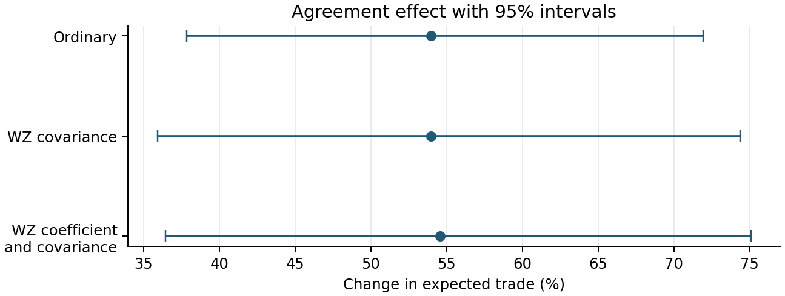

# Adjust pair covariance in three-way PPML

Ordinary pair clustering allows dependence within each pair's history.
In three-way PPML, estimating many country-year effects also changes the
variability of the fitted scores used in that sandwich. Weidner and Zylkin's
analytical adjustment addresses this source of covariance bias. The
coefficient correction is a separate calculation.
[Weidner and Zylkin (2021), §3.4.3](../references.md#the-separate-three-way-ppml-correction)

## Change the covariance in the gravity example

Start with the uncorrected `fit` from the [gravity walkthrough](../get-started.md)
and the optional `wz_slope` from the [coefficient chapter](bias-correction.md).
The calls below use the retained fits, so the estimating equation is solved
only once for each fit above. The same `vcov` mapping can be passed at fit time.

```python
pair_wz = {"cluster": "pair", "adjustment": "wz"}
covariance_only = fit.with_vcov(pair_wz)
both_adjustments = wz_slope.with_vcov(pair_wz)

comparison = pm.etable(
    fit, covariance_only, both_adjustments,
    names=("Ordinary", "WZ covariance", "WZ coefficient and covariance"),
    scale="effect", uncertainty="ci", stars=False, digits=1,
)
print(comparison)
```

```text
-----------------------------------------------------------------------------------
                           Ordinary    WZ covariance  WZ coefficient and covariance
-----------------------------------------------------------------------------------
agreement                    53.9           53.9                   54.6
                         [37.9, 71.9]   [35.9, 74.4]           [36.4, 75.1]
-----------------------------------------------------------------------------------
Estimator                    PPML           PPML                   PPML
Mean order (omega)            1              1                      1
pair effects              Estimated      Estimated              Estimated
exporter^year effects     Estimated      Estimated              Estimated
importer^year effects     Estimated      Estimated              Estimated
Coefficient correction        No             No                     WZ
Covariance              cluster: pair  cluster: pair          cluster: pair
Convention                  stata          stata                  stata
Reference                   normal         normal                 normal
Clusters                     132            132                    132
-----------------------------------------------------------------------------------
Observations                1,056          1,056                  1,056
-----------------------------------------------------------------------------------
Entries are 100 (exp(b) - 1) for each reported coefficient coordinate; not a standalone regressor change.
95% confidence intervals in brackets, transformed from the coefficient interval.
Corrected coefficients are reported with first-order inference at the certified uncorrected root.
```

The ordinary and covariance-only columns report the same agreement effect.
The WZ covariance adjustment widens the interval in this draw. The third
column also applies the coefficient adjustment. Fitting with
`bias_correction="wz"` and no covariance request selects the WZ pair
adjustment by default. Use an explicit pair request to record which
calculation you intend.

## Plot the fitted effects and intervals

Use Matplotlib to draw the percentages and interval endpoints returned by
`effects()`. That method reports proportions, so multiply the columns by
100 for the figure.

```python
import matplotlib.pyplot as plt
import pandas as pd

effects = pd.concat([
    result.effects(["agreement"])
    for result in (fit, covariance_only, both_adjustments)
], ignore_index=True)
points = 100 * effects["estimate"]
lower = 100 * effects["conf_low"]
upper = 100 * effects["conf_high"]
labels = ["Ordinary", "WZ covariance", "WZ coefficient\nand covariance"]

fig, ax = plt.subplots(figsize=(7.4, 2.8), layout="constrained")
ax.errorbar(points, labels, xerr=[points - lower, upper - points],
            fmt="o", color="#215873", capsize=4)
ax.invert_yaxis()
ax.set(xlabel="Change in expected trade (%)", title="Agreement effect with 95% intervals")
ax.grid(axis="x", alpha=0.25)
ax.spines[["top", "right"]].set_visible(False)
fig.savefig("gravity-intervals.png", dpi=175)
```



## Check the design before requesting WZ

The correction requires unweighted built-in PPML with directed pair,
exporter-by-date and importer-by-date effects. Exporters and importers
must come from the same set of at least three countries, with at least
two dates and one record per observed date for every retained pair.
Entire pairs can be absent, including diagonal pairs. A joint fit must
keep the original unconditioned sample for the coefficient correction.
A cancelled fit on this route must cancel the pair block. Pair
independence, identifying variation and regularity conditions are part of
the statistical argument. The callable domain for panel support is a
software rule. Its acceptance on a given network does not establish a
large-sample result for that network.
[Advanced FE options](../reference/experimental-fixed-effects.md#coefficient-corrections)

<a id="related-results-in-bbp"></a>
<a id="covariance-refinements--related-results-in-bbp"></a>

## Delete-group and higher-order covariance

The one-step delete-group covariance estimator of Benatia et al. (2026) combines approximations to changes
in the target on omitting each independent short group. The higher-order
result instead concerns covariance expectation bias after empirical
coefficient correction. It requires additional smoothness, local solution
and completion conditions. These two covariance estimators are outside the scope of Powermean. [Benatia et al. (2026), Supplemental Appendix S3.4.2, Proposition S12, and S3.4.3, Proposition S13](../references.md)

<!-- guide-navigation:start -->
[Previous: Coefficient bias](bias-correction.md) · [Guide index](../README.md) · [Next: Compare with ppmlhdfe](../from-ppmlhdfe.md)
<!-- guide-navigation:end -->
